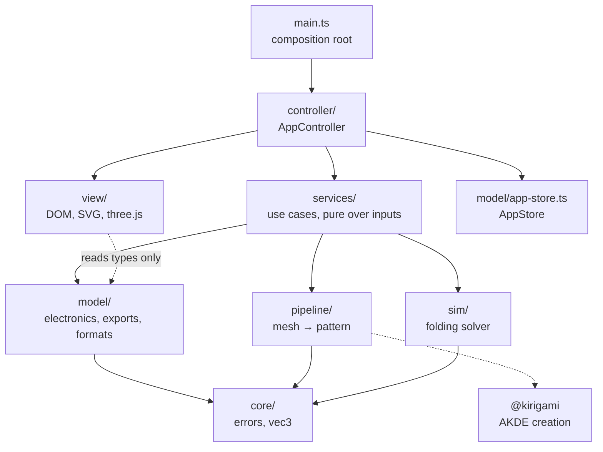
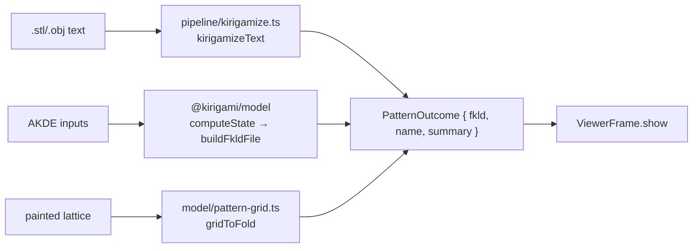

# Architecture overview

Traceform is a single-page TypeScript app built with Vite and organised as classic MVC plus a services layer. One store holds UI state, views render it, and one controller connects the two. All domain logic (geometry, routing, simulation) is pure and runs in plain Node, which is what makes most of it testable without a browser.

## Layers



| Layer | Directory | Owns | May not |
|---|---|---|---|
| Core | `src/core/` | `AppError`, `Vec3` | import anything from another layer, or `three` |
| Model | `src/model/` | the app store, electronics model and routers, exporters, file formats | touch the DOM, services, pipeline or sim |
| Pipeline | `src/pipeline/` | mesh → FKLD pattern stages | import views, services, controller or the store |
| Sim | `src/sim/` | bar-and-hinge folding solver | import views, services or the pipeline |
| Services | `src/services/` | use cases: "which model does the sim fold", "plan the folded copper overlay" | import views or the controller |
| View | `src/view/` | DOM, SVG and three.js rendering | import services, the controller or the pipeline |
| Controller | `src/controller/` | translating intents into service calls and store updates | (top of the stack) |

The rules are enforced by tests, not by convention. See [Import boundaries](../import-boundaries.md).

Many source files, including every service and the controller, state their layer at the top of their docblock (`**Model**`, `**View**`, `**Service**`, `**Controller**`). At the time of writing about half the files under `src/` do this. The directory a file lives in is what the tests actually check.

## Composition root

`src/main.ts` builds everything and does nothing else:

```ts title="src/main.ts"
// ---- Model ----------------------------------------------------------------
const store = new AppStore();

// ---- Views (two columns + header actions + sim modal) ---------------------
const convert = new ConvertPanel();
const viewer = new ViewerFrame();
app.append(convert.element, viewer.element);
installResizableLayout(app, convert.element, viewer.element);

const simModal = new SimModal();
const exportModal = new ExportModal();
const patternEditor = new PatternEditorModal();
const electronics = new ElectronicsModal();
// …
// ---- Controller -----------------------------------------------------------
const controller = new AppController(store, convert, viewer, header, simModal, exportModal, patternEditor, electronics);
// …
void controller.loadSample(false);
```

The last line loads a bundled FKLD example, so every panel is live on first paint. Under `file://`, where `fetch` is blocked, it does nothing.

## One store, one render path

`AppStore` is a small observable. `update` merges a partial state and notifies each listener exactly once, and `subscribe` hands the new listener the current state immediately:

```ts title="src/model/app-store.ts › AppStore"
/** Merge a partial state and notify all subscribers exactly once. */
update(partial: Partial<AppState>): void {
  this.state = { ...this.state, ...partial };
  for (const listener of this.listeners) listener(this.state);
}

/** Subscribe and receive the current state immediately; returns an unsubscribe. */
subscribe(listener: StateListener): () => void {
  this.listeners.add(listener);
  listener(this.state);
  return () => this.listeners.delete(listener);
}
```

The state holds settings that more than one panel must agree on: the loaded model, what the viewer is showing (`viewerShown`), the sim material (`"vinyl" | "printed"`), the tile detail and tile gap shared by the sim and the STL export, and the authored `Circuit`.

`AppController` subscribes once, and its `render` is the only place view data is derived from state:

```ts title="src/controller/app-controller.ts › AppController.render"
private render(state: Readonly<AppState>): void {
  const m = state.model;
  this.convert.renderFacts(m ? deriveFacts(m) : []);
  this.convert.setStatus(state.status.msg, state.status.kind);
  this.header.setKirigamizeEnabled(!!m);
  const simObject = resolveElectronicsTarget(m, state.viewerShown)?.object ?? null;
  this.sim.setEnabled(!!simObject && canSimulate(simObject));
  this.exporter.setEnabled(!!simObject);
  this.electronics.setEnabled(!!simObject);
  this.electronics.setPattern(simObject);
  this.electronics.setTileGap(state.simTileGap);
  this.electronics.setMaterial(state.simMaterial);
  this.sim.setTraces(this.tracesForSim(simObject));
}
```

The last line plans the copper on every render and pins it to the folded mesh. That way the 3D sim shows the circuit even if the electronics editor was never opened.

## Views are dumb

Views render what they are given and report what the user did through callbacks. They hold no app state and never call services. For example, `ConvertPanel` renders facts and a status line and emits one intent, `onFileChosen`:

```ts title="src/controller/app-controller.ts › AppController constructor"
// View intents → controller handlers.
this.convert.onFileChosen((file) => this.loadFromFile(file));
this.header.onKirigamize(() => this.kirigamize());
// …
this.electronics.onEdit((circuit) => this.updateCircuit(circuit));
```

The electronics editor is the largest view. Every edit it makes is a named pure command from `src/model/circuit-commands.ts`; architecture rule R10 forbids it from assigning `this.circuit` directly. See [Electronics editor](../electronics/editor.md).

## Services: "what you see is what you get"

Each service is a pure function of its inputs. No store, no DOM. Most share one policy: **operate on the model the viewer is showing, and fall back to the loaded model**. That way the simulation, the SVG cut file, the STL and the circuit all target the pattern on screen, even when the viewer loaded a different file from the one in the convert panel.

```ts title="src/services/svg-export-service.ts › resolveSvgExport"
export function resolveSvgExport(
  model: LoadedModel | null,
  shown: ShownModel | null,
  /** The print size chosen for the STL, so a pattern cut for folding is the size it was printed. */
  sheetMm?: number,
): SvgExportPayload | null {
  const src = shown ?? (model?.kind === "fold" ? { object: model.object, name: model.name } : null);
  if (!src) return null;
  return buildFkldSvgExport(src.object, baseName(src.name), sheetMm);
}
```

| Service | Responsibility |
|---|---|
| `model-loader.ts` | file text → `LoadedModel`; raises `AppError` with domain `parse` or `io` |
| `pattern-service.ts` | one facade over both pattern-creation paths: the mesh pipeline and AKDE (`@kirigami`) |
| `sim-scene-service.ts` | picks what to fold and caches built scenes per `(FoldFile, material)` in a `WeakMap` |
| `svg-export-service.ts`, `stl-export-service.ts` | build export payloads for the shown pattern |
| `electronics-service.ts` | picks which pattern the editor targets and plans the folded copper overlay |

`sim-scene-service` caches scenes because building one means splitting cuts, triangulating, allocating the solver and setting up collision. The Vinyl/Printed tabs used to repeat all of that on every click. Keying a `WeakMap` on the `FoldFile` gives the cache exactly the lifetime of the loaded model.

## Two creation paths, one output



`pattern-service.ts` narrows every path to the same `PatternOutcome`. The controller therefore never sees `KirigamizeResult`'s stage intermediates; those stay a contract between the pipeline and its tests. See [Kirigami pipeline](../kirigami/pipeline.md).

## The viewer iframe

The centre column is the stock FKLD viewer (`public/viewer/index.html`) in an `<iframe>`. `ViewerFrame` hides the cross-frame handshake: it buffers a payload until the viewer posts `kirigamizer:viewer-ready`, then forwards it. The viewer can also load files by itself (file picker, drag and drop, example list). It echoes each load back as `kirigamizer:viewer-loaded`, and the controller writes that to `state.viewerShown`.

!!! warning "Never re-parent the viewer iframe"
    The iframe holds live FKLD state. Hiding an ancestor keeps its document, but moving it in the DOM reloads it and the preview comes back blank.

## Pages without navigation

The electronics editor has its own URL (`#/electronics`), but it is not a separate document. `src/view/route.ts` explains why: every editor is fed live from the store, and a real page load would cut that link. Routes are hash-based rather than `pushState`, because the app must work from `file://` with no server to rewrite paths. A hash costs nothing there, and the Back button works without extra code.

## Errors

`src/core/errors.ts` defines `AppError` with an `ErrorDomain` of `"parse" | "pipeline" | "sim" | "io" | "create"`. The controller branches on the domain rather than on message text. A `parse` failure clears the current model; an `io` failure only sets the status line. `PipelineError` (`src/pipeline/types.ts`) extends this with a `stage` tag (`"import" | "conditioning" | "mesh" | … | "verify"`) and prefixes its message, so the status reads `"<stage>: <message>"`.

## Node-first geometry

`three` may be imported only in `src/view/` and `src/sim/gpu/`. Everything else uses the dependency-free `core/vec3.ts` with plain `{x, y, z}` objects. Rule R9 checks the whole transitive import graph of `sim/index.ts` and `pipeline/index.ts`, because vitest imports those barrels in plain Node and one stray `three` import would break every test that uses them.
