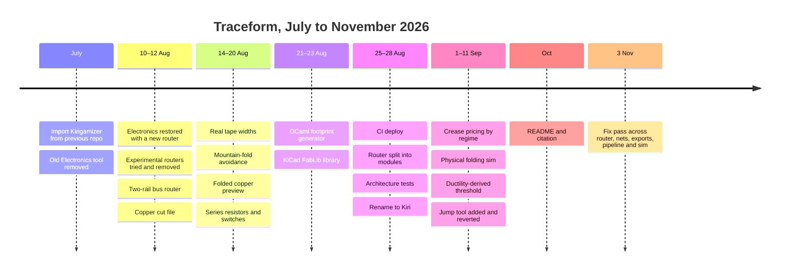

# History

How Traceform reached its current shape, reconstructed from the git history (`git log --reverse`). Dates are commit dates. Short hashes are given so you can `git show` the change.

## Timeline

## Phase 1: import and reset (July)

- `61496e8` **Import project from previous repo.** The kirigami half (mesh pipeline, AKDE creation under `kirigami/`, FKLD viewer, folding simulation) predates this repository and was brought over whole. That is why `kirigami/` sits outside `src/` and is reached through the `@kirigami` alias, and why some names still say *Kirigamizer* (the `package.json` name, the `kirigamizer:*` iframe messages).
- `0eaf5aa` **Remove Electronics tool.** The inherited electronics code was deleted, along with a large committed build and dependency tree, before anything new was written.

## Phase 2: finding a router (10–12 August)

The electronics tool came back as a new design (`6f05249`) and then went through several routers in two days:

| Commit | Change |
|---|---|
| `e3cbea0` | Add an "unrestricted router after Ilic et al." |
| `afda06f`, `4cef025` | Draw copper live; emit each net as continuous strips |
| `b18bfb2` | **Remove auto-routing solvers**: about 2,900 lines deleted, including `electronics-field-routing.ts` |
| `26001df` | **Auto-route copper as a two-rail bus**: the approach that survives today |
| `7dad6f2`, `5fcebaf`, `d43677b` | Separate PWR and GND paths, each net laid as a tree, each net in its own lane |
| `c75cce0` | Speed up the LED polarity search with a heap |
| `85ace59` | **Export copper traces as a cut file** |

The general-purpose solvers were tried and then replaced within a day by a router built for one circuit shape: a battery's two rails feeding parts placed on the pattern. [Routing](../electronics/routing.md) describes that router as it is today.

## Phase 3: the fabric of the build (14–20 August)

These commits are about matching physical reality:

- `f36a621` uses real 6.5mm tape (contributed by Ediz Umur), then `f787641` halves it to 3.25mm. Later, `89a552e` moves to 1.5mm tape and "weeds to the sheet floor", taking the minimum web from the sheet rather than from the tape.
- `f4eee29` **Route around mountain folds**, the first fold-aware routing, merged as PR #4 `fold-aware-routing`.
- `af3ea5f`, `ef899c9` show planned copper on the folded model.
- `1fe56f0` to `620cb6e` add mirror options and cut every layer at print size.
- `a305c7c`, `8a959e3`, `7b9f60e` add series resistors on either rail and a switch in series. That brought in the first non-LED parts, and with them the question of pad geometry.

## Phase 4: real parts (21–23 August)

- `806fa8b` **Generate footprints from pcb.py in OCaml**, then `467597d` parses KiCad footprints in OCaml and `75e26ff` builds the component library from KiCad.
- `57b9c9f`, `821eee8` add a pad model and address pads by name, not position.
- `6d6e70e` **Integrate KiCad FabLib**, the `footprints/fab/` library.
- `57f086f` routes any library part in series, and `02296f8` draws components as footprints.

See [Parts and footprints](../electronics/parts.md) for the generator and why its output is split into two modules.

## Phase 5: hardening the codebase (25–28 August)

The router had grown to one file of more than 3,500 lines, and several agent sessions were editing the tree at once. This phase is mostly refactoring:

- `800107b` untracks `node_modules/` and `dist/`, and `278ac73` builds the site in CI and deploys the output.
- `7a8cc9e` **Edit circuit through commands**: every editor mutation becomes a named, pure command ([Electronics editor](../electronics/editor.md)).
- `48dda3a` moves the copper overlay plan into a service; `f51e700` and `9133fb9` route the modal through a design adapter.
- `39d9ec1`, `c5df9d9`, `239fffa`, `da4331a` split `electronics-routing.ts` into `trace-geometry`, plan scoring, tape width and landings, and tour order and shaping. `9241b6f` breaks the remaining import cycles.
- `b5f04f9` **Enforce architecture rules**, the [import-boundary and module-health tests](../import-boundaries.md).
- `974f6b6` renders parts like svg-pcb, and `9bd96b8` models taped seams as hinges.
- `f57a2d7` renames the project to Kiri.

## Phase 6: strain-aware routing (September)

This is the work closest to the paper's contribution: making the router's crease cost physical.

| Commit | Change |
|---|---|
| `16e6181` | Score traces by the **worst** crease crossed, not only the sum |
| `88b60c5` | Fold the sheet by crease angles |
| `454a763` | Second copper side in the editor |
| `ff53581`, `78286e8` | **Price creases in three regimes**; enable graded price and band ordering |
| `60b44fb` | Use physical folding in the print sim |
| `9a1ccb8` | Let copper bridge narrow openings |
| `839948f` | Stop printed folds where tiles meet |
| `b25c490` | **Derive the routing threshold from ductility** |
| `3bb368d` → `6822927` | A jump tool and fold-adjacent routing (about 8,000 lines) added, then reverted two days later, together with a lower-case UI rename |

[Fold strain](../electronics/fold-strain.md) and [Routing](../electronics/routing.md) describe the model as it stands after these changes.

## Phase 7: fix pass (3 November)

64 commits (`5bdc944` to `c402aee`), 44 of them `fix:`:

- Hand-drawn wires became copper the net router routes around, with a `wire-short` fault where the bus runs into one (`7f428f2`), and are checked against part pads (`666a227`) and priced by crease strain (`3f5e70c`). Removing a part or LED reindexes wire vertices (`5bdc944`, `33347c5`). See [Netlist](../electronics/netlist.md).
- Router and nets: touching PWR/GND copper counts as a crossing (`e48640b`), reachability follows the corridor (`60bd985`), and part breaks keep clear of LED legs (`2996bb6`). See [Routing](../electronics/routing.md).
- Exports: one strips layer per net (`627311f`), STL scaled by the `printScale` rule (`6c2322f`), folded-form files refused (`0859d36`), and carrier tab placement moved to `carrier-tabs.ts` (`c097983`, `691f6b3`) with several placement fixes. See [Export](../electronics/export.md).
- Pipeline and sim: welding across cell edges (`4853fd7`), one cut-tree contact per boundary loop (`f648134`), flat layout split into `flat-layout.ts` (`b7f383b`), and a damping bound on the sim timestep (`f15a869`). See [Pipeline](../kirigami/pipeline.md) and [Simulation](../kirigami/simulation.md).

## How the work was done

Much of the code was written by several AI-assisted coding sessions working in one tree at once. That shaped the codebase in ways visible in the source:

- **Long "why" docblocks.** Files explain the reasoning and the failures behind a design, because the next editor may be a session with no memory of the last one.
- **Executable rules over written ones.** Layering, file size, cycles and iCloud duplicates are all tests ([Import boundaries](../import-boundaries.md)), because a comment warning was shown not to stop a repeat.
- **Symbol citations.** Notes and docs cite `file.ts › symbol`, because line numbers changed within hours under concurrent edits.
- **Measured, not argued, geometry.** Several bugs (pad axes, seat reflections) were fixed only once someone measured the emitted geometry instead of reasoning about what a field "means". See [Testing](testing.md).

The repository lives in an iCloud-synced folder, which has created tracked `name 2.ts` conflict copies and corrupted `.git` objects more than once. Rule R14 now fails the suite if a duplicate is tracked under `src/` or `tests/`.
