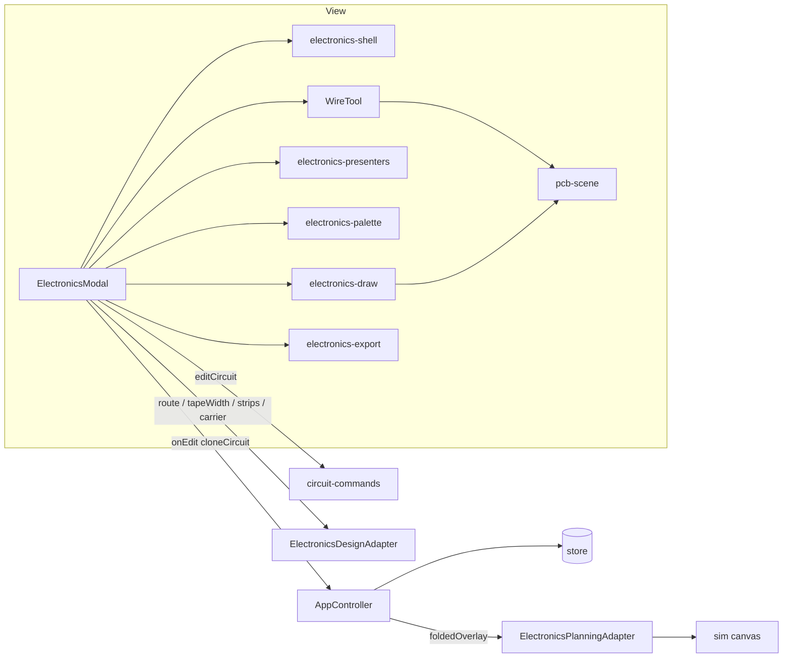

# Electronics editor

The electronics editor is the 2D page where an author places parts on the flat pattern, wires them into nets, draws copper by hand, and asks the router for copper tape. This page covers how the view is split up, how every edit becomes a named pure command, and how the same circuit ends up drawn on the folded 3D model.

## Where it lives

The editor is a page of the single-document app, not a dialog. Its main class is `ElectronicsModal` in `src/view/electronics-modal.ts`. The filename is older than the page design. Helpers with no state of their own sit next to it:

| File | Role |
| --- | --- |
| `src/view/electronics-modal.ts` | The page: gestures, selection, side switching, Auto/Manual routing, rendering into the SVG canvas and sidebar. |
| `src/view/electronics-shell.ts` | `shellMarkup()`: the whole static HTML (header, toolbar, canvas, sidebar) as one string. Binds no listeners. |
| `src/view/electronics-draw.ts` | Pure canvas layers: the sheet for the selected build (`substrateParts`), the carrier frame, the ratsnest, the battery terminals, plus path-string helpers. |
| `src/view/electronics-palette.ts` | DOM-free part catalogue: which library parts are offered or blocked, how they are shelved, how a search matches, and how a saved LED component id resolves. |
| `src/view/electronics-presenters.ts` | DOM-free, `this`-free presenters: rows for the nets, parts and pads panels, and the status line sentence. |
| `src/view/electronics-export.ts` | Turns one side's plan into a cut file and a status message (see [Export](export.md)). |
| `src/view/wire-tool.ts` | The hand-drawn wire gesture state machine (`WireTool`). |
| `src/view/pcb-scene.ts` | A pure display-list renderer: `SceneItem` in, SVG string out. |
| `src/view/route.ts` | Hash routing: which page is showing. |
| `src/model/circuit-commands.ts` | Every circuit edit as a named pure command. |
| `src/model/electronics-design.ts` | `ElectronicsDesignAdapter`: the heavy model work the page asks for (route, tape width, cut files). |
| `src/services/electronics-service.ts` | `ElectronicsPlanningAdapter`: the folded copper overlay for the 3D preview. |



## A page with its own URL

`src/view/route.ts` keeps the current page in the URL hash. `#/electronics` is the editor and everything else is `HOME`, the model page.

```ts title="src/view/route.ts › goToRoute"
export function goToRoute(name: string): void {
  if (!addressable()) return;
  const next = name === HOME ? "#/" : `#/${name}`;
  if (location.hash !== next) location.hash = next;
}
```

Writing the hash is the whole navigation. The browser fires `hashchange`, and the handlers registered through `onRouteChange` hear it. Where there is no URL (the test DOM), the function does nothing, so `ElectronicsModal › open` writes the route and then calls `show()` itself instead of waiting for the event.

The modal registers its route listener as the last statement of its constructor:

```ts title="src/view/electronics-modal.ts › ElectronicsModal constructor (end)"
    // Last in the constructor, and deliberately so: showing the page runs the whole render path, and from
    // any earlier line half the fields it touches do not exist yet. A deep link used to arrive mid-build.
    //
    // Back, Forward, and a `#/electronics` pasted into the address bar all arrive through here...
    onRouteChange((route) => this.syncRoute(route));
    // ...and a document loaded straight at the editor's URL starts on the editor, rather than on the
    // model page with the address bar claiming otherwise.
    if (currentRoute() === ROUTE) this.show();
```

`syncRoute` is the only thing that decides whether the page is up, so the URL and the screen cannot disagree. `show()` adds the `is-electronics` class to `<body>`, which hides `#app`. The page is inserted after `#app` instead of inside it. Escape closes the parts menu and nothing else; the Back control and the browser's Back button leave the page.

!!! warning "Do not move the viewer iframe"
    The constructor comment is explicit: hiding an ancestor of the FKLD viewer's iframe keeps its document, but re-parenting the iframe reloads it and the preview comes back blank. The editor hides `#app` with a body class for this reason.

## State the page holds

The editor holds two independent circuits, one per face of the sheet. `insideCircuit` and `outsideCircuit` each have their own routed plan and stale flag. Three private accessors, `circuit`, `routed` and `stale`, read and write whichever triple the `side` field names:

```ts title="src/view/electronics-modal.ts › ElectronicsModal.circuit"
  private get circuit(): Circuit {
    return this.side === "inside" ? this.insideCircuit : this.outsideCircuit;
  }
  private set circuit(c: Circuit) {
    if (this.side === "inside") this.insideCircuit = c;
    else this.outsideCircuit = c;
  }
```

The rest of the file reads `this.circuit` as if there were one circuit. The router, the presenters and the export builders are each called once against one `Circuit`, and none of them knows a second side exists. `setPattern` resets both sides, because a new pattern's face and gap indices do not mean the same thing as the old ones.

Other view state that matters:

- `tool`: what the next canvas tap does. Values are `"led"`, `"battery"`, `"wire"`, the legacy `"resistor"`/`"switch"`, or any library `Component.id`.
- `placeMode` (the "Seat" control): `"gap"` puts a part across a fold with a pad on each side of the hinge. `"free"` stands it on a tile, wired by nets or by hand-drawn copper.
- `material` (the "Build" control): `"vinyl"` or `"printed"`. `buildGap()` returns the sim's tile gap for printed builds and `0` for vinyl, where the sheet is scored and not cut.
- `viewMode`: `"strips"` or `"carrier"`, matching the two cut files.
- `mirror`: left-right and top-bottom flips applied to the canvas and the cut files.

## Every edit is a named pure command

`src/model/circuit-commands.ts` holds the rules for changing a `Circuit`. A command is an object with one `apply` method that returns a new circuit:

```ts title="src/model/circuit-commands.ts › CircuitCommand"
export interface CircuitCommand {
  apply(circuit: Circuit): Circuit;
}

// …

export function editCircuit(circuit: Circuit, command: CircuitCommand): Circuit {
  return command.apply(circuit);
}
```

The modal applies them through one private method:

```ts title="src/view/electronics-modal.ts › ElectronicsModal.runCommand"
  /** Apply a pure circuit command. Gesture handling stays in the view; mutation rules stay in the model. */
  private runCommand(command: CircuitCommand): void {
    this.circuit = editCircuit(this.circuit, command);
  }
```

The commands are `replaceCircuit`, `clearPlacedCircuit`, `appendLed`, `appendPlacedPart`, `appendLegacyPart`, `toggleBattery`, `addNet`, `renameNet`, `recolourNet`, `deleteNet`, `assignPad`, `removeSelectedPart`, `removeLed`, `movePlacedPart`, `rotateFreePart`, `cycleLedFlip` and `cyclePartFlip`. Two helpers that follow the same rules but are not commands sit in the same file: `cloneCircuit` and `reindexTerminals`.

Some rules the commands encode:

- `assignPad` removes any existing terminal for that `(part, pad)` before adding the new one, so a pad can never be on two nets. An empty net name unwires the pad.
- `deleteNet` also removes every terminal that pointed at the net, and unsets `net` on any wire that named it. Unset rather than kept, because net ids are reused and a wire left naming the old id would join the next net minted.
- `toggleBattery(face)` places or removes the battery. When the circuit has declared both the PWR and GND nets, it also adds the battery's two terminals (`part: BATTERY_PART`, which is `-1`) on those nets, and removes them when the battery comes off.
- `cycleLedFlip` and `cyclePartFlip` cycle instead of toggling. If the item has an explicit `flip`, the field is deleted, which gives the choice back to the router. If not, the item is pinned to the opposite of the router's current choice. Pressing R therefore goes from the router's choice, to pinned, and back to the router's choice.

The architecture test `import-boundaries.test.ts › R10` enforces the pattern. It fails if any line of `electronics-modal.ts` assigns `this.circuit =` without `editCircuit` on the same line. See [Testing](../development/testing.md).

### The `Terminal.part` index hazard

A `Terminal` names its part by **position** in `circuit.parts`, not by an id:

```ts title="src/model/electronics.ts › Terminal"
export interface Terminal {
  /** Index into {@link Circuit.parts}, or {@link BATTERY_PART} for one of the battery's two terminals. */
  part: number;
  /** The pad's own name in its footprint. */
  pad: string;
  /** A {@link Net.id}. */
  net: string;
}
```

When a part is removed, every terminal pointing at a higher index has to come down by one. If it does not, each of those terminals silently names its neighbour: the netlist still resolves and wires the wrong pads, and nothing raises an error. `removeSelectedPart` does the renumbering itself, so a caller cannot forget:

```ts title="src/model/circuit-commands.ts › reindexTerminals"
export function reindexTerminals(terminals: Terminal[], removed: number): Terminal[] {
  return terminals
    .filter((t) => t.part !== removed)
    .map((t) => (t.part > removed ? { ...t, part: t.part - 1 } : t));
}
```

The battery's terminals use `-1`, which is never greater than a removed index, so they are never shifted. `circuit-commands.test.ts › leaves the battery's terminals alone when a part below them is removed` pins that. `electronics-modal.test.ts › renumbers the terminals when a part below them is deleted` covers the same path end to end through a Delete keypress.

!!! warning "Wires and LEDs also hold indices"
    Hand-drawn wire vertices (`WireVertex` in `src/model/manual-wire.ts`) store `{ kind: "pad"; part: number; pad }` and `{ kind: "led"; led: number; leg }`, which are also positions in `circuit.parts` and `circuit.leds`. `removeSelectedPart` and `removeLed` renumber them through `circuit-commands.ts › reindexWires` and `shifted`: indices above the removed item come down by one, and a vertex on the removed item is parked on `DETACHED` (`-2`, since `-1` is `BATTERY_PART`), which resolves to nothing, so the wire keeps a dangling vertex the author can re-attach. Keep this in mind before adding another index-based reference, or when changing either removal command.

### `cloneCircuit` and the `...rest` spread

Every edit ends in `emit()`, which hands `cloneCircuit(this.circuit)` to the controller for the store. The clone used to copy fields one by one, and any field it did not name was dropped on the way to the store. The symptom was that a feature drew on the canvas and vanished on the next round trip, with nothing thrown or logged. The vault records six fields lost this way: `flip`, `component`, `nets`/`terminals`, `wires`, `PlacedPart.free` and `Net.color`.

```ts title="src/model/circuit-commands.ts › cloneCircuit"
export function cloneCircuit(c: Circuit): Circuit {
  const { leds, battery, resistors, switches, parts, nets, terminals, wires, ...rest } = c;
  return {
    ...rest,
    leds: leds.map((l) => ({
      a: l.a,
      b: l.b,
      ...(l.flip === undefined ? {} : { flip: l.flip }),
      ...(l.component === undefined ? {} : { component: l.component }),
    })),
    battery: battery ? { face: battery.face } : null,
    // …
    terminals: (terminals ?? []).map((t) => ({ part: t.part, pad: t.pad, net: t.net })),
    wires: (wires ?? []).map(cloneWire),
  };
}
```

The known fields are deep-copied by name, and `...rest` carries any unknown **top-level** field through. The arrays are still rebuilt property by property (`clonePlacedPart`, `cloneWire`, `withFlip`), so a new field on a part, net, terminal or wire is still dropped until it is added there. `...rest` copies by reference, which is fine for a value but not for a nested structure.

The guard is `electronics-modal.test.ts › the round trip to the store`. Its `fullCircuit()` fixture fills every optional field. One test checks that the clone has the same keys and shares no objects with the original, and another checks that an unknown field survives. Adding a field to `Circuit` means adding it to that fixture.

## When routing happens

A full plan takes most of a second. The page header comment says the Route button is what plans copper. Routing defaults to Manual (`autoRoute = false`). Each edit declares what it does to the plan through the `Replan` type:

```ts title="src/view/electronics-modal.ts › ElectronicsModal.emit"
  private emit(replan: Replan = "auto"): void {
    // …
    if (replan === "now") this.forceReplan();
    else if (replan === "later") this.stale = true;
    else if (replan === "auto" && !this.autoRoute) this.stale = true;
    if (replan === "auto") this.render();
    else this.draw();
    this.renderNets();
    this.editHandler(cloneCircuit(this.circuit));
  }
```

- `auto`: placing, moving and turning parts. The edit plans when Auto is on, and is marked stale otherwise.
- `now`: plans whatever the mode. Clear all uses it.
- `later`: never plans and marks the copper stale. Net edits that change what the copper should be use it, such as assigning a pad or deleting a net.
- `none`: the copper is unaffected. Renaming or recolouring a net, or showing the page.

While the copper is stale, the canvas keeps drawing the last plan, the Route button gets the `is-stale` class, and `statusLine` adds "copper is out of date — press Route". Pressing Route (`routeNow`) plans and repaints but is not an edit: it does not call the edit handler, so nothing is written to the store.

The canvas is repainted before the panels in `emit()`. The battery's and each hinge-LED's PWR/GND rows are derived from `this.routed` (`electronics-presenters.ts › derivedNetRows`), and painting the panel first showed the plan from before the edit.

## Rendering

`draw()` rebuilds the whole canvas into two groups. `el-static` holds the sheet, the copper, the parts and the marks, and is repainted on every edit or zoom. `el-live` belongs to the wire tool alone and is rewritten on every pointer move.

- **Copper** is drawn as the outline that will be cut, through `copper-svg-export.ts › stripOutline`, the same function the cut files use. A stroked centreline at constant width would hide the narrowing that keeps two nets apart under a chip.
- **Parts** are drawn from their footprints with `part-render.ts › partLayers` in the `"svgpcb"` style, and grouped **by layer** across the whole board (`F.Cu`, `F.Mask`, `drills`, `origins`, `padLabels`, `componentLabels`) instead of per part. The source comment explains why: grouped per part, one part's mask lands on its neighbour's pad name where they overlap.
- **The ratsnest** (`electronics-draw.ts › ratsnestParts`) draws a dashed line for each connection the router could not lay. It is drawn as a stroked `wire` scene item, which `pcb-scene.ts` otherwise reserves for previews, because it is not copper and must never look like tape.

`pcb-scene.ts` keeps *what to draw* separate from *how to draw it*: a list of `SceneItem`s goes in, an SVG string comes out, and colours are left to the stylesheet. Today `wire-tool.ts` and `electronics-draw.ts` use `sceneSvg`; `draw()` itself still builds strings inline.

### Hand-drawn wires

`WireTool` turns pointer and key events into `ManualWire`s: tap to lay a vertex, drag a handle, Enter to finish, Backspace to take one back, X+tap to drop one, Delete to remove the wire. It reaches the editor only through the narrow `WireHost` interface (`clientToFlat`, `tp`, `circuit`, `commit`, `live`, …), so its gestures can be tested against a fake host. It never routes. It writes only `host.live().innerHTML` during a gesture and commits once on pointer up. Hit-testing is geometric (nearest within a radius) and never uses `event.target`, because the live layer is rebuilt on every move.

A wire vertex is stored by what it is attached to (a pad, an LED leg, a battery terminal, or a free point), so moving a part drags the wire with it. A vertex that no longer resolves is dropped from the drawn geometry, and the wire stays in the circuit so the author can re-attach it. `allTraces()` merges routed and hand-drawn traces for drawing and export. As its comment notes, `routed.traces` never includes the wires: `planRoutes` routes declared nets around them and reports bus copper laid through one as a `wire-short` netlist fault, but does not return them as its own.

## The folded preview

The copper planned on the flat pattern is also drawn on the folded model in the simulation. The editor does not supply it. `AppController › tracesForSim` plans it from the stored circuit, so the copper appears on the model even if the editor has never been opened:

```ts title="src/controller/app-controller.ts › AppController.tracesForSim"
  private tracesForSim(fold: FoldFile | null): AnchoredMesh[] {
    const { circuit: stored, simTileGap } = this.store.getState();
    return this.electronicsPlanning.foldedOverlay({
      fold,
      circuit: stored,
      tileGap: simTileGap,
      sheetMm: this.exporter.printSizeMm(),
    });
  }
```

`electronicsPlanning` is an `ElectronicsPlanningAdapter`, a one-method interface that the controller takes as a constructor parameter, defaulting to `defaultElectronicsPlanning`. Its real implementation is `resolveFoldedCopperOverlay`:

```ts title="src/services/electronics-service.ts › resolveFoldedCopperOverlay"
  const circuit = stored ?? EMPTY_CIRCUIT;
  if (!fold || (!circuit.leds.length && !circuit.battery && !circuit.wires?.length)) return [];
  try {
    const faces = flatFaces(fold);
    const gaps = gapGraph(fold, faces, tileGap).gaps;
    const routed = planRoutes(faces, gaps, circuit, sheetMm, sheet);
    const tapeW = tapeWidthFor(faces, sheetMm, sheet, circuit);
    // …
    const drawn = manualTraces({ faces, gaps, circuit, tapeW });
    return anchorOverlay([...drawn, ...routed.traces], routed.pads, term, tapeW, faces);
  } catch {
    return [];
  }
```

`src/model/trace-anchor.ts › anchorOverlay` stores each point of copper as a triangle of the pattern plus barycentric weights inside it. A face is rigid and stays planar as the sheet folds, so the same weights over the folded corners give the copper's folded position without re-planning. Points that fall outside every face are dropped, not snapped to a guess. `src/view/sim-canvas.ts` colours each `AnchoredMesh` by its `kind` and falls back to a net colour for kinds that are net ids.

The store holds one circuit, the one `emit()` sends, which is the active side's. The folded preview therefore shows one side at a time.

## Design choices

| Choice | Alternative considered | Reason (source) |
| --- | --- | --- |
| A page at `#/electronics` | A modal dialog | A page has its own URL, Back/Forward and deep links. `role="dialog"`/`aria-modal` were removed because they told a screen reader the rest of the app did not exist (constructor comment). |
| Hash routing | `pushState` | `main.ts` must work under `file://`, where there is no server to rewrite paths, and `pushState` would 404 on refresh (`route.ts` header). |
| No router library | Matching, parameters, nesting | Nothing in the app needs them: "a page is a name, and a name is a hash" (`route.ts` header). |
| Edits as pure commands | Mutations inline in gesture handlers | The view keeps gestures and DOM. Field preservation, terminal reindexing and flip cycling stay small, named and testable in the model (`circuit-commands.ts` header). |
| Two circuits, one per side | One circuit with a per-trace layer flag | Nothing downstream had to change: no via concept, no cross-side net (`Side` type docblock). |
| Manual routing by default | Re-plan on every edit | A plan costs most of a second, and the board re-routing itself mid-thought was disruptive (modal header comment). |
| Heavy work behind `ElectronicsDesignAdapter` | Importing the router into the view | A test can drive the page without planning a real route (constructor parameter comment, `electronics-design.ts` header). |

!!! note "Why presenters and palette are DOM-free"
    `electronics-presenters.ts` says the split exists because the two halves fail differently. A wrong row is a wrong sentence and deserves a test that reads like the sentence. A wrong `appendChild` is a layout bug you see as soon as you look. Before the split, every question about content had to go through the mock DOM. `electronics-palette.ts` follows the same idea: the modal decides how to draw the menu, the palette decides what is in it.

!!! note "Why the module was split into helpers"
    `module-health.test.ts › R12` gives `electronics-modal.ts` a line budget and says "split it, do not raise it". `electronics-shell.ts` and `electronics-export.ts` were extracted when the second copper side pushed the file over that budget (their header comments; commit `454a763`). Neither re-exports the other's symbols as a facade; the definitions moved.

??? info "Why derived rows are never stored"
    For a hinge-LED, which leg is PWR is a router output: `planRoutes` searches over flips. A stored assignment would state as fact something the router has not decided yet, and would disagree with the plan the moment the router flipped one. So the panel shows those rows as `derived`, recomputed from `routed` on every render and kept out of `circuit.terminals`. Four mutation paths rebuild that array, so a derived row passing through it would be persisted (`electronics-presenters.ts › derivedNetRows`, `netPanelRows`). A battery placed today stores real terminals through `toggleBattery`. The derived battery pair only appears for circuits saved before that.

See also: [Routing](routing.md), [Netlist](netlist.md), [Parts](parts.md), [Fold strain](fold-strain.md), [Export](export.md), [Simulation](../kirigami/simulation.md).
