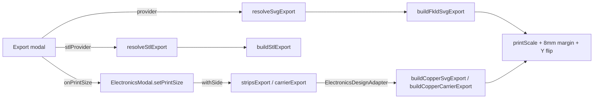

# Export: what gets cut and what is only drawn

Traceform writes three kinds of fabrication file: the pattern's cut and score lines (SVG), the 3D-printed tiles (STL), and the copper tape (SVG, as strips or as a carrier frame). This page covers the layers in each file, the units and print scale they share so they line up when stacked, and how a routed trace becomes a cuttable outline.

## The files

| File | Built by | Reached from | Contents |
| --- | --- | --- | --- |
| `<name>-cut.svg`, `<name>-score.svg`, zipped as `<name>.zip` | `model/fkld-svg-export.ts › buildFkldSvgExport` | Export modal, through `services/svg-export-service.ts › resolveSvgExport` | Pattern outline and slits (cut), creases (score) |
| `<name>-combined.svg` | same | same | Cut and score in one colour-coded file |
| `<name>.stl` | `model/stl-export.ts › buildStlExport` | Export modal, through `services/stl-export-service.ts › resolveStlExport` | Printed tiles and hinge bridges |
| `kiri-<side>-copper[-mirrored-…].svg` | `model/copper-svg-export.ts › buildCopperSvgExport` | Electronics editor, through `view/electronics-export.ts › stripsExport` | Copper tape as separate strips, one cut layer per net |
| `kiri-<side>-copper-carrier[-mirrored-…].svg` | `model/copper-svg-export.ts › buildCopperCarrierExport` | Electronics editor, through `view/electronics-export.ts › carrierExport` | One copper sheet: frame, tabs and traces |

`<side>` is `inside` or `outside`. The editor has one strips button and one carrier button per side (see [Editor](editor.md)).



## Which pattern is exported

The two export services apply the same rule: export what the viewer is showing, or fall back to the loaded fold model.

```ts title="src/services/svg-export-service.ts › resolveSvgExport"
export function resolveSvgExport(
  model: LoadedModel | null,
  shown: ShownModel | null,
  /** The print size chosen for the STL, so a pattern cut for folding is the size it was printed. */
  sheetMm?: number,
): SvgExportPayload | null {
  const src = shown ?? (model?.kind === "fold" ? { object: model.object, name: model.name } : null);
  if (!src) return null;
  return buildFkldSvgExport(src.object, baseName(src.name), sheetMm);
}
```

Both services are pure over their inputs (no store, no DOM), which their header comments give as the reason they can be unit-tested in Node. `resolveElectronicsTarget` in `electronics-service.ts` uses the same rule to pick the pattern the editor works on.

## Units and print scale

A FOLD pattern has coordinates but no units. `src/model/print-scale.ts › printScale` converts pattern units to millimetres of sheet. Every SVG export and the router call it, so all of them agree on the size:

```ts title="src/model/print-scale.ts › printScale"
export function printScale(fold: FoldFile, sheetMm: number = DEFAULT_PRINT_SIZE): number {
  // … bounds over vertices_coords …
  const longest = Math.max(maxX - minX, maxY - minY);
  if (!(longest > 0)) return 1;
  // The same test the router's tape width uses, so the two cannot disagree about which patterns are
  // scale-less: both axes under the sheet is the same thing as the longer of them being under it.
  return longest < sheetMm ? sheetMm / longest : 1;
}
```

A pattern whose longest side is shorter than the print size is treated as having no scale and is enlarged to the print size. A larger pattern is taken at its word, one unit per millimetre, and is never shrunk. `DEFAULT_PRINT_SIZE` is 130 mm (`stl-export.ts`). The module header explains why it exists: the SVG exports used to declare a 4-unit pattern as a 4 mm sheet, so copper planned for it came out a tenth of a millimetre wide.

The print size comes from the "size" field in the export modal. When it changes, `ExportModal › onPrintSize` notifies the controller, which passes it to `ElectronicsModal › setPrintSize`. The same value goes to `resolveSvgExport` and to the folded copper overlay. The comment on `onPrintSize` says why it is pushed instead of read at download time: the router plans to that size too. If the export modal is open when the size changes, it also rebuilds its own cut and score previews at the new size.

The copper files and the FKLD file share one sheet frame: `printScale`, then an 8 mm margin (`MARGIN` in both files), then a Y flip, because FOLD is y-up and SVG is y-down. `copper-svg-export.ts › sheetFrame` reproduces the frame from `buildFkldSvgExport` exactly, so the copper files register against the cut and score layers when imported. Every file declares `width`/`height` in `mm` with a `viewBox` in the same numbers.

!!! note "The STL uses the same rule"
    `buildStlExport` scales by `printScale`'s rule, restated in place because `print-scale.ts` imports `stl-export.ts`: up to the print size when the pattern is smaller, never down (`s = span < printSize ? printSize / span : 1`). It used to scale every pattern to the print size, which shrank a large pattern in the STL while the SVG files kept its native size.

## Pattern cut and score (`fkld-svg-export.ts`)

`buildFkldSvgExport` and `buildStlExport` both return `null` for a file whose key frame is a folded form (`fold-file.ts › isFoldedForm`, `frame_classes` containing `"foldedForm"`): its coordinates are the folded 3D shape, and the exports refuse it rather than flatten it by dropping z.

Edges are sorted by `edges_assignment`, upper-cased first:

- **Cut**, black `#000000`: boundary `B` edges, chained into closed loops and filled as one even-odd silhouette, plus cut `C` edges (slits and darts), always stroked on top so no cut is hidden inside the fill.
- **Score**, blue `#0000ff`: mountain `M` and valley `V` creases, each shortened by 1.5 mm at both ends (`SCORE_END_GAP`) so a crease does not touch the cut line and weld to it.
- `U` (unassigned) edges on the rim, with at most one face, are treated as `B`. A `U` edge between two faces is an unknown fold and is left out.
- `F` edges are internal triangulation and are excluded.

Strokes are 0.25 mm. The module header gives the intended workflow: import the zip's two SVGs into Cricut Design Space, set black to Cut and blue to Score.

## Copper: what is cut and what is only drawn

A cutter follows the *path*. A stroked centreline would cut a line down the middle of the tape instead of cutting the tape out. Every run is therefore emitted as a **closed outline** at the tape width, filled and without a stroke (`copper-svg-export.ts` header).

```ts title="src/model/copper-svg-export.ts › stripOutline"
export function stripOutline(
  t: Trace2D,
  tapeW: number,
  pads: LedPads[] = [],
  tapeMm = TAPE_MM,
): Vec2[] {
  // A net leg that tapers onto a part's own pad carries its own width at every point; land copper under a
  // switch or LED carries one flat narrow width; ordinary tape has neither and takes the tape's.
  return outlineStrip(t.pts, t.widths ?? widthsFor(t, t.width ?? tapeW, pads, tapeMm));
}
```

`stripOutline` is the single definition of a run's shape, and the strips file, the carrier file and the editor canvas all call it. Its docblock records why: the carrier once laid every run at full width and shorted all six of a test pattern's LEDs, while the strips file for the same circuit had a clean gap between them. Widths are per point, so a run narrows where it passes between an LED's legs or onto a part's own land.

### Strips file layers

```ts title="src/model/copper-svg-export.ts › buildCopperSvgExport (body)"
  const body =
    [group("pwr", PWR_FILL, pwr!.body), group("gnd", GND_FILL, gnd!.body), ...others.map((l, i) =>
      group(`net-${l.net.replace(/[^\w-]/g, "_")}`, NET_PALETTE[i % NET_PALETTE.length]!, l.body))].join("\n") +
    // The parts sit on their own layer: they show where the resistor goes, and are not copper to cut.
    (marks.length ? `\n  <g id="parts">\n    ${marks.join("\n    ")}\n  </g>` : "");
```

| Group | Fill | Cut? |
| --- | --- | --- |
| `pwr` | `#ff0000` | Yes: one closed path per PWR run |
| `gnd` | `#222222` | Yes: one closed path per GND run |
| `net-<id>` | `NET_PALETTE`, in order | Yes: one group per other net (a declared net, or a hand-drawn wire on its own net) |
| `parts` | footprint colours | No: shows where each part goes |

The fills differ so that Cricut Design Space treats each net as its own layer, cut from its own piece of tape. Runs of the same net may overlap; they are separate strips laid on top of each other. An SPDT switch's idle throw needs bare pattern under it, so its notch rides on the strip's own path as an inner ring, and `evenodd` turns it into a hole.

Every net with a run gets a layer. `pwr` and `gnd` always come first, and the payload's `nets` lists the strip count of each other net, which `stripsExport` adds to the status line. Before `627311f` the file had only the two rail layers, and runs on any other net (declared nets and most hand-drawn wires) were left out with a warning. The carrier file takes every trace whatever its net.

### Carrier file layers

The carrier is the 3-layer build: one piece of copper cut as a frame around the unfolded pattern, with every trace held inside it on thin tabs. Align the frame, press the traces down, snip the tabs, lift the frame away. The hard requirement is that the copper comes off the mat in one piece, so no trace gets a closed outline of its own. Each trace's outline stops short of its tab, and the pieces are chained (`stitchLoops`) into one outer rectangle and one inner loop that detours around every trace through its tab.

| Group | Fill | Cut? |
| --- | --- | --- |
| `carrier` | `#b87333`, `evenodd` | Yes: frame, tabs and traces as one filled shape |
| `carrier-unclosed` | none, 0.25 black stroke | Yes, but as lines: stretches that would not close into a loop. Expected to be empty |
| `annotation` | footprint colours | No: parts only |

The frame border is 5 mm outside the pattern window (`FRAME_BUFFER`). Tab placement lives in `carrier-tabs.ts` (`pickTab`, `openAtMany`, `sideSpans`). Tabs anchor at least a tape width from any pad or battery terminal (`PAD_CLEAR`, with points from `ElectronicsModal › keepOff`), since a tab under a part would be snipped at the pad. A long run gets a second tab (`TAB_EVERY_MM`, capped by `MAX_TABS_PER_RUN`), but only if it is clean. `pickTab` tries candidates shortest first, with a toll on walls that already carry tabs (`CROWD_TOLL`), and refuses a tab that runs back across its own run, lies across another net's trace, or comes within a tape width of a tab already placed (crossing tabs count as touching). A tab over a part is used only when every candidate goes over one. A run whose only tabs would be poor (crossing, on a pad or over a part) and that overlaps a held run of its own net (`stripsMeet`) gets no tab of its own: it is held through that run. The payload counts tabs that had to grip a pad (`padTabs`), cross another trace (`crossingTabs`) or pass over a component (`componentTabs`), and `carrierExport` puts each count in the status message.

### Parts are drawn from their footprints

Both copper files draw each part with `part-render.ts › partSvg`, the same function the canvas uses, through one `drawnParts` list in a fixed order (resistors, switches, library parts, then LEDs). `designators()` numbers that list, so `R1` is `R1` on the canvas and in both files. The two files are meant to be laid over each other, and the labels are how you tell which part is which. The editor legend says "Part pad — drawn, not cut".

## Mirror

The editor's Mirror controls set a `Mirror { x, y }`. It is applied once, inside the shared `sheetFrame` transform, so every layer of a copper file flips together:

```ts title="src/model/copper-svg-export.ts › mirrorPoint"
export function mirrorPoint(p: Vec2, w: number, h: number, m: Mirror): Vec2 {
  return { x: m.x ? w - p.x : p.x, y: m.y ? h - p.y : p.y };
}
```

The reflection is about the sheet's centre, not the pattern's, so strips, carrier and preview stay registered. A mirrored file gets a `-mirrored-x`, `-mirrored-y` or `-mirrored-xy` suffix and a note in the status message, because a mirrored cut and a straight one look the same from opposite sides. The mirror belongs to the copper exports only; `buildFkldSvgExport` takes no mirror argument.

## Exporting a side that is not on screen

`ElectronicsModal › withSide` temporarily switches the active side for one export call and restores it in a `finally`. If that side's copper is stale it re-plans first, so a cut file is never built from an out-of-date plan, even though the canvas does keep *drawing* stale copper under Manual routing:

```ts title="src/view/electronics-modal.ts › ElectronicsModal.withSide"
  private withSide<T>(side: Side, fn: () => T): T {
    const prior = this.side;
    this.side = side;
    try {
      // …
      if (this.stale) this.forceReplan();
      return fn();
    } finally {
      this.side = prior;
    }
  }
```

The gate is `stale` and not an identity check against `EMPTY_ROUTE`. The comment explains that a side auto-planned once while empty holds a fresh empty plan instead of the singleton, so the identity test stopped firing for exactly the side this feature exists to export.

`exportRequest(side)` gathers everything into a plain `ExportRequest`. `stripsExport`/`carrierExport` return an `ExportResult` of `{ filename?, svg?, message }`, and `saveExport` downloads when there is a file and always writes the message.

## Width checks

| Field | Meaning |
| --- | --- |
| `widthMm` | Nominal tape width on the sheet: `tapeW × scale`. |
| `narrowestMm` | Narrowest copper actually emitted, measured through the same `widthsFor` the outline uses. |
| `tooNarrow` | `widthMm < MIN_CUTTABLE_MM` (1 mm). Reads the nominal width only. |

The status message prints `widthMm` and, if set, the `tooNarrow` warning. `narrowestMm` is in the payload but not shown in the UI; `tests/current/model/emitted-width.test.ts` pins the difference, including that copper under the limit can ship while `tooNarrow` stays false.

## Design choices

| Choice | Alternative considered | Reason (source) |
| --- | --- | --- |
| Closed filled outlines | Stroked centrelines | A cutter tracks the path, so a centreline cuts down the middle of the strip (`copper-svg-export.ts` header). |
| One `stripOutline` for canvas, strips and carrier | Each drawing its own runs | The carrier once differed and shorted LEDs that the strips file kept apart (`stripOutline` docblock). |
| One fill colour per net in the strips file | One copper layer | Cricut Design Space separates layers by fill, so PWR and GND can be cut from separate tape (`copper-svg-export.ts` header). |
| Shared `printScale` and 8 mm margin | Each export sizing itself | The layers have to register when imported; a scale-less pattern used to be cut tiny (`print-scale.ts` header, `sheetFrame` docblock). |
| Mirror applied in `sheetFrame` | Mirroring each shape | Piecemeal mirroring would let one layer flip without another (`sheetFrame` docblock). |
| `ExportResult` always carries a message | `null` on refusal | A refused export that said nothing would look like a broken button (`ExportResult` docblock). |

!!! note "Why `tooNarrow` was not changed to read the emitted width"
    The `CopperSvgExport.tooNarrow` docblock says that every circuit measured on the bundled patterns emits copper narrower than the nominal tape somewhere, under LED legs or on part lands. A flag that read the emitted width would be permanently true and say nothing. The local narrowing is deliberate. What was wrong was the docblock's earlier claim, so the real figure is reported as `narrowestMm` and the flag documents that it reads the nominal width only. Parts of that docblock still quote 3.25 mm tape and a 3 mm limit; current values are `TAPE_MM = 1.5` (`tape-width.ts`) and `MIN_CUTTABLE_MM = 1`.

??? info "Why `MIN_CUTTABLE_MM` is 1 mm"
    Its docblock: it was 3 mm when the tape was 3.25 mm, and partly meant "copper tape is not sold that narrow". At the 1.5 mm the router now plans for, only the blade limit remains, and about a millimetre is where tracking stops being reliable. It stays above zero because a warning nobody can trip is not a warning.

See also: [Editor](editor.md), [Routing](routing.md), [Parts](parts.md), [FKLD format](../kirigami/fkld.md), [Pipeline](../kirigami/pipeline.md).
