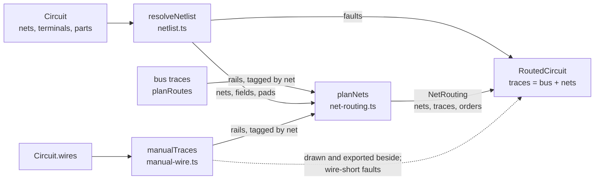

# Netlist and net routing

The netlist is the KiCad-style path through the electronics editor: the author declares named nets, assigns part pads to them, and a dedicated router joins each net's terminals with copper tape while keeping every net clear of every other. Hand-drawn wires sit beside it as copper the author plans directly. They are checked for buildability, and the net router routes declared nets around them; the bus router does not see them.

## Where it sits

The bus router (see [routing.md](routing.md)) is structurally two-net: it lays a PWR and a GND rail down opposite banks of one spine through the LED hinges. The netlist path handles everything else. The module header of `net-routing.ts` is explicit that this is a separate problem, not a generalisation:

> The bus router is structurally two-net: a tour visits the LED hinges and the two rails run down opposite *banks* of one shared spine, so "the other net" is always exactly one net and is always on the other side. Neither idea survives a third net, so this routes each net independently and keeps them apart by exclusion instead of by geometry.

| File | Role |
|---|---|
| `src/model/netlist.ts` | Resolves `Circuit.nets` / `Circuit.terminals` into points on the flat pattern, plus pad fields and pad obstacles. Reports faults. No routing. |
| `src/model/net-routing.ts` | `planNets`: routes N nets over the corridor graph, one at a time, behind a whole-path clearance gate. |
| `src/model/net-palette.ts` | Net colours, and the two default nets `pwr` / `gnd`. |
| `src/model/manual-wire.ts` | Hand-drawn wires: symbolic vertices resolved to a `Trace2D`. |
| `src/model/wire-rules.ts` | `checkWire`: whether a hand-drawn wire can be built, as a delta against the routed circuit. |
| `src/model/electronics-routing.ts` | `routeDeclaredNets`, the glue that calls `resolveNetlist` and `planNets` from `planRoutes`. |

## Data flow



`planRoutes` lays the bus first, then calls `routeDeclaredNets`, which resolves the netlist and hands the bus and the hand-drawn wires to `planNets` as `rails`. There are four call sites of `routeDeclaredNets` in `electronics-routing.ts`, because the netlist must also route on the early-return paths where there is no battery or no LEDs.

```ts title="src/model/electronics-routing.ts › routeDeclaredNets"
  const { nets, faults, fields, pads } =
    resolveNetlist(circuit, tapeW, tapeMm, new Set(rails.map((r) => r.net)), batteryPads);
  if (!nets.length) return { traces: [], nets: [], faults: [...faults, ...wireShorts(drawn, bus, tapeW)] };
  // The bus goes over as `rails` and NOT also as `obstacles`. Passed twice it arrives twice — once tagged
  // with the net it is a rail for and once anonymously — and the anonymous copy is not excluded from a
  // net's own clearance test, so every tap is refused by the very rail it is trying to reach.
  // Hand wires go the same way, tagged with their own net, so a declared net may land on (and tap) a wire
  // drawn on it while every other net keeps clear. They stay out of `resolveNetlist`'s rail set above: a
  // wire does not run out of the battery's squares the way a bus rail does.
  const routed = planNets(nets, faces, gaps, tapeW, [], sheet, tapeMm, [...rails, ...drawn.map(asRail)], fields, pads);
```

The fifth argument, `obstacles`, is `[]`: the bus and the wires both arrive as `rails` instead. See [Are drawn wires visible to the routers?](#are-drawn-wires-visible-to-the-routers).

## The data model

`Circuit.nets` is a list of `Net { id, name, color? }` and `Circuit.terminals` a list of `Terminal { part, pad, net }`. Both are optional, so circuits saved before nets existed still load.

- `Terminal.net` points at `Net.id`, never at the name. Renaming a net keeps its id (`circuit-commands.ts › renameNet`), so every pad on it stays wired.
- The editor mints new ids as `n1`, `n2`, ... through `electronics-modal.ts › mintNet`, which takes the lowest `nN` not currently in use.
- `Terminal.part` is an index into `Circuit.parts`. Removing a part goes through `circuit-commands.ts › reindexTerminals`, which drops the removed part's terminals and shifts higher indices down by one.
- `deleteNet` removes the net and every terminal on it, and unsets `net` on any wire that named it.

There is no default netlist for a newly placed part. A note at the bottom of `netlist.ts` records that `defaultTerminals` (which wired an LED's two pads onto PWR and GND as it was dropped) was removed on 2026-08-28, because "placing a part and wiring it are two decisions and this made one of them silently."

## Resolving the netlist

`netlist.ts › resolveNetlist` answers one question: for each net, which points on the flat pattern have to end up joined? It returns a `Netlist`:

| Field | What it holds |
|---|---|
| `nets: ResolvedNet[]` | Each net's `NetPoint`s: part index, pad name, position `at` in flat pattern units, and an optional `padWidth`. |
| `faults: NetlistFault[]` | Every way the netlist was malformed, each with a user-facing `why`. |
| `fields: PadField[]` | Every terminal of every part that has at least one wired pin, with how wide copper may be near it. Used to keep a leg narrow while it is over a part. |
| `pads: PadObstacle[]` | Every copper pad of every placed part, wired or not, as its placed outline and the net it belongs to (`null` if unwired). |

### Faults, not silence

Fault kinds are `no-such-part`, `no-such-pad`, `no-such-net`, `unknown-component`, `duplicate-terminal`, `single-terminal-net`, `pads-too-close` and `wire-short` (raised by `manual-wire.ts › wireShorts` from `routeDeclaredNets`, not by `resolveNetlist`). The file's stated reason for reporting rather than dropping: "A terminal that silently vanishes is a net that silently loses a connection, and the resulting circuit looks routed and is wrong."

Some rules worth knowing:

- A terminal is checked against `footprint.ts › terminals`, not against every pad, so assigning a net to a mounting peg is a `no-such-pad` fault.
- A net with fewer than two points is a `single-terminal-net` fault and is left out of routing, **unless** the bus already laid a rail with that net's id. A single pad on PWR with a PWR rail on the sheet is a part asking to be tapped onto the rail, and `planNets` routes that tap.
- `pads-too-close` is raised when a pad's nearest neighbour leaves no room for a weedable landing. The terminal is still routed, at the floor width. See [parts.md](parts.md) for fine-pitch parts.

### Battery terminals

The battery is not in `Circuit.parts` and has no footprint; a terminal on it uses `BATTERY_PART` and the pad names `BATTERY_PWR_PAD` / `BATTERY_GND_PAD`. Where the bus is already running a rail for that net out of the battery, the terminal is skipped (routing it again would lay a second strip along existing copper). Otherwise the battery is an ordinary point, at a full tape width.

### Pins versus pads

KiCad pads sharing one pad number are emitted by the generator as `1`, `1_1`, `1_2` (see [parts.md](parts.md)). They are one pin, so wiring and obstacle ownership are keyed by pin:

```ts title="src/model/netlist.ts › padPin"
export function padPin(name: string): string {
  return name.replace(/_\d+$/, "");
}
```

Without this, once pads became obstacles, pad `1_1` would read as foreign metal beside pad `1` and a net wired to pin 1 would be refused for approaching its own pin. The comment records this measured on `SeeedStudio_XIAO_ESP32C3`.

### Landing width

Each `NetPoint.padWidth` is the narrower of the pad's own smaller extent and `pad-landing.ts › landingWidthFor` applied to the distance to the nearest other terminal (`footprint.ts › nearestTerminalMm`). It can only narrow: on a 1206 the neighbour bound is loose, on a 2.54mm header it binds.

## Planning routes: `planNets`

Each net becomes a tree over the same corridor graph the bus router uses (face centres joined through crossing points on shared edges, `corridor.ts › buildCorridor`), so copper travels along the tiling rather than cutting straight across. Fold strain enters through the corridor's costs; see [fold-strain.md](fold-strain.md).

Per net (`routeOne`):

1. `spanningEdges` builds a minimum spanning tree on straight-line distance between the net's points. The comment calls this a deliberate approximation: computing true corridor distances for every pair first is quadratic in pads, and on these patterns pads close on the sheet are close through the tiling too.
2. For each tree edge, `searchCorridor` finds a path between the two faces. A pad not inside any face is stranded rather than snapped, because snapping would silently move the user's part.
3. `layLeg` builds the leg as `[a, ...mid, b]`, densifies it near pad fields, computes per-point widths, and runs the whole-path gate `pathOk`. If refused, it tries one bend on the final hop at increasing offsets either side (`DETOUR_STEPS`, `DETOUR_STEP_TAPES`), because inside a tile a leg is a straight chord and the search cannot go round anything. If no last-hop bend clears, it bends the first hop (which leaves a pad and can be blocked by that part's neighbouring pin), then tries one bend on each end; before this the outcome depended on which terminal the tree started from.
4. If the net shares an id with a bus rail, it tries one extra tap leg onto that rail. `tapCandidates` offers every projection of every pad onto every rail segment, nearest first, up to `TAP_TRIES`; the nearest anchor is often unusable because the two rails pinch together near an LED. The result is reported as `RoutedNet.railTap`: `"none"`, `"laid"` or `"failed"`.

A net that cannot reach all its terminals is laid partially. The spanning tree is rooted on a terminal that lies on the material, and a terminal whose tree edge starts from a stranded terminal is stranded too, since copper from it would join nothing the rest of the net touches. `RoutedNet.stranded` lists the missing terminals, `why` names the net in the way where blame was found (or "other copper or a pad" when the leg was refused by copper or a pad that no net owns), and `ratsnest` holds lines from each stranded terminal to the nearest copper of its own net.

### Ordering, and blame-directed reordering

Nets are sorted hardest-first (most terminals, then widest span), and up to `MAX_ORDERS` rotations of that order are tried. Plans are scored on terminals stranded first and copper length second. A failed rail tap scores as one stranded terminal.

After each attempt, the net that lost most (counting a failed rail tap as a loss, as the score does) is promoted in front of whichever net blocked it:

```ts title="src/model/net-routing.ts › planNets (promote)"
  const promote = (order: number[], victim: number, blocker: number): number[] => {
    const rest = order.filter((i) => i !== victim);
    const at = rest.indexOf(blocker);
    return [...rest.slice(0, at), victim, ...rest.slice(at)];
  };
```

The doc comment on `promote` gives the reason there is no separate rip-up loop: a net's route depends only on which nets were routed before it, so tearing out the blocker and re-laying it after the victim is the same operation as routing the victim first. These extra orders are bounded by `RIPUP_TRIES`; a `seen` set of order keys prevents retrying an order, which is enough because routing is deterministic in the order alone. The search stops as soon as an attempt strands nothing.

`NetRouting.orders` reports how many distinct orderings were tried. It exists because the search changes no measured outcome, so its effect cannot be observed through the routes; `net-routing.test.ts` asserts on `orders` directly ("tries orders the failures asked for, beyond the blind rotations").

!!! note "Why keep a search that buys nothing"
    The comments on `RIPUP_TRIES` and in the module header record measurements: blame-directed reordering reached the same number of terminals with and without the extra orders over five patterns, and an exhaustive sweep over all orderings beat the shipped rotations by only two terminals in 252. The stated conclusion is that the residual failures are not ordering failures: many netlists are not planar on a single-sided sheet with no vias. The search is kept because it costs nothing on a circuit that routes, and because the blame it computes lets a stranded net say which net is in its way.

The hardest-first sort is kept for a different reason than the obvious one. The `planNets` docblock says it measured no reach benefit, but it makes the order canonical, "so a circuit routes the same whatever sequence its author happened to declare the nets in."

### The clearance gate

The whole-path check is what stands between the router and a short. The `blocked` set passed to `searchCorridor` is only a finite toll on already-used corridor nodes (the header calls it "a finite 500x toll"), not an exclusion; the header records that the search never came back empty for want of room, so every stranded terminal comes from the gate.

`hitBy` is the single distance reading. `clearOf` asks whether a leg hit anything; `blamedFor` asks whose net it hit. They were split because immovable copper (bus rails and hand-drawn wires, both passed as `rails`) has `net: null`, and when `clearOf` was defined as `blamedFor(...) === null` a hit on immovable copper read as clear.

The required centreline separation between two runs is read from each run's width at the point of closest approach:

```ts title="src/model/net-routing.ts › gapNeeded"
function gapNeeded(wA: number, wB: number, weed: number): number {
  return Math.max((wA + wB) / 2, weed);
}
```

`(wA + wB) / 2` is two strips just touching; `weed` is the sheet's minimum weedable web (`weedFloorFor`, which reads `tape-width.ts › weedGapFor`). For two full-width runs this equals the old constant `tapeW`, which `fine-pitch.test.ts` pins ("holds two full-width runs exactly as far apart as it always did").

!!! warning "The additive rule is not what ships"
    The `gapNeeded` docblock names a known conservatism: the strictly correct rule is `(wA + wB) / 2 + weed`, since two runs just touching leave no web at all. The max form permits that, as the old constant did. The additive form is stricter for every pair and would re-baseline reach on every pattern, "which would hide a bug fix inside a behaviour change. It is a separate decision, to be made with its own measurement."

Pads are judged separately, because the run gate only sees runs. `foreignPads` builds, once per net, the list of pads that are not this net's (with bounding boxes, so far pads are skipped cheaply). A pad on the same part stacked on one of the net's own pads counts as the net's own (`padIsMine`); a stacked pad of another part is foreign. `padHitBy` refuses a leg whose copper edge comes within `PAD_CLEARANCE_MM` (0.2mm, described as KiCad's default clearance) of any of those foreign pads, measured edge to edge against the pad's placed outline (`segToPoly`). `padCapAt` narrows the leg to `2 · (room − clearance)` where it passes foreign pads, floored at `tapeW · MIN_LAND_FRAC`, so a leg can thread between two pins rather than be refused for touching one. The pad margin is deliberately not the weed floor: a pad is drawn, never cut, so there is no web to lift.

### Crossing detection

Two different predicates are in play, and they answer different questions.

- **Clearance (routing).** `nearestOn(p, q, r, s)` returns the closest-approach distance between two segments plus the parameters `t` and `u` along each. It replaced a minimum over four point-to-segment projections, which is only correct for disjoint segments; the comment records that a right-angle crossing measured 10 where the true distance is 0. Crossings therefore read as distance zero and fail the gate. For parallel segments it projects all four endpoints, since the facing ends can be either segment's first or last point.
- **Proper crossings (metrics and wire checks).** `trace-geometry.ts › segsCross` is an orientation test that treats collinear or touching segments as not crossing. `route-metrics.ts › countNetCrossings` counts proper crossings between traces of different nets and skips same-net pairs ("single-sided tape, one potential"). `wire-rules.ts › crossesNet` uses `segsCross` to locate each crossing of a hand-drawn wire.

The module header of `net-routing.ts` explains why clearance and not crossing is the routing condition: two runs can approach to zero without crossing, and laid as tape they are one piece of copper.

## Net colours

`net-palette.ts` keeps colour as authored data on `Net`, so the sidebar, canvas and exports agree. `defaultNets()` seeds `{ id: "pwr", name: "PWR" }` and `{ id: "gnd", name: "GND" }`, with `PWR_COLOUR` red and `GND_COLOUR` near-black. `nextNetColour` hands out the first unused entry of `NET_PALETTE`, so deleting a net frees its colour. `withDefaultNets` seeds the two rails only on a circuit with no nets at all, so a deliberately deleted PWR is not re-added on reload.

!!! note "Why `pwr` and `gnd` are the ids"
    The bus router tags its rail copper with the literal ids `"pwr"` and `"gnd"`, and the strips SVG export assigns a run to a cut layer by matching those strings. A declared net sharing the id taps the rail of the same id, which is what joins a part wired to declared PWR to the battery. The header of `net-palette.ts` warns that renaming `PWR_NET_ID` would silently break that match.

## Hand-drawn wires

`manual-wire.ts` holds copper the author plans directly. A `ManualWire` is `{ id, pts: WireVertex[], net?, width? }`, and each vertex is stored by what it is attached to:

```ts title="src/model/manual-wire.ts › WireVertex"
export type WireVertex =
  /** A point the author placed, in flat pattern units. */
  | { kind: "free"; x: number; y: number }
  /** A pad of a placed part: an index into {@link Circuit.parts} and the pad's own name. */
  | { kind: "pad"; part: number; pad: string }
  /** A leg of an LED: an index into {@link Circuit.leds}, and which of its two legs. */
  | { kind: "led"; led: number; leg: 0 | 1 }
  /** One of the battery's two terminals. */
  | { kind: "battery"; side: "pwr" | "gnd" };
```

Moving a part therefore drags its wires with it. `resolveVertex` resolves each kind through the same functions the router uses (`netlist.ts › padPosition`, `seatLed`, `batteryTerminals`), so a wire lands exactly where the router puts the pad. An LED leg is `0`/`1` (face `a` or `b`) rather than `pwr`/`gnd`, because which leg carries which rail is the router's decision.

A vertex that no longer resolves is dropped from the drawn polyline but kept in the circuit, so the author can re-attach it. `resolveWire` returns `null` below two surviving vertices. An unnamed wire carries its own `id` as its net, which makes it distinct from every other net; the `ManualWire.net` docblock says the wire tool should set `net` explicitly and the fallback only keeps a half-drawn wire from merging into someone else's net.

The wire tool (`src/view/wire-tool.ts`) snaps a tap in strict priority order: part terminals, then LED legs, then battery terminals, else a free point. It stores the symbolic vertex, never a coordinate. See [editor.md](editor.md).

### The checks on a drawn wire

`wire-rules.ts › checkWire(t, ctx, routed)` reports what is wrong with one wire and where. Every check is a delta: computed on the routed circuit with and without the wire, so a wire is not blamed for faults the router's own copper already had.

| Severity | Kind | Meaning |
|---|---|---|
| Error | `off-body` | Tape (with its width) leaves the sheet. |
| Error | `spans-cut` | The wire crosses a cut seam (`seamCrossing`). |
| Error | `over-led` | Copper newly passes under an LED body. |
| Error | `crosses-net` | Proper crossing with another net's run, a run across the battery terminal of the other pole, a landing on a part pad wired to another net, or two pins of one part joined (`padShorts`). |
| Error | `too-close` | Centreline within one tape width of another net's copper. |
| Warning | `unweedable` | Close enough that the backing between strips will tear when weeded. |
| Warning | `fold-fatigue` | Crosses a cut, or a crease whose `foldStrain` reaches the routing threshold or that has folded shut (`badHinge`). |
| Warning | `acute-join` | A bend sharper than 30 degrees. |
| Warning | `dangling` | An end reaches no copper, pad or terminal. |

The split is total: `ERRORS` and `WARNINGS` partition `ALL_WIRE_FAULT_KINDS`, and `wire-rules.test.ts` asserts that over the whole union so a new kind without a severity fails. `isBuildable` is "no errors":

```ts title="src/model/wire-rules.ts › isBuildable"
export function isBuildable(faults: WireFault[]): boolean {
  return !faults.some((f) => ERRORS.has(f.kind));
}
```

The wire tool runs `checkWire` on the draft as each vertex is laid, and the status line reads `ERRORS` from this module rather than restating it (`electronics-presenters.ts`).

### Are drawn wires visible to the routers?

To the net router, yes; to the bus router, no. Verified by reading the call sites:

- `routeDeclaredNets` calls `manualTraces` and passes the wires to `planNets` as `rails`, each tagged with its own net. Every other net keeps clear of a wire; a declared net with the wire's id may land on it and tap it.
- `planRoutes` lays the bus without the wires. Where bus copper (or a routed net) touches a wire of another net, `manual-wire.ts › wireShorts` reports a `wire-short` netlist fault, one per wire. "Touching" is centrelines closer than half the two widths summed.
- The wires are not added to `RoutedCircuit.traces`. The editor (`electronics-modal.ts › allTraces`) and `electronics-service.ts` append `manualTraces` to the routed traces for drawing, export and the folded overlay.

`tape-demand.ts` also counts `circuit.wires` when estimating how many runs must fit, which feeds the tape width.

!!! info "Wire vertices follow part and LED removal"
    Removing a part or an LED shifts the `{ kind: "pad", part }` and `{ kind: "led", led }` vertices of drawn wires above it down by one, as terminals are shifted. A vertex on the removed item is kept but detached, so it no longer resolves. Deleting a net unsets `net` on wires that named it, because net ids are reused (`circuit-commands.ts › deleteNet`). See [editor.md](editor.md).

## Design choices

| Choice | Alternative considered | Reason (source) |
|---|---|---|
| Route nets independently, kept apart by a clearance gate | Generalise the bus's bank geometry | Banks assume exactly two nets (`net-routing.ts` header). |
| Report unroutable nets as stranded | Cross nets and let the user discover the short | Copper tape has no second layer and no via (`net-routing.ts` header). |
| Clearance, not crossing, as the routing predicate | Segment-intersection test | Runs can touch without crossing; laid as tape they are one piece of copper (`clearOf` docblock). |
| `max((wA+wB)/2, weed)` gate | Additive `(wA+wB)/2 + weed` | Additive would re-baseline reach everywhere; a separate decision (`gapNeeded` docblock). |
| Pad clearance of 0.2mm | Reuse the weed floor | A pad is drawn, never cut; the weed margin cost reach for nothing (`PAD_CLEARANCE_MM` docblock). |
| Rip-up implemented as reordering | Separate tear-out loop | A net's route depends only on which nets came before it (`promote` docblock). |
| Hardest-first order | Declaration order | Makes the plan independent of declaration order; no reach benefit measured (`planNets` docblock). |
| Bus and wires passed as `rails` only | Also as `obstacles` | The anonymous copy blocked every tap (`routeDeclaredNets` comment). |
| Wire vertices stored symbolically | Store coordinates | A wire follows a part that moves (`manual-wire.ts` header, `wire-tool.ts › snap`). |
| Wire checks as deltas | Absolute fault counts | The routed circuit already carries faults that are not the wire's doing (`wire-rules.ts` header). |

??? info "History"
    The vault and commit history record several defects in this path that are now fixed, each of which left a comment at the fix site: `clearOf` reading unblamable hits as clear (fixed with `hitBy`), the four-projection segment distance passing crossings (fixed with `nearestOn`), a width-blind gate that held every pair of runs a full tape width apart and made two nets to adjacent pins of a 2.54mm part impossible (fixed with `gapNeeded` and per-point widths), and pads not being obstacles at all (fixed with `PadObstacle`, `padHitBy` and `padCapAt`). The jump tool added in `3bb368d` was reverted in `6822927`. See [../development/history.md](../development/history.md).

Related: [routing.md](routing.md), [parts.md](parts.md), [fold-strain.md](fold-strain.md), [editor.md](editor.md), [export.md](export.md), [../development/testing.md](../development/testing.md).
