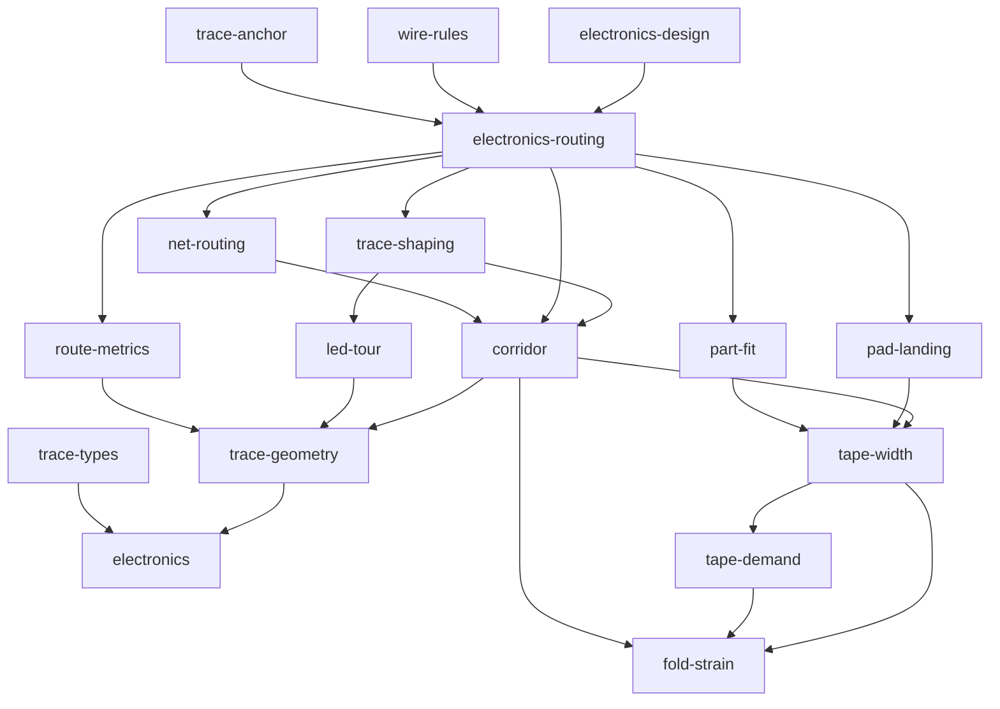
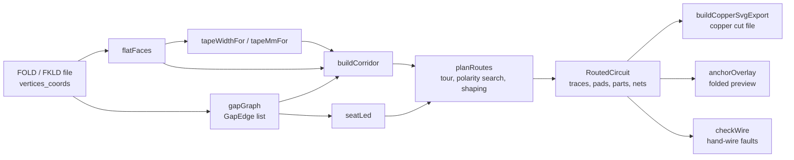

# Electronics layer overview

The electronics layer reads the same flat pattern the kirigami pipeline writes, seats LEDs and other parts on its hinges, and plans copper-tape runs across it, pricing each fold the copper crosses by the strain that fold puts in it. Everything it produces lives in the flat pattern's own coordinate frame, so the copper cut file registers against the cut and score layers without any alignment step.

## One coordinate frame

The pattern is the shared representation. `src/model/electronics.ts` reads `vertices_coords` straight out of the FOLD/FKLD file and builds everything else from it:

```ts title="src/model/electronics.ts › flatFaces"
/** Build the flat-face polygons + centroids, aligned 1:1 with `faces_vertices`. */export function flatFaces(fold: FoldFile): FlatFace[] {
  const pts = flatPoints(fold);
  const faces = fold.faces_vertices;
  if (!Array.isArray(faces) || pts.length === 0) return [];
  const out: FlatFace[] = [];
  for (const f of faces) {
    // …
    out.push({ verts: f.slice(), poly, centroid: { x: cx / f.length, y: cy / f.length } });
  }
  return out;
}
```

Faces are kept index-aligned with `faces_vertices`, so a face index means the same tile in the editor, the router, the folded preview and the exporters.

The header of `electronics.ts` calls these coordinates millimetres, and for a pattern at real scale they are. But a pattern can also come in at unit scale, which is what kirigamize produces. So the router never assumes one unit is one millimetre. It works in **pattern units** and converts physical sizes through a single ratio: the tape width in pattern units (`tapeWidthFor`) over the tape width in millimetres (`tapeMmFor`). A pattern smaller than the print sheet on both axes is read as if it will be cut at `PRINT_SHEET_MM`, measured along its longest axis. That is the same rule the STL export uses, so the router and the cutter agree on how big the model is. See [Routing › Tape width](routing.md#tape-width-selection).

!!! warning "Convert every millimetre through the same pair of widths"
    `tape-width.ts` states this rule. A width is either a physical millimetre or a length in pattern units, and the two are converted in one place. Any figure in mm (a footprint pitch, the weeding floor, the bridge allowance) becomes pattern units as `mm * tapeW / tapeMm`, with both widths taken from the same call. If you read `TAPE_MM` as the denominator while `tapeMmFor` returned something else, you get a plan that looks right but is the wrong size. The comments in `planRoutes`, `tape-width.ts` and `manual-wire.ts` each record this mistake having happened once already.

## The gap graph

The built object is printed rigid tiles on a flexible backing. A **gap** is the bare strip of backing between two adjacent tiles. It is a living hinge at an `M`/`V` fold, and it is where an LED sits: its body straddles the hinge and its two legs land on the two tiles. `gapGraph` turns every such edge into a `GapEdge`:

```ts title="src/model/electronics.ts › isGapEdge"
/**
 * Is this shared edge a real, openable gap (a tile pinches there and the router may cross it)?
 * True iff exactly two faces share it AND its assignment is a joint (`M`/`V`/`C`) or untagged —
 * closed nets emit cut lips without always tagging every interior edge, so an untagged interior edge
 * defaults to traversable. `F` (facet diagonal) and `B` (boundary) edges are explicitly NOT gaps.
 */function isGapEdge(rec: { faces: number[] }, asg: string | undefined): boolean {
  if (rec.faces.length !== 2) return false;
  if (asg != null && asg !== "" && !GAP_ASSIGNMENTS.has(asg)) return false;
  return true;
}
```

Each `GapEdge` carries:

| Field | Meaning |
|---|---|
| `faceA`, `faceB` | The two tiles the hinge joins |
| `point` | Midpoint of the shared edge: where an LED body sits |
| `ends`, `verts` | The edge's endpoints as coordinates and as vertex ids (index lookups avoid a second, scale-sensitive source of truth) |
| `legA`, `legB` | The pinched edge midpoints on each tile. The distance between them is the hinge width the strain model uses |
| `assignment` | `M`, `V`, `C` or `""` |
| `dihedral` | Target fold angle in **degrees**, signed by assignment (mountain positive, valley negative), or `null` if the file records none |

`gapGraph` also returns the dual graph itself (`pos`, `adj`): face centroids joined *through* gap midpoints. The header comment in `electronics.ts` still says copper crosses each hinge at its midpoint. **The router no longer works that way.** Today the gap list does three jobs:

1. **Seating.** An LED is identified by its face pair (`gapForLed`). Its copper ends are placed straddling `GapEdge.point` along the hinge normal (`pad-landing.ts › seatLed`).
2. **Pricing.** Each gap's `dihedral` and measured hinge width set the price of crossing that edge (`corridor.ts › buildCorridor`, see [Fold strain](fold-strain.md)).
3. **Editor hit-testing and wire checks.** `nearestGap`, and `wire-rules.ts` walking `ctx.gaps`.

Copper actually travels on the **corridor**, built in `corridor.ts`. Its nodes are two crossing points on every face edge, at a quarter and three quarters of the way along. A tile is crossed by a straight **chord** between two of its own crossing points, and only when that chord keeps the full tape width on the material. A node on an edge two faces share belongs to both faces, and that shared node is how a route steps from one tile to the next. Only gap edges carry a crease price.

```ts title="src/model/corridor.ts › EDGE_CROSSINGS"
/** Where along a shared edge the bus may cross it. Symmetric about the middle so neither net is favoured,
 *  and away from the middle so a crossing does not land on a chip, which sits at the midpoint -- which is why
 *  this fixed copper-under-the-chip as well as overlap.
 *  …
 */
const EDGE_CROSSINGS = [1 / 4, 3 / 4];
```

So copper crosses a hinge *off* its midpoint on purpose, because the midpoint is where the chip sits. [Routing › Corridor search](routing.md#corridor-search) explains why the router moved from face centres to chords.

## Module map

`electronics-routing.ts` used to be one large file. It was split into leaf modules in late August 2026 (commits `39d9ec1` "Extract segment math to trace-geometry", `c5df9d9` "Split plan scoring out of router", `239fffa` "Move tape width and landings to modules", `9241b6f` "Break remaining import cycles", `da4331a` "Move tour order and shaping out"). It still **re-exports** every name it used to define, so existing call sites did not change. It also still holds the bus router itself.

| Module | Role |
|---|---|
| `electronics.ts` | Pure flat-pattern geometry and the circuit data model: `Circuit`, `Led`, `Battery`, `FlatFace`, `GapEdge`, `flatFaces`, `gapGraph`, `tilePolys`, `pointInFace` |
| `fold-strain.ts` | What a fold costs copper: strain, threshold, crease price, bands, sheet-thickness bounds. Imports nothing. See [Fold strain](fold-strain.md) |
| `trace-geometry.ts` | Segment math only (`segsCross`, `segPointDist`, `patternDiag`, `ptKey`, …). Knows nothing about nets or pads |
| `trace-types.ts` | Types only: `Trace2D`, `PadPair`, `PartSpan`, `LedSeat`, `Corridor`, `CorridorBridge`, … |
| `corridor.ts` | The travel graph (`buildCorridor`), Dijkstra over it (`searchCorridor`, `corridorPath`), containment (`tapeOnBody`), cut seams (`seamsOf`) and bridges over narrow openings |
| `route-metrics.ts` | Plan scoring: `PlanKey`, `lexLess`, `flawless` and the fault counters |
| `tape-width.ts` | `TAPE_MM`, `tapeWidthFor`/`tapeMmFor`, `weedGapFor`, `MIN_WEED_MM`, `FOLD_PENALTY_FRAC`, `BRIDGE_MM` |
| `tape-demand.ts` | How wide a run may be given how many runs share a tile (`traceDemand`, `tapeMmForDemand`), used only under `tapeChoice: "area"` |
| `pad-landing.ts` | Where copper may stop: `ledSeat`, `seatLed`, `landingWidthFor`, `narrowedTo`, `batteryTerminals` |
| `part-fit.ts` | Breaking a run so a resistor, switch or library part can bridge the gap: `partFit`, `breakRuns`, `breakForResistors`, `switchLand` |
| `led-tour.ts` | Visiting order: `nearestTour`, `twoOpt`, `tourOf`, and the `Target` type |
| `trace-shaping.ts` | Shape-in, shape-out cleanup: `asTree`, `junctions`, `straighten`, `dodgeChips` |
| `trace-anchor.ts` | Pins flat copper to face barycentrics so the folded preview can draw it (`anchorTraces`, `anchorOverlay`) |
| `wire-rules.ts` | Whether a hand-drawn wire is buildable: `checkWire`, `ERRORS`, `WARNINGS` |
| `electronics-routing.ts` | Facade plus the two-rail bus router: `planRoutes`, `RoutedCircuit`, `EMPTY_ROUTE`, and private `routeDeclaredNets`, `seatLedLegs` |
| `electronics-design.ts` | The adapter the editor UI calls (`ElectronicsDesignAdapter`, `defaultElectronicsDesign`): route, measure tape, build cutter files |

Also part of the layer, documented elsewhere: `net-routing.ts` and `netlist.ts` (declared nets, see [Netlist](netlist.md)), `parts.ts`, `footprint.ts` and `library.ts` (see [Parts](parts.md)), `manual-wire.ts` (see [Editor](editor.md)) and `copper-svg-export.ts` (see [Export](export.md)).



The arrows point from importer to imported, and most nodes also import `electronics`. Shared vocabulary and arithmetic sit at the bottom, and nothing below `electronics-routing` imports it.

### Symbol → owning module

If you find a name re-exported from `electronics-routing.ts`, the file to open is the one listed here.

| Symbol | Owning module |
|---|---|
| `planRoutes`, `RoutedCircuit`, `EMPTY_ROUTE` | `electronics-routing.ts` |
| `gapGraph`, `GapEdge`, `flatFaces`, `FlatFace`, `Circuit`, `gapForLed`, `pointInFace` | `electronics.ts` |
| `foldStrain`, `thresholdStrainFor`, `traceformCreaseFraction`, `creaseCostFraction`, `strainBand`, `SheetSpec`, `DEFAULT_SHEET` | `fold-strain.ts` |
| `buildCorridor`, `searchCorridor`, `corridorPath`, `reachableFaces`, `tapeOnBody`, `seamsOf`, `TERMINAL_TOLL` | `corridor.ts` |
| `PlanKey`, `lexLess`, `flawless`, `countUnderLed`, `countNetCrossings`, `overlapLength`, `trimAtOwnJoins` | `route-metrics.ts` |
| `TAPE_MM`, `tapeWidthFor`, `tapeMmFor`, `weedGapFor`, `MIN_WEED_MM`, `FOLD_PENALTY_FRAC`, `bridgeSpanFor` | `tape-width.ts` |
| `traceDemand`, `tapeMmForDemand`, `TAPE_FLOOR_MM` | `tape-demand.ts` |
| `ledSeat`, `seatLed`, `landingWidthFor`, `narrowedTo`, `batteryTerminals`, `DEFAULT_LED` | `pad-landing.ts` |
| `partFit`, `breakRuns`, `breakForResistors`, `switchLand`, `idleSide` | `part-fit.ts` |
| `nearestTour`, `twoOpt`, `tourOf`, `Target` | `led-tour.ts` |
| `asTree`, `straighten`, `dodgeChips`, `junctions` | `trace-shaping.ts` |
| `segsCross`, `crossesAny`, `patternDiag`, `ptKey` | `trace-geometry.ts` |
| `Trace2D`, `PadPair`, `Corridor`, `LedSeat` | `trace-types.ts` |
| `anchorTraces`, `anchorOverlay` | `trace-anchor.ts` |
| `checkWire`, `isBuildable` | `wire-rules.ts` |
| `planNets`, `RoutedNet` | `net-routing.ts` |
| `buildCopperSvgExport`, `buildCopperCarrierExport` | `copper-svg-export.ts` |

## Data flow



1. **Pattern → geometry.** `flatFaces` and `gapGraph` read the file. Nothing is stored twice, and a stale circuit against a changed pattern simply finds its gap missing (`gapForLed` returns null), so its LED is reported unreachable.
2. **Geometry → corridor.** `buildCorridor` lays crossing points and chords, prices every gap crossing from its strain, adds bridges over narrow openings, and marks refused nodes when a strain limit is set.
3. **Corridor → plan.** `planRoutes` seats each LED, orders the bus tour, searches LED polarities against the `PlanKey` objective, shapes the result, breaks runs for parts, and finally routes any declared nets around the bus. See [Routing](routing.md).
4. **Plan → traces.** The result is a list of `Trace2D` polylines in pattern units, each tagged with a net id (`"pwr"`, `"gnd"`, or a declared `Net.id`). Optional per-point `widths` narrow a run where it lands on a pad.
5. **Traces → cut file and preview.** `copper-svg-export.ts` emits every run as a closed outline at its width, in the same frame (margin, bounds, Y-flip) as the FKLD cut/score SVG, so the layers import registered. `trace-anchor.ts` stores each point as a face plus barycentric weights, so the folded preview moves the copper with its tile at no per-frame planning cost. See [Export](export.md) and [Simulation](../kirigami/simulation.md).

The router is deterministic. Every decision comes from geometry and index order, with no randomness, so the editor preview, the folded overlay (`services/electronics-service.ts › resolveFoldedCopperOverlay`) and the export each call `planRoutes` on their own and get the same copper.

## Design choices

!!! note "Why a facade instead of moving call sites"
    The `electronics-routing.ts` comments say the segment math and plan vocabulary moved out "to break the import cycles it sat in the middle of". A module that only wanted to *name* a `Trace2D` used to import the whole router, and the router imported it back. They are re-exported "so this module stays the one public face of copper routing … and the split stays free to move again without touching them."

!!! note "Why types live in their own leaf"
    `trace-types.ts` is "deliberately types and nothing else. There is no behaviour here to disagree with, so a module can depend on this without inheriting a routing policy." `RoutedCircuit` stays with the router because it is that function's result, not shared vocabulary.

!!! note "Why the UI goes through an adapter"
    `electronics-design.ts` is "the small adapter-shaped contract for the heavy model work" the view asks for. "Tests can replace it without importing the router into the UI."

| Choice | Alternative considered | Reason (from source) |
|---|---|---|
| Route on a corridor of edge crossing points joined by chords | Route through face centres (the original dual gap graph) | Through a single centre point, "both nets solve the same problem and get the same answer", and tolling a shared waypoint "diverted nothing even at 400x" (`corridor.ts › buildCorridor`) |
| Two crossings per edge at ¼ and ¾ | One midpoint; thirds; three or four crossings | The midpoint forced both nets together at every tile boundary and put copper on the chip. Quarters beat thirds on overlap. More crossings let the nets interleave (`corridor.ts › EDGE_CROSSINGS`) |
| Sign the fold angle from `M`/`V` | Trust the file's sign | FOLD and the FKLD pipeline "do not agree on a sign convention, and M/V is unambiguous" (`electronics.ts › GapEdge.dihedral`) |
| Report an unroutable LED as `unreachable` / `unseated` | Draw copper anyway | "Reported rather than drawn wrong, like any other part that does not fit" (`RoutedCircuit.unreachable`) |

Related pages: [Fold strain](fold-strain.md), [Routing](routing.md), [Netlist](netlist.md), [Parts](parts.md), [Architecture overview](../architecture/overview.md), [Import boundaries](../import-boundaries.md), [FKLD](../kirigami/fkld.md).
