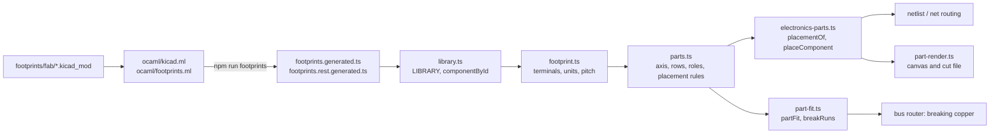

# Parts and footprints

Every component in Traceform comes from a vendored KiCad footprint file. An OCaml generator turns those files into committed TypeScript, and a short chain of model modules then reads pads, assigns them roles, places them on the flat pattern, decides how a part is seated in a run of copper tape, and draws it.

## The pipeline



| File | Role |
|---|---|
| `footprints/fab/*.kicad_mod` | The vendored KiCad FabLib footprints, unedited. Adding a part is dropping a file here. |
| `ocaml/kicad.ml` | S-expression reader and pad converter: KiCad pads to SVG paths, in inches, y up. |
| `ocaml/footprints.ml` | Scans the directory, derives ids and notes, emits the two generated modules. |
| `ocaml/build.sh` | Compiles the generator and writes both outputs safely. Run with `npm run footprints`. |
| `src/model/footprints.generated.ts`, `footprints.rest.generated.ts` | Generated, committed. Do not edit. |
| `src/model/kicad-parser.ts` | TypeScript port of svg-pcb's KiCad parser, used by tests. |
| `src/model/library.ts` | The one lookup for a `Component.id`. |
| `src/model/footprint.ts` | Unit conversion, terminal vs hole, pad size, nearest-neighbour pitch. |
| `src/model/parts.ts` | Pad axis, rows, in-line vs across, roles, `placement` / `netPlacement`, `seatSigns`. |
| `src/model/electronics-parts.ts` | A placed part as a 2x2 transform, with every pad baked once. |
| `src/model/part-fit.ts` | How much copper a seated part removes, and where. |
| `src/model/pad-landing.ts` | How wide copper may be where it lands near metal. LED seats, battery terminals. |
| `src/model/part-render.ts` | Painting a placed part, in two styles. |

## Generating the library

`ocaml/footprints.ml` states its purpose in its header: pad sizes and pitches come from the manufacturer's own footprint file, "so a number in the app is a number from a datasheet rather than one somebody measured off a drawing." It records that a switch pitch was wrong twice (2.54mm assumed, then 2.5mm misread) before reading the file fixed it.

`ocaml/kicad.ml` reads only pads (no silkscreen, courtyard or fab outline), converts millimetres to inches and negates y so "up" matches the flat pattern, and turns each pad shape into one SVG path. `np_thru_hole` pads are kept as mechanical holes, marked by having no copper layer.

`footprints.ml` then:

- Derives a TypeScript identifier from each filename by rule (invalid characters to `_`, a leading `_` before a digit), with three aliases the app and tests already used:

```ocaml title="ocaml/footprints.ml › aliases"
let aliases =
  [ ("Switch_Slide_RightAngle_CnK_AYZ0102AGRLC_7.2x3mm", "SW_SPDT");
    ("Button_CnK_PTS636.0_6x3.5mm", "SW_PUSH");
    ("Battery-Holder_Coin-Cell_CR2032_Linx_BAT-HLD-001", "BAT_COIN_20") ]
```

- Takes a palette note from the footprint's `descr`, falling back to `tags`, then to the filename as words, with URLs stripped.
- Splits the parts into two modules by whether a rail could pass through them (2 or 3 terminals):

```ocaml title="ocaml/footprints.ml › placeable"
let max_in_series = 3

let placeable (pads : Kicad.footprint) =
  let n = List.length (List.filter is_terminal pads) in
  n >= 2 && n <= max_in_series
```

`build.sh` re-execs under the architecture `ocamlopt` targets (a Rosetta shell reports i386 and `cc` then fails on arm64 output), and writes each output through a temp file, moving both only after both succeed:

```sh title="ocaml/build.sh"
trap 'rm -f footprints.tmp.ts footprints.rest.tmp.ts' EXIT
$run ./footprints > footprints.tmp.ts
$run ./footprints rest > footprints.rest.tmp.ts
mv footprints.tmp.ts ../src/model/footprints.generated.ts
mv footprints.rest.tmp.ts ../src/model/footprints.rest.generated.ts
```

The comment explains both: redirecting onto the committed output destroys it if the run fails, and a stale eager half beside a fresh lazy half would duplicate or drop parts.

The generated output is committed, so normal development needs no OCaml toolchain (see `ocaml/footprints.ml` header).

!!! note "Why OCaml"
    The rationale is only partly documented. The original message of commit `806fa8b` ("Generate footprints from pcb.py in OCaml"; the full text survives on the `backup/pre-reword` branch as `5e39fe4`) explains why OCaml is a generator rather than runtime code: on the router's own graph, TypeScript with typed arrays measured 19.4us against 20.0us native and 34.5us through js_of_ocaml, "so putting OCaml in the hot path would cost speed, while generating from it costs nothing and puts the numbers in one place." Why OCaml was picked over a TypeScript or Node script for the generator itself is not documented in code, comments or commits.

### The TypeScript parser

`src/model/kicad-parser.ts` is a port of svg-pcb's `js/ki_cad_parser.js`, kept close to the original: same reader, same five shape cases, same fixed tessellation, same `${name}_${i}` naming for repeated pads. It marks its divergences inline as `DIVERGENCE`: circular drills (svg-pcb's guard compares a string atom with `"number"` and never passes, which would drop every drill), a pad `index` that `parts.ts` orders terminals by, and a `trapezoid` case svg-pcb lacks.

No module under `src/` imports `kicadParser`; only tests do (`kicad-parser-port.test.ts`). The app's library always comes from the OCaml output. `kicad-parser.test.ts` checks that output a different way: it re-parses every source file with independent regexes and asserts pad counts and sizes agree with the generated modules.

## One lookup: `library.ts`

```ts title="src/model/library.ts"
/** Every part in the library, both halves of the generated split. */
export const LIBRARY: Component[] = [...COMPONENTS, ...REST_COMPONENTS];

const BY_ID = new Map(LIBRARY.map((c) => [c.id, c]));

/** One part by its `Component.id`, or undefined. */
export function componentById(id: string): Component | undefined {
  return BY_ID.get(id);
}
```

The header explains why this exists. There used to be three lookups (router, cut files, netlist) that each searched only the eager half, while the palette merged both. Once `netPlacement` made every part with a terminal placeable, a part could be offered, placed, and then fail to resolve everywhere that mattered. The split is therefore no longer a bundling boundary: both halves load eagerly and are joined here. The generator still emits two files.

!!! warning "Stale generated header"
    The header that `footprints.ml` writes into `footprints.generated.ts` still says the router and cut files resolve ids against the eager module alone, and that the rest file holds parts that "cannot be routed or drawn". Since `library.ts` that is no longer true. The text lives in `ocaml/footprints.ml › emit_header` / `emit_rest_header`, so fixing it means editing the generator and regenerating.

## Reading a footprint: `footprint.ts`

The stored representation is lossless (SVG path in inches per pad) and, in the header's words, "the wrong thing to compute with." `footprint.ts` converts inches to millimetres and outlines to boxes, and nothing else does.

What counts as a terminal is settled by name as well as by copper:

```ts title="src/model/footprint.ts › isTerminal"
export function isTerminal(name: string, pad: Pad): boolean {
  return carriesCopper(pad) && name !== "" && !/^_\d+$/.test(name);
}
```

The FabLib slide switch's locating pegs are plated `thru_hole` pads on `*.Cu`; read by copper alone the switch has five terminals instead of three. KiCad names a pad so a netlist can refer to it, so an unnamed pad is the format's own way of saying "not wired". `terminals(fp)` is the accessor for anything a user can wire; `holes(fp)` returns the drilled non-terminals.

`nearestTerminalMm(fp, name)` gives the distance to a terminal's nearest neighbour, skipping coincident twins (a through-hole pad and its surface-mount copy named `1` and `1_1` at the same point). Counting those reads the room as zero and collapses every landing to the floor. The result is cached per footprint object because pitch is a property of the part, not the placement.

## Roles and placement rules: `parts.ts`

`padAxis(fp)` reads which axis a part's terminals line up along by counting rows each way and taking the tidier reading. KiCad orients footprints as their datasheet drawing did, so a 1206 runs along x and a pin header down y.

`acrossPart(fp)` decides whether a rail runs **along** a part (in line, like a resistor) or steps **across** it (in at a common, out at a throw, like the slide switch). It returns the chosen `common`, `live` and `idle` pad names, the row separation and the pitch. The docblock explains why this is one function: when the router and the export briefly had a rule each, they disagreed on the coin cell, and "a cut file that disagrees with its own drawing is the worst failure this code has."

The one deliberate departure from a manufacturer footprint lives here too: the SPDT switch's common is reflected through the line of its mounting pegs to the opposite edge, so the rail runs straight through instead of doubling back round the housing (`parts.ts` header).

### Two placement questions

| Function | Question | Rule | Used by |
|---|---|---|---|
| `placement(fp)` | Can a rail pass through this part? | 2 or 3 terminals | Editor drop: whether a part may be seated in a rail |
| `netPlacement(fp)` | Is there anything to wire? | At least 1 terminal | Palette (`electronics-palette.ts › admit`) |

When the author drops a part (`electronics-modal.ts`), it is seated in a rail only if `placement` accepts it and the click is within pick radius of a run. Otherwise it is placed **free**: a set of pads at the author's chosen point and turn, with no copper cut, joined by declared nets or hand-drawn wires. The palette leaves out parts owned by fixed tools (`FIXED_PLACEMENT`). A seated part is stored with the angle of the run it lands on.

!!! info "Stale field comment"
    `PlacedPart.rot` in `electronics.ts` is still documented as "Only meaningful with `free`". Seated parts now carry `rot` too; only seated parts saved before that have none, and `placementOf` keeps their old placement on purpose.

## Placing a part: `electronics-parts.ts`

This is a port of svg-pcb's `makeComponent`: one transform per placed part, every pad baked from it, and every consumer reading the same array. It replaced three hand-kept derivations of pad positions (netlist, cut file, renderer) that agreed only by transcription.

A placement is `at = origin + m · padLocal`, with `m` a 2x2 matrix rather than `{rot, flip}`. `placementOf` has three branches: legacy seated parts with no `rot`; in-line parts, anchored on the middle of the pad span and turned so the footprint's own along-axis follows the run; and two-row parts, seated turned to the rail and anchored on the `common` pad. `placeComponent` bakes each terminal's centre, placed outline, run-normalised size and copper flag, plus drilled holes. It is pure and recomputed every pass, because `tapeW` depends on the whole circuit and `cloneCircuit` rebuilds every `PlacedPart` on edit, so no cache could hit.

### A placement is never a reflection

A surface-mount part has one side, so a mirrored placement is a part soldered upside down. `PlacedPart.flip` is a half-turn, not a mirror. The signs that map a two-row footprint onto the run are defined once:

```ts title="src/model/parts.ts › seatSigns"
  const dC = ax.across(live) - ax.across(common);
  // The same test `rowLeads` already used to refuse a fabricated row, and for the same reason.
  if (Math.abs(dC) < 1e-9) {
    return { sC: 1, sA: Math.sign(ax.along(live) - ax.along(common)) || 1, fabricated: true };
  }
  const sC = Math.sign(dC);
  return { sC, sA: sC, fabricated: false };
```

`sA` used to be read off the `live` pad independently of `sC`, which made the placement orientation-reversing for most two-row parts; the docblock records a XIAO socket whose pins came out 1 and 5 swapped. Forcing `sA = sC` keeps every genuine two-row placement a rotation. Parts whose second row `acrossPart` invents (the three-terminal switch) keep the old reading; such a part is its own mirror image, so the reflection is equivalent to a half-turn. `electronics-parts.ts › isMirrored` reads the determinant, and `placed-component.test.ts` asserts it is false for every library part across a set of free-part turns and flips, with one named exception: a fabricated-row part when flipped.

## Breaking copper for parts

A series part such as a resistor has both ends on the same rail, so tape running under it shorts it. The copper must be cut in two, not narrowed. `part-fit.ts` holds the arithmetic so the gap the router cuts, the housing the canvas draws and the fit the netlist reports cannot drift apart.

`partFit(fp)` returns `rows` (1 or 2), the `gap` of bare pattern and the copper reserve needed `before` and `after` the break centre:

- **In line**: the gap between the outermost pads, measured along the part's own axis.
- **Across**: `rowSep + neckFor(...)`, where the neck pulls the outgoing tape back so the idle throw sits a keep-out (`SWITCH_KEEPOUT_MM`) from copper.

In the bus router (`electronics-routing.ts`), seated library parts are grouped by component (`byComponent`; free parts are skipped) and each group is broken with its own fit:

```ts title="src/model/electronics-routing.ts › planRoutes"
    const fit = partFit(fp);
    if (!(fit.gap > 0)) continue; // nothing to break a rail for
    // The bare strip between the cut ends is weeded like an LED's, so it is refused below the same floor
    // `seatLed` refuses an LED_0603 at — an 0603 bridges 0.70mm.
    if (fit.gap < MIN_WEED_MM) continue;
    const drops = group.map((g) => g.part);
    const broke = breakRuns(partTraces, drops, toFlat(fit.gap), {
      before: toFlat(fit.before),
      after: toFlat(fit.after),
    }, ledKeepOut);
```

`breakRuns` snaps each part, stored as a point, to the nearest run (the routes are re-planned whenever the circuit changes, so a run index would name different copper later). It slides the part inboard if it was dropped near an end (`fitWithin`), turns it round if only the other orientation fits, and splits the run (`splitRun`). The last argument is a keep-out: each LED's legs and body, pad to outboard pad, which `seatLedLegs` lays after the breaks. A break centre may not fall where its bare pattern would come within a tape width of that copper, nor where another run of the same net would touch both cut halves or be cut off; a run that doubles back so its halves touch is refused (the `breakRuns` `keepOut` docblock records that, before it, 3-4 of every 8 parts dropped on the bus on house, church and puffin were shorted by a neighbouring leg). Resistors and switches get the same keep-out. Each returned `PartSpan` carries `source`, its index in the author's part list, because a part that does not fit is dropped and spans are not index-aligned.

For across parts, `idleSide` picks the side for the live throw that leaves the idle throw furthest from other copper (unless the author set `flip`), `clearOfOtherNet` drops placements whose terminals would touch the other net, `clearOfLeds` drops placements whose lands would run over an LED chip or its other-net leg, and `switchLand` lays pad-width land copper to the common and live throw. Free parts are not broken into rails; nets reach them through the netlist (see [netlist.md](netlist.md)).

## Fine-pitch parts on copper tape

A pin header at 2.54mm pitch is close to the tape width (`TAPE_MM` is 1.5mm in `tape-width.ts`). The rules that make such parts routable all live in one place:

```ts title="src/model/pad-landing.ts › landingWidthFor"
export function landingWidthFor(sep: number, tapeW: number, weed?: number): number {
  return Math.max(tapeW * MIN_LAND_FRAC, Math.min(tapeW, padRoomFor(sep, tapeW, weed)));
}
```

`padRoomFor(sep) = sep − weed` is the copper width that leaves a weedable web to the neighbouring pad; `landingWidthFor` clamps it between a cuttable floor (`tapeW · MIN_LAND_FRAC`) and the tape. `padRoomFor` is exported separately because a clamped number cannot report that it ran out of room.

How these are used:

- `netlist.ts › resolveNetlist` sets each terminal's `padWidth` to the smaller of the pad's own size and `landingWidthFor(nearestTerminalMm)`. Where `padRoomFor` falls below the floor it raises a `pads-too-close` fault but still routes the terminal at the floor width, so "impossible on this tape" can be told apart from "another net got there first."
- `Netlist.fields` (a `PadField` per terminal of every wired part) lets `pad-landing.ts › narrowedTo` keep a leg narrow for as long as it stands over the part, not only at its endpoint.
- `net-routing.ts › padCapAt` narrows a leg further to fit past pads of other nets, and `padHitBy` refuses legs that would touch them (see [netlist.md](netlist.md)).
- `seatLed` refuses an LED whose own pad gap is below `MIN_WEED_MM`, rather than shrinking copper until it tears. A library part in series is refused below the same floor.

## Drawing a part: two styles

`part-render.ts` paints and never places: every position comes from a `ResistorShape` that the router and `copper-svg-export.ts › partShape` already decided. `partLayers` returns elements grouped by PCB layer (`copper`, `mask`, `drills`, `padLabels`, `componentLabels`, `origin`); `partSvg` flattens them in paint order.

`PartStyle` is `"kiri"` (the default) or `"svgpcb"`:

=== "Canvas: svgpcb"

    The editor calls `partLayers(..., { style: "svgpcb" })` and groups the output by layer across the whole board, in svg-pcb's order. Mask and copper share one outline (no rim), so a pad reads as flat gold; drills are solid white; pad labels use svg-pcb's fixed size (`PAD_LABEL_MM`). `SVGPCB_COLOURS` copies svg-pcb's layer colours without alpha, because kiri's canvas is a light sheet rather than a dark green substrate.

=== "Cut file: kiri"

    `copper-svg-export.ts › partMarks` calls `partSvg(fp, sh, designator)` with no options, so the cut files use the default style. A rim of bare copper (`RIM`) shows round the mask opening, and `MASK_LINE` outlines each pad's true boundary in mask. The comment explains the outline: the carrier file is drawn on a field of copper the same colour as the pad, and without it the pad edge vanishes.

The style is a parameter rather than a palette change because the same function serves both outputs and the cut files' appearance is load-bearing.

## Design choices

| Choice | Alternative considered | Reason (source) |
|---|---|---|
| Generate the library from vendored KiCad files | Hand-written pad tables | Numbers come from datasheets; hand values were wrong twice (`footprints.ml` header). |
| Ids derived by rule, with three aliases | A lookup table | A new file needs no code change (`footprints.ml › Ids`). |
| Generator offline, output committed | OCaml at runtime via js_of_ocaml | Slower than TypeScript in the hot path; generating costs nothing (`806fa8b` original message). |
| One `library.ts` lookup over both halves | Separate lookups per consumer | Parts could be offered and then fail to resolve (`library.ts` header). |
| Terminal decided by name and copper | Copper layer alone | Plated pegs read as terminals (`isTerminal` docblock). |
| One `acrossPart` reading | A rule each in router and export | They disagreed on the coin cell (`acrossPart` docblock). |
| Placement as a 2x2 matrix, baked once per pass | `{rot, flip}`; a cached per-part bake | The matrix makes a reflection detectable; caches cannot hit (`electronics-parts.ts` header). |
| `sA = sC` | Read `sA` off the live pad | The latter mirrored most two-row parts (`seatSigns` docblock). |
| Cut the run for a series part | Narrow it | Copper under both ends shorts the part (`breakForResistors` docblock). |
| Report `pads-too-close` and still route | Drop the terminal | Dropping is the silent stranding faults exist to end (`resolveNetlist` comment). |
| `PartStyle` parameter | Repaint the shared palette | The cut files would change too (`part-render.ts`). |

Related: [netlist.md](netlist.md), [routing.md](routing.md), [editor.md](editor.md), [export.md](export.md), [../import-boundaries.md](../import-boundaries.md), [../development/testing.md](../development/testing.md).
