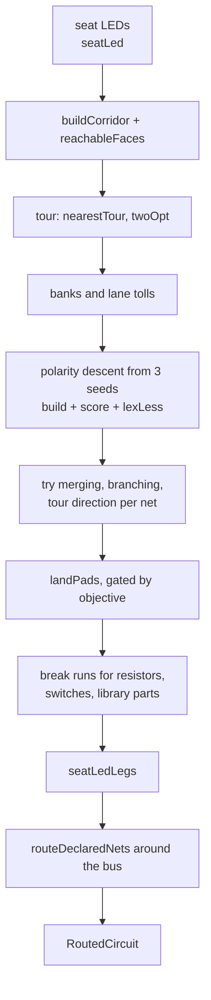

# Routing

`planRoutes` in `src/model/electronics-routing.ts` lays the copper for a circuit. It runs one tour from the battery past every LED, puts PWR and GND on the two banks of that tour, and picks LED polarities and plan variants by a lexicographic objective. Declared nets are then routed around the bus by a separate router. This page follows a plan from input to traces.

## The topology: a two-rail bus

The router's header states the constraints. The tape is single-sided, so copper may lie over a cut, a hinge, bare backing, or tape of its *own* net. Exactly two things are forbidden:

1. **No trace over an LED body.** It shorts the chip.
2. **PWR must not cross GND.** That is a short in the layout.

The answer is a **two-rail bus**. One tour runs from the battery past every LED, and the two nets are its two *banks*: PWR takes the pad on one side of the direction of travel and GND the pad on the other. "That is how a person tapes this by hand, and it comes out at exactly two strips whatever the LED count, rather than two per LED." The router picks each LED's polarity: whichever pad lands on the PWR bank becomes `+`, and `RoutedCircuit.pads` reports it so the editor can show which way round to fit the part. An author can pin an LED's orientation (`Led.flip`), and the search then routes around that choice.

!!! warning "Crossings are reduced, not eliminated"
    The header is explicit. The guarantee holds only where an LED's two pads flank the direction of travel. Where the tour meets a hinge end-on, one rail has to reach across the other, and no polarity flip can undo that. Two attempts at routing the tour *along* each hinge "each traded the crossings for over-LED violations or 6x the copper, so neither shipped."



## Inputs and early exits

```ts title="src/model/electronics-routing.ts › planRoutes (signature; parameter docs trimmed)"
export function planRoutes(
  faces: FlatFace[],
  gaps: GapEdge[],
  circuit: Circuit,
  sheetMm: number = PRINT_SHEET_MM,
  sheet: SheetSpec = DEFAULT_SHEET,
  creasePenaltyFrac: number = FOLD_PENALTY_FRAC,
  bandCap: number = STRAIN_BAND_CAP,
  graded: boolean = true,
): RoutedCircuit {
  // **New parameters APPEND. Never insert one.** Every optional parameter here has a default, so an
  // inserted one leaves every existing call compiling while it silently receives the wrong argument —
  // …
```

`creasePenaltyFrac`, `bandCap` and `graded` exist so tests and benchmarks can run the *same* code as a baseline. At `creasePenaltyFrac = 0` the router minimises copper alone, and at `bandCap = 0` it orders on cost alone. The comment explains: "a baseline routed by different code from the thing it is a baseline for measures the fork as much as the price." Shipped callers (`electronics-design.ts`, `electronics-service.ts`) pass only the first five arguments.

The function returns early, still routing any declared nets, when there is no battery, when no LED can be seated, or when no seated LED is reachable from the battery's face across the material (`reachableFaces`). Reachability is walked node to node over the same chords and bridges `searchCorridor` uses, starting only from the first nodes a leg out of each battery terminal may reach on the body, once for PWR and once for GND. An LED is kept only if both nets reach it. Walking tile to tile instead had called an LED behind a neck too narrow for a chord reachable, and it was drawn as a straight line through empty space (`reachableFaces` docblock). An LED is dropped into `unreachable` and, if its part does not fit the hinge, also into `unseated`. The two are kept apart because "an unreachable LED sits on a tile the copper cannot get to … An unseated one is on a hinge its own package does not fit", and the fixes differ.

## Seating an LED

`pad-landing.ts › ledSeat` reads the LED's footprint: its pitch, its pad width, and the bare `gap = pitch − padW` between its copper ends. `seatLed` places the two copper ends `gap` apart, straddling `GapEdge.point` along the hinge normal, one on each tile. A part is refused when `gap < MIN_WEED_MM`, because the strip between the nets would tear when weeded, when either end falls off its own tile, or when the far end of either leg (a pad's width outboard, both corners) is off the material, since `seatLedLegs` lays tape there whatever the route did. `planRoutes` also refuses an LED whose legs, end to end, come within a tape width of an LED already seated, which two hinges meeting at a corner can cause.

The pads are no longer the tile dents (`pinchMid`). `seatLed`'s comment gives the reason: on `house.fkld` the dents were 5.81 mm apart, while a 1206's legs are 3.40 mm apart and "could not reach their own copper. The joinery does not move; the pad does."

## LED tour ordering

```ts title="src/model/led-tour.ts › twoOpt"
export function twoOpt(order: number[], centre: Vec2, targets: Target[]): number[] {
  const pos = (i: number): Vec2 => (i < 0 ? centre : targets[order[i]!]!.hinge);
  // …
  while (improved && guard++ < 64) {
    improved = false;
    for (let i = 0; i < order.length - 1 && !improved; i++) {
      for (let j = i + 1; j < order.length && !improved; j++) {
        const before = tourLen();
        const span = order.slice(i, j + 1).reverse();
        const trial = [...order.slice(0, i), ...span, ...order.slice(j + 1)];
        const kept = order;
        order = trial;
        if (tourLen() < before - 1e-12) improved = true;
        else order = kept;
      }
    }
  }
  return order;
}
```

The shared order is a nearest-neighbour tour from the battery over the LED hinge midpoints, improved by 2-opt on the open path. The 2-opt does two jobs. It shortens the tour, and it removes self-crossings, because "a self-crossing tour is always strictly longer than the same tour with the crossing pair reversed". The two rails cross each other only where the tour crosses itself.

`tourOf` runs the same nearest-neighbour + 2-opt over one net's *own* pads. A net's pads sit to one side of the hinges, so an order that is short hinge-to-hinge can zigzag pad-to-pad. The router builds both the shared-order plan and the per-net-order plan and lets the objective choose. The source records that neither wins everywhere: one bundled pattern needs per-net ordering and another needs shared.

## Banks and lanes

The travel direction at each LED comes from its neighbours in the tour. PWR's bank is the side the battery's `+` terminal is on as the bus leaves it. Every corridor node then gets a lane preference. A node on the other net's side of the tour spine adds `LANE_TOLL = 3` to that node's entry in the search's `taken` map, which multiplies its step cost through `SHARED_TOLL` (below). That keeps the two rails on their own banks without forbidding a crossing over. The comment records the sweep: 3 cleared one pattern's overlap entirely, and above 6 results got worse again.

## Corridor search

Each hop from a reached point to the next pad is a shortest-path search over the corridor described in [Overview › The gap graph](overview.md#the-gap-graph). Nodes are edge crossing points, a tile is crossed by an on-material chord, and gap crossings are priced from strain ([Fold strain](fold-strain.md)).

```ts title="src/model/corridor.ts › searchCorridor (cost)"
  const cost = (key: string, step: number): number => {
    // …
    const own = mine?.has(key) ? OWN_TAPE_DISCOUNT : 1;
    // The fold penalty is additive, not a multiplier: it is a fixed price for crossing that crease, and it must
    // not scale with how long the step happens to be.
    const fold = c.cost.get(key) ?? 0;
    const chip = blocked.has(key) ? OCCUPIED_TOLL : 1;
    const shared = 1 + (taken.get(key) ?? 0) * SHARED_TOLL;
    return step * chip * shared * own + fold;
  };
```

The step cost is the chord length scaled by tolls: `OCCUPIED_TOLL = 500` through another LED's hinge, `SHARED_TOLL = 2` per prior use by the other net, and `OWN_TAPE_DISCOUNT = 0.2` along tape this net already laid (used only when merging). The crease price is added on top. `planRoutes` folds two more tolls into the same `taken` map: `LANE_TOLL` on the other net's bank, and `TERMINAL_TOLL = 400` on nodes near the other net's battery terminal. Every toll is finite, so a tile reachable only past an occupied hinge stays reachable.

The heap orders on the **worst strain band** along the path first and cost second, packed into one number:

```ts title="src/model/corridor.ts › searchCorridor (bottleneck ordering)"
  const banded = c.band.size > 0;
  const bandAt = (key: string): number => (banded ? (c.band.get(key) ?? 0) : 0);
  const pack = (worst: number, run: number): number => worst * BAND_STRIDE + run;
```

`BAND_STRIDE = 1e12` is far above any reachable path cost, so a lower worst band always sorts first. The comment states the rationale: "Fatigue is a max statistic … Ordering purely on cost … can only ever reduce how *many* creases a run crosses, and leaves the worst one exactly where it was."

`corridorPath` runs the search twice when needed. The **strict** pass forbids any chord that sweeps the other net's terminal or meets the other net's laid tape (`trace-geometry.ts › meetsAny`: a crossing, a shared waypoint or a collinear overlap). The first leg, from the terminal to the first node, is held to the same tests. If the strict pass finds nothing, the **tolled** pass allows those chords at `TERMINAL_TOLL` times their cost, so a pad walled in by the other net is still reached. The tolled pass tolls only a proper crossing; tolling contact there too "was measured to give house a PWR/GND crossing and two more sharp joins". The comment gives the reason for the strict pass: on church, the tolled route "took a chord passing 0.090 from the terminal when 0.099 was required and there was room to spare, because a large toll is still finite."

PWR is routed first with a clear field. GND is then routed against PWR's waypoints (`SHARED_TOLL`) and PWR's laid tape (the strict pass). Rip-up and reroute was implemented and "measured to change nothing at all", so it was removed.

## Plan scoring

The objective lives in `route-metrics.ts`, which describes itself as the place where "best" is decided "and nowhere else".

```ts title="src/model/route-metrics.ts › PlanKey, lexLess"
export type PlanKey = readonly [
  chips: number,
  terminals: number,
  crossings: number,
  defects: number,
  length: number,
];
// …
export function lexLess(a: PlanKey, b: PlanKey, upto: number = a.length): boolean {
  for (let i = 0; i < upto; i++) {
    if (a[i] !== b[i]) return a[i]! < b[i]!;
  }
  return false;
}
```

The first entry that differs decides. Tape under a chip destroys the part. Tape over a battery terminal shorts the supply. A PWR×GND crossing shorts the layout; `countNetCrossings` counts any contact (`segsMeet`), not only proper crossings, because rails meeting at a waypoint or running along each other short just as surely. A defect makes the sheet hard to weed. Length only breaks ties. `planRoutes` fills the key:

```ts title="src/model/electronics-routing.ts › planRoutes (score)"
  const score = (tr: Trace2D[], f: boolean[]): PlanKey => [
    // …
    countUnderLed(tr, padsFor(f), clearW, clearW * 1.2) + countOverLed(tr, padsFor(f)),
    countUnderTerminal(tr, term, termClear),
    countNetCrossings(tr),
    // ONE tier, summed on purpose, and this is the only place in the key where two measures are traded.
    // …
    countAcuteJoins(tr) * overlapTol * 4 + overlapLength(tr, overlapTol) + selfOverlapLength(tr, overlapTol),
    // Length ranks last: of two plans equal on everything that matters more, the shorter and straighter wins.
    totalLength(tr),
  ];
```

- **Chips** sum two measures because "neither subsumes the other". `countOverLed` tests zero-width centrelines for a proper crossing. `countUnderLed` measures real tape width but exempts the pad a run lands on.
- **Defects** is the one tier that trades measures. `overlapTol * 4` converts a sharp join into a length, so "four sharp joins against three tape widths of overlap is a trade the router is meant to be able to make."
- **There is no crease term.** Strain awareness enters only through the corridor search. Later steps (straightening, landing) are judged on this key, which does not see creases.

`lexLess(a, b, 4)` compares everything except length. The landing step uses it so that a squared-off landing, which is always slightly longer, is not refused for length alone.

??? info "History: the weighted sum"
    `PlanKey` replaced `chips·1e12 + terms·1e9 + crossings·1e6 + defects + length·1e-6`. That sum gave the right ranking only because the constants were far apart, so the guarantee "held by arithmetic accident rather than by construction". The change was output-identical on the bundled patterns. It was made so the property no longer has to be re-measured when patterns get bigger. Tests: `tests/current/model/plan-key.test.ts`.

## The search

The plan is chosen by local search over LED polarities. Every candidate is a full `build`, which routes both nets, shapes them, and returns the better of the straightened and as-routed versions.

1. **Three seeds.** A geometric seed puts each pad on the bank its side of the travel direction already faces, plus all-false and all-true. "No one seed wins everywhere."
2. **Descent.** From each seed, flip one unpinned LED at a time and keep the flip if `lexLess` says it is better. Each seed gets at most as many sweeps as there are LEDs, and the descent stops early when a sweep changes nothing. The best result across seeds wins.
3. **Post-steps, each kept only if it scores better.** Merging (cheap travel along own tape), then branching (a hop may start from an earlier pad when it is clearly nearer, `BRANCH_GAIN = 0.25` in squared distance), then the four combinations of tour direction per net. These run outside the descent because, as the comments record, they cut copper and overlap but can add a PWR/GND crossing on some patterns. As post-steps the objective can refuse them.

The per-net tour is memoised. The comment notes that "a 2-opt per net per build is what made a plan take 1.9s."

## Trace shaping

`trace-shaping.ts` and the closures in `planRoutes.finish` do not decide where copper goes. They change only what it looks like:

| Step | What it does |
|---|---|
| `dodgeChips` | Nudges a run back off any chip it cut the corner over |
| `asTree` | Merges a net's branches into a spanning tree, so shared stretches are taped once and cycles are dropped |
| `clearTerm`, `clearChips` | Push a span that passes too close to the other terminal or to a chip out around it, only where the detour stays on the body. For a chip, a sidestep at the span's midpoint is tried first, then one abreast of the chip, for a long chord that crosses it far from its middle |
| `straighten` | Drops intermediate vertices wherever the direct line is legal: it stays on the body, clears chips, does not cross the other net, and does not skip a pad or terminal |
| `clearPads` | Steps a run off its own pad first when leaving would reach more than `PAD_INTRUDE_MAX` of the way across its own chip |
| `trimAtOwnJoins` | Shortens runs back to the joins they must keep |

Straightening is not applied unconditionally. Both the straightened and the as-routed plans are built and scored. The comment explains: "a direct route is direct for *both* nets, so taken unconditionally it drives them together … and can push copper under a chip."

`straighten` checks body, chips and the other net. It does not check creases, so a shortcut can cross a different hinge from the one the corridor search chose, and the objective has no crease term to catch it.

## Tape width selection

```ts title="src/model/tape-width.ts › widthMmFor"
  if (!Number.isFinite(shortest) || !(perMm > 0)) return TAPE_MM;
  const roll = sheet.tapeChoice === "area" && faces.length > 0
    ? tapeMmForDemand(
        Math.sqrt(Math.abs(area2) / 2 / faces.length) / perMm,
        circuit ? traceDemand(circuit) : CALIBRATED_DEMAND,
        sheet,
      )
    : TAPE_MM;
  return Math.min(roll, maxTraceWidthMm(shortest / perMm, sheet));
```

- **Default (`tapeChoice: "roll"`)**: `TAPE_MM = 1.5` mm, capped by the hinge-splinting bound `maxTraceWidthMm`, which does not bind on the default sheet. The width fell from 3.25 mm on 2026-08-28 (`89a552e` "Use 1.5mm tape and weed to sheet floor"). 3.25 mm strips crowded the patterns, and they were too wide for SMD parts: a 1206 pad is 1.40 mm and a header pitch is 2.54 mm. 1.5 mm is a stocked width.
- **Opt-in (`"area"`)**: the width comes from the model's characteristic tile size `sqrt(area / faces)` and from how many runs must share a tile:

    ```ts title="src/model/tape-demand.ts › continuousMmForDemand"
    function continuousMmForDemand(tileMm: number, demand: number, spec: SheetSpec): number {
      const k = Math.max(1, Math.floor(demand));
      const web = minWebMm(spec);
      const budget = CALIBRATED_DEMAND * TAPE_TILE_SHARE * Math.max(tileMm, 0);
      return (budget - (k - CALIBRATED_DEMAND) * web) / k;
    }
    ```

    This holds the corridor budget `k·w + (k−1)·web` fixed at its calibrated value for `k₀ = 2` runs, the bus. So every bundled pattern keeps the width it was calibrated at. `traceDemand` counts from the **circuit, not the plan**, because "a width read off the finished plan would be a width that changed the plan it was read from." The result is clamped to `[TAPE_FLOOR_MM, 10 mm]`.

`tapeWidthFor` multiplies the mm width by pattern units per mm. Every clearance in the router comes from it: `clearW = tapeW/2`, `overlapTol = 0.75·tapeW`, the battery terminal geometry, and the corridor's chord checks. Callers that have a circuit must pass it, so that the canvas, the folded preview and the cut file compute the same width.

## Pad landing

Where copper stops is the delicate part. A landing must be narrow enough that the two nets under a chip can be weeded apart, and wide enough to solder to.

```ts title="src/model/pad-landing.ts › landingWidthFor"
export function landingWidthFor(sep: number, tapeW: number, weed?: number): number {
  return Math.max(tapeW * MIN_LAND_FRAC, Math.min(tapeW, padRoomFor(sep, tapeW, weed)));
}
```

The width is the separation minus the weeding gap (`weedGapFor`, which is `MIN_WEED_MM` in pattern units), clamped between `MIN_LAND_FRAC` (0.35) of a tape width and the full width. `narrowedTo` applies the same rule to any point standing in a pad's field. It is the one definition shared by the exporter's `widthsFor` and by `net-routing.ts`.

Two steps then make sure each LED leg actually sits on copper:

- **`landPads`** squares the last stretch of a run onto the chip's axis over the leg's length (`reach = padW`), so the tape arrives from outboard instead of capping across the leg. It refuses bends sharper than `LANDING_FOLD_MAX` and bends whose mitre would leave the material. It is applied run by run, and kept only where the objective (excluding length) does not get worse.
- **`seatLedLegs`** then lays leg copper unconditionally. It extends a run that ends on the pad, if the run carries on in the leg's direction. Otherwise it lays a separate stub from the pad outboard.

### Strip count versus pad coverage

The separate stub is why strip count grows with LED count, even though the bus is meant to be "two strips whatever the LED count". The source records the measurement and the decision:

```ts title="src/model/electronics-routing.ts › seatLedLegs"
        // A separate strip from the pad outboard along the leg, where no run ENDS on this pad.
        //
        // It looks redundant when a run already passes through the pad, and guarding on that does cut the
        // strip count hard — puffin at twelve LEDs goes 25 runs to 14. But it is not redundant, and the
        // measurement says so: a run that merely passes the pad is narrowed by {@link landingWidth} to
        // keep the two nets apart under the chip, which caps it at 1.14mm beneath a 1.70mm pad. Guarding
        // the stub took GND coverage from 96-100% down to 30-99%, LEDs at 42%, 50%, 30%. The stub lands
        // END-ON, which is exempt from that narrowing, and full-width copper under the leg is the whole
        // reason the chip lights.
        //
        // So the extra strips are bought, not accidental: strip count against pad coverage, and coverage
        // is the one that decides whether the circuit works.
        runs.push({ net, pts: [own, anchor] });
```

!!! warning "A test records this trade"
    `tests/current/model/electronics-routing.test.ts › emits a handful of strips, not two per LED` asserts `traces.length <= 2 * n` on puffin. It failed when this page was first written (`expected 9 to be less than or equal to 8`), and the prior knowledge vault records that it was left failing on purpose rather than re-baselined, so the trade stays visible. It passes as of 2026-11-03, after the router fixes listed in [History](../development/history.md); the bound was not changed. Do not "fix" the strip count by guarding the stub without re-measuring pad coverage.

## Parts on the bus

After the bus is final, `breakForResistors`, then `breakRuns` for switches, then `breakRuns` per library-part group, cut gaps into runs for each part to bridge. Each break keeps clear of the LED legs laid after it. `idleSide` and `clearOfOtherNet` decide each switch or two-row part's orientation and drop any seat that would short the two nets, and a seat whose lands would run over an LED is dropped too. A library part whose gap is below `MIN_WEED_MM` is not placed. See [Parts](parts.md).

## Declared nets

`routeDeclaredNets` hands the finished bus copper to `net-routing.ts › planNets` as **rails tagged with their net**. A declared net with the id `pwr` or `gnd` taps that rail, and every other rail is an obstacle. The bus goes first because the LEDs and battery "are pinned to hinges and faces and have nowhere else to go, while a net is free to take any path across the material." `planNets` searches the same corridor and the same strain prices. See [Netlist](netlist.md).

## Fold-adjacent routing (added and reverted)

Commit `3bb368d` (2026-09-11) "Add jump tool and fold-adjacent routing" added a **jump**. A jump paired the two lips of a cut the unfolder had made, using an `fkld:edges_lipPeer` key or a weld of the folded form. It placed solder lands on each lip and priced a hop between them at one pattern diagonal in the corridor. That commit added `fold-adjacency.ts`, `corridor-jumps.ts`, `jump-rules.ts`, `manual-jump.ts`, a jump tool in the view and a `docs/fold-adjacent-routing.md`.

Commit `6822927` the same day, "Remove jump tool, rename and lowercase UI", removed all of it. Diffing the parent of `3bb368d` against `6822927` over `src/model`, `src/pipeline` and `src/services` shows **one file changed: `fold-strain.ts`, documentation only**. What remains is:

- the expanded Nakaya paragraph and the "Zero cost is a decision about which failure is priced" warning in the `fold-strain.ts` header;
- the note in `traceformCreaseFraction` that `epsMax` is pattern-relative, so costs are not comparable across patterns.

No jump, lip-pairing or `lipPeer` code exists in `src/`. The only cut-crossing mechanism in the router today is the **bridge** over a narrow opened cut (`9a1ccb8`), described in [Fold strain › Are cuts invisible](fold-strain.md#are-cuts-invisible-to-the-router). Outside `src/model`, the revert also renamed and lowercased UI strings; see [Editor](editor.md).

## Design choices

!!! note "Why lexicographic and not weighted"
    "A property that is true by construction does not have to be re-measured whenever a pattern gets bigger" (`route-metrics.ts › PlanKey`).

!!! note "Why the router is deterministic"
    "The preview and the SVG export each route independently and must agree" (`planRoutes` docblock). No search randomness, no time limits.

!!! note "Why accept crossings over chip violations"
    Offsetting the tour and reaching pads by stubs cut crossings further "but lays copper over 1-5 chips on every model". "Tape over a chip shorts the part, so this keeps that at zero and accepts the crossings instead" (`planRoutes`).

| Choice | Alternative considered | Reason (from source) |
|---|---|---|
| One tour, two banks | Per-LED pairs of strips | Two strips whatever the LED count, as taped by hand (header) |
| Nearest-neighbour + 2-opt | — | 2-opt removes self-crossings, so rails cross only where the tour does (`led-tour.ts`) |
| Shared and per-net visiting orders, scored | Pick one | Neither wins everywhere; the score decides (`build`) |
| GND tolled against PWR, no rip-up | Rip-up and reroute | Measured to change nothing; removed as a costly no-op |
| Own tape discounted, not free | Free reuse of own tape | Free reuse cut copper but did not reduce self-overlap, and gave many more strips plus a crossing (`railPts`) |
| Straightened vs as-routed, scored | Always straighten | Unconditional straightening drove the nets together and could push copper under a chip |
| Merging, branching, direction as post-steps | Inside the descent | Merging and branching cut overlap and copper but add a PWR/GND crossing on some patterns; branching "is not a polarity question" |
| `landPads` gated with `upto: 4` | Score with length | The length tie-breaker "was enough to refuse every single landing on every pattern" |
| Leg stub always laid | Skip when a run passes the pad | Coverage over strip count: a narrowed pass-through leaves the leg partly off copper |
| `FOLD_PENALTY_FRAC = 0.5` | Full diagonal | At the full diagonal one pattern gained a chip violation. At half, nothing regressed and most of the gain remained. The knee moved to 0.5 when the tape narrowed, and `crease-price.test.ts` pins it (`tape-width.ts`) |

Related: [Overview](overview.md), [Fold strain](fold-strain.md), [Netlist](netlist.md), [Parts](parts.md), [Export](export.md), [Testing](../development/testing.md), [History](../development/history.md).
