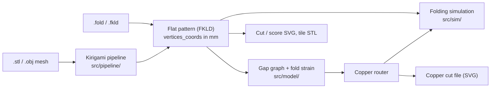

# Traceform

Traceform (the `kiri` repository) turns a 3D model into a flat pattern you can cut, fold and print, and lets you route a copper-tape circuit across that same flat pattern. The router knows which folds the copper has to cross and what each one costs it.

The system goes with the SCF '26 paper *Traceform: A Shared Geometric Representation for Form and Strain-Aware Routed Circuits* (Dayangac, Yalcin, Umur). This site documents the implementation: how it is put together, the reasons behind the main decisions, and where each part lives in the source.

## The idea in one paragraph

Form and circuit share one geometric representation: the flat pattern's `vertices_coords`, in millimetres. The kirigami half writes that pattern as an FKLD file. The electronics half reads the same coordinates, so a routed trace lands in the same SVG frame as the cut and score layers, with no conversion step and no second record of where anything is. The built object is made of rigid tiles joined by flexible hinges. Copper travels on a corridor of crossing points laid along every tile edge and joined by straight chords across tiles. Every hinge it crosses carries a strain price based on that fold's target angle and the measured hinge width, so the router prefers gentle folds and avoids sharp ones.

## Where to start

| If you want to… | Read |
|---|---|
| Build and run it | [Setup](development/setup.md) |
| Understand how the code is split up | [Architecture overview](architecture/overview.md), then [Import boundaries](import-boundaries.md) |
| Know why it was built this way | [Design decisions](architecture/design-decisions.md) |
| Follow a mesh to a cuttable pattern | [Kirigami pipeline](kirigami/pipeline.md), [FKLD and flat patterns](kirigami/fkld.md) |
| Understand the fold preview | [Folding simulation](kirigami/simulation.md) |
| Understand the circuit side | [Electronics overview](electronics/overview.md), then [Fold strain](electronics/fold-strain.md) and [Routing](electronics/routing.md) |
| Add a component | [Parts and footprints](electronics/parts.md) |
| Change the editor | [Electronics editor](electronics/editor.md) |
| Write or fix a test | [Testing](development/testing.md) |
| See how the project got here | [History](development/history.md) |

## Conventions on this site

- Code is cited as `file.ts › symbolName`, never by line number. Line numbers in this repository change quickly; symbol names survive refactors. If a cited symbol no longer exists, the page is out of date.
- Snippets are copied from the source at the time of writing and trimmed with `// …`. The source is authoritative.
- Physical quantities are in millimetres unless stated otherwise. Angles are radians in code, except where a file format says degrees (see [FKLD](kirigami/fkld.md)).
