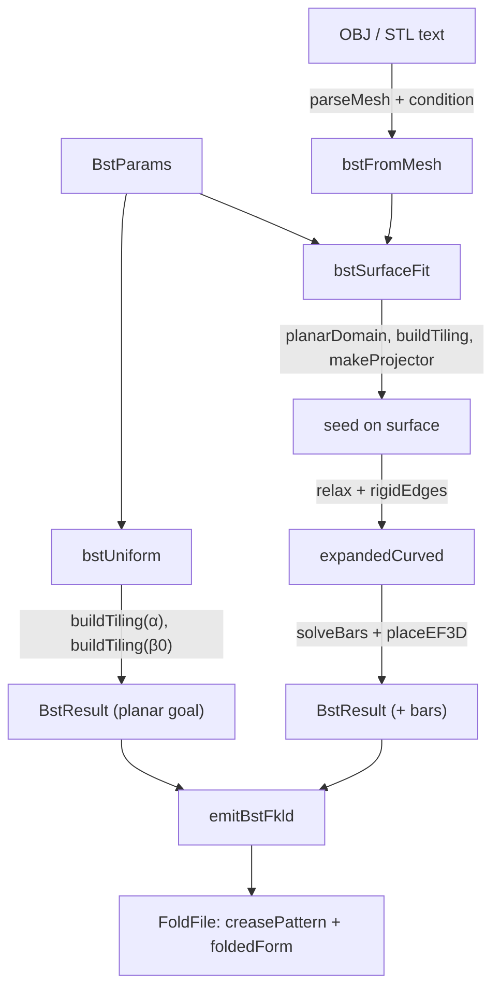

# Bistable star tiling

`src/pipeline/bst/` builds a rotating-tile auxetic kirigami and, optionally, fits its deployed state to a target surface. It emits the flat contracted tiling as the crease pattern and the deployed shape as a goal frame. At the time of writing it is a tested library path that no part of the app UI calls.

## Status at a glance

!!! warning "Not reachable from the app"
    `bstUniform`, `bstSurfaceFit` and `bstFromMesh` are imported only by `tests/current/bst/`. Nothing under `src/` outside `src/pipeline/bst/` calls them, and no script does either. The bundled example `public/examples/bistable-star-tiling.fkld` does **not** come from this module. It is generated by `scripts/gen-bistable-star-tiling.mjs`, a standalone script for a rotating-triangles (kagome) auxetic with no imports from `src/`. The two share a name and nothing else.

What is implemented:

- the star-tiling kinematics (Eq. 1 of the paper) for any slit ratio γ;
- tiling geometry for the **square case only** (α = 0, γ = 1, the classic rotating squares). The concave-star tile profile is marked TODO in `star-tiling.ts`;
- surface fitting by projective dynamic relaxation onto a target mesh;
- bistable-bar inverse design (Eqs. 2 and 3), placement, and self-intersection rejection. On the square geometry every void is rejected, so the emitted pattern has no bars;
- FKLD emission that the 3D Sim deploys in guided mode.

The module history is a single commit (`61496e8`, "chore: Import project from previous repo").

## Background

The header of `types.ts` names the source and summarises the idea:

```ts title="src/pipeline/bst/types.ts"
 * Implements Toyooka & Tachi, DETC2022/MESA-88761 "Programming Surfaces by Bistable Star Tiling
 * Kirigami". A flat sheet is tiled with rigid tiles connected at pivots; the parallelogram voids
 * form a 1-DOF auxetic linkage that expands isotropically by a scale factor as the slit angle θ
 * opens from α (contracted) to β (expanded). Grading the local expansion over the sheet programs
 * Gaussian curvature so the flat sheet deploys into a target surface. Bistable bar elements added
 * to the voids make the structure stable both flat and deployed.
```

This is a different mechanism from the [mesh-to-pattern pipeline](pipeline.md). There, the sheet is cut until it can be laid out isometrically and creases fold it into shape. Here, rigid tiles stay rigid and the voids between them open by different amounts across the sheet, so a flat sheet expands non-uniformly into a curved shape.

## Parameters and types

```ts title="src/pipeline/bst/types.ts › DEFAULT_BST"
export const DEFAULT_BST: BstParams = {
  alpha: 0, // square tiling (validated first; star is α<0)
  gamma: 1,
  beta0: (80 * Math.PI) / 180,
  grid: { nx: 5, ny: 5 },
  epsilon: -0.1,
  relaxIters: 400,
};
```

| Field | Meaning |
|---|---|
| `alpha` | slit angle of the contracted (flat, stable) state, rad. 0 = square; −π/4 < α < 0 = concave star |
| `gamma` | slit edge-length ratio. 1 = square; γ > √2 = star regime |
| `beta0` | slit angle of the uniformly expanded state, rad |
| `grid` | tile grid size |
| `epsilon` | target bar strain (negative = compression) for the bar pass |
| `relaxIters` | iteration cap for surface relaxation |

Conventions match the rest of the pipeline: millimetres and radians, degrees only in `edges_foldAngle`. The module is pure, with no DOM, sim or Three.js imports.

The data types:

- `BstTiling`: deduplicated `vertices`, `tiles` (4 corner ids each, CCW), `voids` (`VoidCell` corner cycles), and the `theta` it was built at.
- `ResultBar`: a void's corners A, B, C, D plus bar endpoints E, F in both the flat (`Ec`, `Fc`) and deployed (`Ee`, `Fe`) states.
- `BstResult`: `contracted` (the crease pattern), `expandedCurved` (3D goal per vertex, same indexing), `driven` flags, and `bars`.

## Data flow



## Tiling kinematics and geometry

```ts title="src/pipeline/bst/star-tiling.ts › tileSpacing"
/** Eq 1 length between adjacent tile centers at slit angle θ: L_θ = √(1+γ²+2γ·sinθ). */
export function tileSpacing(gamma: number, theta: number): number {
  return Math.sqrt(1 + gamma * gamma + 2 * gamma * Math.sin(theta));
}

/** Eq 1 scale factor between two slit angles: s = L_θb / L_θa. */
export function scaleFactor(gamma: number, thetaA: number, thetaB: number): number {
  return tileSpacing(gamma, thetaB) / tileSpacing(gamma, thetaA);
}
```

These two functions are general in γ. `star-tiling.test.ts` checks the paper's limits: a maximum scale of √2 for the square tiling and up to 1 + √2 for γ = √2.

`buildTiling(params, theta)` builds geometry for the square case only. It reads `params.grid` and ignores `alpha` and `gamma`. Tile (i, j) is a unit square centred at (i, j)·P(θ) with P = cos(θ/2) + sin(θ/2), rotated by ±θ/2 in a checkerboard pattern. Two steps are done numerically rather than derived by hand:

- **Hinges** (`hingeMap`). At an open reference angle (π/3), tile corners that coincide are merged into one pivot vertex with union-find. The header gives the reasoning: they stay coincident at every θ, and this "avoids hand-deriving the checkerboard hinge pattern".
- **Voids** (`traceVoids`). The bounded faces of the tile-edge planar graph are traced once at the reference angle. Tile faces and the outer face are discarded, and the vertex cycles stay valid at any θ.

## Uniform tiling

```ts title="src/pipeline/bst/index.ts › bstUniform"
export function bstUniform(params: Partial<BstParams> = {}): { fkld: FoldFile; result: BstResult } {
  const p: BstParams = { ...DEFAULT_BST, ...params };
  const contracted = buildTiling(p, p.alpha);
  const expanded = buildTiling(p, p.beta0);
  const expandedCurved: Vec3[] = expanded.vertices.map((v) => ({ x: v.x, y: v.y, z: 0 }));
  const driven = contracted.vertices.map(() => true);
  const result: BstResult = { contracted, expandedCurved, driven, bars: [] };
  return { fkld: emitBstFkld(result, p), result };
}
```

The crease pattern is the tiling at α, and the goal is the same vertex set at β0, flat at z = 0. Every vertex is driven. `emit-bst.test.ts` checks that the sim takes the guided path and that the fold expands by about the scale factor.

## Surface fitting

`bstSurfaceFit(mesh, params)` (and `bstFromMesh`, which first runs the pipeline's `parseMesh` and `condition`) proceeds in five steps:

1. **Footprint.** `mesh-project.ts › planarDomain` fits a plane (area-weighted mean normal) and takes the 2D bounding box of the mesh projected into it.
2. **Scale.** The β0 tiling is scaled by k so that it fills 90% of the footprint. The contracted α tiling is built at the same k and centred.
3. **Seed.** Each expanded vertex is lifted to the fit plane and projected onto the mesh with `makeProjector`, a closest-point query with exact AABB culling. Its header gives the reason for the culling: the relax loop calls it once per vertex per iteration.
4. **Relax** (`relax.ts › relax`). Jacobi projective averaging between two goals: keep every tile edge and one diagonal per tile at its rest length (`rigidEdges`), and keep every vertex on the surface. Damping defaults to 0.1, and the loop stops when the normalised residual `(maxEdgeErr + maxMeshErr) / meanRest` drops below `tol` (1e-3) or after `relaxIters` iterations.
5. **Bars.** Each void's local scale (deployed over contracted characteristic size) goes to `solveBars`, and kept bars get 3D endpoints from `placeEF3D`.

The result returns `diag: { residual, converged, scale }`. Rigid flat tiles cannot lie exactly on a curved surface, so the `relax.ts` header treats a faceted approximation with a small residual as the correct outcome. `converged` therefore often comes back false on curved targets. For the 6 × 6 dome used in `bistable-bar.test.ts`, a local run at the time of writing ended at a residual of about 0.021 with `converged: false` after 400 iterations.

## Bistable bars

```ts title="src/pipeline/bst/bistable-bar.ts › solveBar"
export function solveBar(alpha: number, beta: number, gamma: number, epsilon: number): { R: number; phi: number } | null {
  const e = epsilon;
  const denom = e * (e + 2);
  if (Math.abs(denom) < 1e-12) return null; // ε=0 → no compliant bar
  const cos = Math.cos((beta - alpha) / 2);
  const disc = ((e + 1) ** 2 * cos - 1) ** 2 - e * e * (e + 2) ** 2;
  if (disc < 0) return null;
  const R = (gamma - gamma * (e + 1) ** 2 * cos) / denom - Math.sqrt(disc) / denom;
  const phi = (alpha + beta) / 2;
  return { R, phi };
}
```

For each four-corner void, `solveBars` inverts Eq. 1 to get the local deployed angle β (`localBeta`), solves (R, φ) with Eqs. 2 and 3, and places E near side AB and F = 2G − E near side CD, where G is the void barycentre. `placeEF` clamps the offset so the endpoints stay inside the void. The header says "the bistability magnitude is approximated, the placement is valid". A void is skipped, with a recorded `reason`, when it has fewer than four corners, when its scale is out of range, when there is no real solution, when φ ≤ 0, or when an endpoint lands inside a neighbouring tile (Sec. 2.4 self-intersection).

!!! info "Why the emitted patterns carry no bars"
    From the `bistable-bar.ts` header: "On the square approximation (α=0) the contracted voids close and the Eq-2 placement self-intersects the flanking tiles across the whole (s,ε) sweep, so every void is (correctly, per Sec 2.4) skipped and the emitted pattern carries 0 bars." Bars would appear once the star tile profile exists in `star-tiling.ts`. Because `buildTiling` ignores α and γ, passing star-regime parameters does not change this. A local run at the time of writing with α = −0.3 and γ = 1.6 on the test dome also produced 0 bars.

The header also limits scope: bars are emitted as rigid members for fabrication. The kinematic sim shows deployment, not the snap-through between the two stable states, which is a material property.

## Emitting FKLD

```ts title="src/pipeline/bst/emit-bst.ts › emitBstFkld"
  for (const tile of contracted.tiles) {
    const [a, b, c, d] = tile;
    faces.push([a, b, c], [a, c, d]); // fan-split the rigid quad
    addEdge(a, b, "B");
    addEdge(b, c, "B");
    addEdge(c, d, "B");
    addEdge(d, a, "B");
    addEdge(a, c, "F"); // shared diagonal of the two triangles (rigid)
  }
```

Each tile is two triangles. Its outline edges are `B` and its diagonal is `F` (fold angle 0). Bars append E and F vertices to both frames, all driven, and five `F` edges each (connectors ABE and CDF, plus the bar). The file follows the same guided-fold contract as the main pipeline: base frame `creasePattern` 2D, `file_frames[0]` a `foldedForm` 3D frame (here with `frame_parent: 0` and `frame_inherit: true`), and `fkld:vertices_driven`. It also writes `fkld:meta_bars` (bar count) and `fkld:meta_architecture` with `source: "bst"`, α, γ and β0. It does not write `fkld:edges_cutType`, because no edge is `C`. See [FKLD](fkld.md) for the keys and [simulation](simulation.md) for how guided files fold.

## Design choices

!!! note "Why tile outlines are B, not C"
    From the `emit-bst.ts` header: tile boundary edges are `"B"` "so `splitCuts` never duplicates the shared pivot/hinge vertices and the tiles stay connected as a linkage". The sim's cut-splitting would otherwise separate the tiles at their pivots. Drawing the slits as cut lines is listed as "a later refinement; correctness of the linkage comes first".

!!! note "Why square first"
    `DEFAULT_BST` comments "square tiling (validated first; star is α<0)", and the `star-tiling.ts` header calls the square case "the plan's square-first path": the rotating-squares auxetic is well understood, and the kinematics functions are already general for when the star profile is added.

| Choice | Alternative considered | Reason (source) |
|---|---|---|
| Hinges and voids found numerically | hand-derived checkerboard topology | "avoids hand-deriving the checkerboard hinge pattern and is checked by the unit tests" (`star-tiling.ts`) |
| Own closest-point code in `mesh-project.ts` | reuse `sim/collision.ts` | the sim routine "is internal to sim/, which the layering rules keep out of pipeline" (`mesh-project.ts`). See [import boundaries](../import-boundaries.md). |
| Relax only the expanded copy | relax both states | "the flat contracted tiling is used as-is for the crease pattern, so only this copy is relaxed" (`relax.ts`) |
| Every vertex driven | drive the boundary only | "full kinematic morph to the surface" (`bstSurfaceFit`) |
| Clamp bar endpoints into the void | emit Eq. 2's R as is | "an oversized bar would self-intersect the tiles, so we fit it" (`bistable-bar.ts › placeEF`) |

Tests live in `tests/current/bst/` and run with `npm run test:bst`. See [testing](../development/testing.md).
