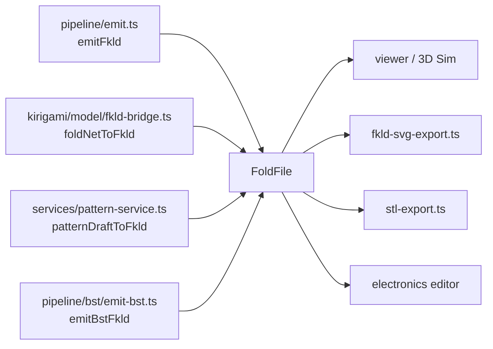

# FKLD flat-pattern format

FKLD is the file format every flat pattern in Traceform is stored, loaded, simulated and exported as. It is a strict superset of FOLD: the standard FOLD keys plus a `fkld:` namespace that plain FOLD tools ignore. This page covers what the app writes, how it reads files, the coordinate frames and units, and the angle conventions that have caused bugs.

## The package and the app's typing

The format core is the npm dependency `@dayangac/fkld` (`^0.2.0` in `package.json`). The package is written in CoffeeScript with hand-written `.d.ts` files, and has four modules:

| Module | Provides |
|---|---|
| `spec` | `KEYS`, the registry of every `fkld:` property name, plus `isRegisteredKey` and `isFkldKey` |
| `cut-types` | `CUT_TYPES` (`major`, `minor`, `seam`, `dart`, `auxetic`, `vent`, `tab`), `CUT_TYPE_INFO`, `validateEdgeCutTypes` |
| `molecule` | edge-molecule parameter arrays and `validateMoleculeArrays` |
| `io` | `serializeFkld` (JSON with trailing newline) and `parseFkld` |

Code never spells an extension key as a string literal when it can use `KEYS`. For example, `KEYS.edges.dihedralTarget` is `"fkld:edges_dihedralTarget"`.

Inside the app, `src/model/fold-file.ts` defines the minimal typing the shell needs:

```ts title="src/model/fold-file.ts › FoldFile"
export interface FoldFile {
  file_spec?: number;
  file_creator?: string;
  file_classes?: string[];
  frame_title?: string;
  frame_classes?: string[];
  frame_attributes?: string[];
  frame_unit?: string;
  vertices_coords?: number[][];
  edges_vertices?: [number, number][];
  edges_assignment?: string[];
  faces_vertices?: number[][];
  /** FKLD extensions (`fkld:edges_cutType`, `fkld:meta_architecture`, …). */
  [key: string]: unknown;
}
```

Only the keys the shell reads are typed. The index signature leaves every `fkld:*` and frame key reachable. `isFkld(file)` is true when any key starts with `fkld:`, and the sim uses it to label a model "kirigami" or "origami" (`src/sim/scene.ts › buildScene`).

## What a pattern contains

### Standard FOLD arrays

| Key | Meaning |
|---|---|
| `vertices_coords` | 2D flat positions (the crease pattern) |
| `edges_vertices` | vertex index pairs |
| `edges_assignment` | `M` mountain, `V` valley, `F` flat facet, `B` boundary, `C` cut |
| `edges_foldAngle` | target fold angle per edge, **degrees** (FOLD spec) |
| `faces_vertices` | triangles (or polygons in hand-made files) |
| `file_frames` | extra frames. Kirigamize writes one `foldedForm` 3D frame here |

### FKLD extensions written by the app

| Key | Per | Written by | Notes |
|---|---|---|---|
| `fkld:edges_cutType` | edge | kirigamize, AKDE bridge, pattern editor | subtype of each `C` edge, null elsewhere |
| `fkld:edges_dihedralTarget` | edge | kirigamize, AKDE bridge | **radians**. Meaning differs by writer, see [angle pitfalls](#angle-units-and-signs) |
| `fkld:edges_moleculeTheta`, `fkld:edges_moleculeWidth` | edge | kirigamize (tucks only), AKDE bridge (V edges) | Tachi molecule θ (rad) and w (mm) |
| `fkld:vertices_angleDefect` | vertex | kirigamize | δ in rad. 0 for vent-synthesized vertices |
| `fkld:vertices_curvatureClass` | vertex | kirigamize | `positive`, `negative`, `flat` or `boundary` |
| `fkld:vertices_reliefStrategy` | vertex | kirigamize | `cut`, `molecule` or `none` |
| `fkld:vertices_driven` | vertex | kirigamize, BST | 1 = held to the goal frame. Not in `KEYS`; defined as `DRIVEN_KEY` in `emit.ts` |
| `fkld:meta_architecture` | file | all writers | `scaleMeters: 0.001` plus writer-specific provenance |

Kirigamize's `fkld:meta_architecture` records `source: "kirigamize"`, `lambda`, `strategy` and `sheet: { widthMm, heightMm, marginMm }`, the paper rectangle from [placement](pipeline.md#placement-and-classification).

!!! info "Cut subtypes and fabrication layer"
    In `@dayangac/fkld`, every cut subtype's `fabricationLayer` is `"cut"`. So `C` means "goes on the cutter's cut path". It does not mean material lies on both sides: a closed shape's unfolded silhouette is all `C`. `printed-joinery.ts › edgeRole` depends on this distinction (see [printed tiles](pipeline.md#printed-tiles-gaps-and-hinges)). The package describes `vent` as an architectural opening that "does not exist for geometric relief". The kirigamize pipeline reuses that subtype for its curvature-relief slivers at saddle vertices.

## Frames and units

### One shared 2D frame

A pattern's base frame is the flat sheet. `vertices_coords` are 2D, and this coordinate space is shared by everything downstream:

- the electronics model. `src/model/electronics.ts` states: "All coordinates are the flat pattern's 2D `vertices_coords` in millimetres (the same space the SVG cut/score export uses), so a routed trace drops straight into a copper layer with the cut/score layers." See [electronics overview](../electronics/overview.md).
- the cut and score SVG and the STL export below;
- the simulator, which treats the flat frame as rest geometry.

### The folded goal frame

Kirigamize and BST output carry the 3D target as a second frame with the same vertex indexing:

```ts title="src/pipeline/emit.ts › emitFkld"
    [DRIVEN_KEY]: driven,
    file_frames: [
      {
        frame_classes: ["foldedForm"],
        frame_attributes: ["3D"],
        frame_unit: "mm",
        vertices_coords: goal3D,
      },
    ],
```

When a file declares a `foldedForm` frame and `fkld:vertices_driven`, the importer folds in guided mode (`src/sim/origami-import.ts › applyDeclaredGoal`). The goal acts as a weak guide force that is released once the fold reaches its target. Where the goal is trustworthy, crease targets are measured from it. Files without a goal fold freely by crease targets. See [simulation](simulation.md).

### Millimetres, and patterns with no real size

Inside the pipeline, units are millimetres by convention (`types.ts`), and kirigamize writes `frame_unit: "mm"`. The input mesh is not rescaled, though, so a mesh modelled a few units across becomes a pattern a few "mm" across. The bundled `house.fkld` is about 4 units wide and still says `"mm"`. `src/model/print-scale.ts` handles this:

```ts title="src/model/print-scale.ts › printScale"
  const longest = Math.max(maxX - minX, maxY - minY);
  if (!(longest > 0)) return 1;
  // The same test the router's tape width uses, so the two cannot disagree about which patterns are
  // scale-less: both axes under the sheet is the same thing as the longer of them being under it.
  return longest < sheetMm ? sheetMm / longest : 1;
```

A pattern smaller than the print sheet (`DEFAULT_PRINT_SIZE = 130` mm, from `stl-export.ts`) is treated as scale-less and cut at sheet size. A pattern at or above sheet size is taken at its stated size and never shrunk. The SVG export, the copper export (`copper-svg-export.ts`), the electronics editor's canvas scale, and the router's tape width (`tape-width.ts › tapeWidthFor`, through `PRINT_SHEET_MM = DEFAULT_PRINT_SIZE`) all apply the same rule. Don't rely on `frame_unit` to find a pattern's physical size. Use `printScale`.

## Angle units and signs

Three things go wrong with recorded fold angles: the unit, the sign convention, and what the number measures.

=== "Units"

    | Key | Unit | Source |
    |---|---|---|
    | `edges_foldAngle` | degrees | FOLD spec. `emit.ts` converts `(t * 180) / Math.PI` |
    | `edges_foldAngles` (plural) | radians | read first by the sim importer, if present |
    | `fkld:edges_dihedralTarget` | radians | written from `signedDihedral` (an `atan2`) |

    Commit `f4eee29` ("feat: Route around mountain folds") fixed a reader that treated both keys as one number:

    ```ts title="src/model/electronics.ts › dihedralMap"
    function dihedralMap(fold: FoldFile): Map<string, number> {
      const out = new Map<string, number>();
      const ev = (fold.edges_vertices as number[][] | undefined) ?? [];
      const degrees = (fold as Record<string, unknown>).edges_foldAngle as number[] | undefined;
      const radians = (fold as Record<string, unknown>)["fkld:edges_dihedralTarget"] as number[] | undefined;
      const raw = degrees ?? radians ?? [];
      const toDeg = degrees ? 1 : 180 / Math.PI;
      // … stores Math.abs(v) * toDeg per edge
    ```

    Its doc comment records the bug: before the fix, "160 degrees of fold [was] reported as 2.8 degrees", so a `> 170` threshold could never fire. See [fold strain](../electronics/fold-strain.md).

=== "Signs"

    The pipeline uses the AKDE solver convention, **mountain positive**:

    ```ts title="src/pipeline/emit.ts › emitFkld"
      // FOLD edges_foldAngle is in DEGREES; AKDE sign convention (M+, V−).
      const edges_foldAngle = sheet.foldAngle.map((t) => (t === null ? null : (t * 180) / Math.PI));
    ```

    The sim importer's default for an edge with no recorded angle follows Origami Simulator instead:

    ```ts title="src/sim/origami-import.ts › targetFoldAngles"
        const rad = faRad?.[i];
        if (typeof rad === "number" && Number.isFinite(rad)) return rad;
        const deg = faDeg?.[i];
        if (typeof deg === "number" && Number.isFinite(deg)) return (deg * Math.PI) / 180;
        switch (ea[i]) {
          case "M":
            return -Math.PI;
          case "V":
            return Math.PI;
    ```

    The pattern editor (`pattern-grid.ts`) uses the same mountain −π, valley +π convention. Because the conventions disagree, `electronics.ts` reads magnitude only and takes the sign from `edges_assignment`: "Guessing a sign convention from a file that does not declare one is how a mountain gets routed as a valley." Follow the same rule in new readers.

=== "Meaning"

    Kirigamize's `fkld:edges_dihedralTarget` is the signed fold angle, where 0 is flat. The AKDE bridge writes something else under the same key:

    ```ts title="kirigami/model/fkld-bridge.ts › dihedralTargetFor"
    function dihedralTargetFor(assignment: EdgeAssignment, gamma: number): number | null {
      switch (assignment) {
        case "M":
          return gamma;
        case "V":
          return 0;
        default:
          return null;
      }
    }
    ```

    Here M carries the pyramid's interior dihedral γ and V carries 0. Before comparing values across files, check `file_creator` or `fkld:meta_architecture`.

## Writers



| Writer | Creator string | Frames | Notes |
|---|---|---|---|
| `src/pipeline/emit.ts › emitFkld` | `"Kiri"` (default) | flat + `foldedForm` | Full extension set. Validates cut types and molecules before returning. See [pipeline](pipeline.md#emit). |
| `kirigami/model/fkld-bridge.ts › foldNetToFkld`, via `fkld-export.ts › buildFkldFile` | `"AKDE"` | flat only | AKDE pyramid. Undoes FoldNet's solver normalisation so coords are mm. Cut subtypes `major`/`minor`. |
| `src/services/pattern-service.ts › patternDraftToFkld` | `"Kiri pattern editor"` | flat only | From `pattern-grid.ts › gridToFold`. `C` edges are `seam`. |
| `src/pipeline/bst/emit-bst.ts › emitBstFkld` | `"kirigamizer: bistable star tiling (BST)"` | flat + `foldedForm` | Not wired into the UI. See [bistable](bistable.md). |

`fkld-bridge.ts` lives in the app rather than in the package because "it is coupled to AKDE's runtime FoldNet / KirigamiState types, not to the FKLD format itself — only the FKLD *keys* come from the package" (its header). A pyramid file without a goal frame is still folded in guided mode: `scene.ts › pyramidInputsFromFold` recovers the pyramid inputs from `fkld:meta_architecture.sourcePyramid`, or failing that from an `N=… L=… H=… T=…` frame title, and `buildScene` recomputes the pyramid from them.

`kirigami/model/` also holds the rest of the AKDE creation model (`types.ts`, `validation.ts`, `pattern.ts`, `geometry.ts`, `constraints.ts`). The main app imports `geometry.ts` (for `computeState` and the molecule math `computeTheta`/`computeW` that `emit.ts` reuses), `fkld-export.ts` and `zip.ts`. `kirigami/model/svg-export.ts` is the AKDE Cricut export used by `kirigami/controller/`. At the time of writing, nothing under `src/` imports it.

## Reading files

`src/services/model-loader.ts › parseLoaded` reads `.fold`, `.fkld` and `.json` with plain `JSON.parse` into a `LoadedModel` of kind `"fold"`. `.obj` and `.stl` become kind `"mesh"` for the [pipeline](pipeline.md). Files are not validated on load: readers check what they need and fall back when a key is missing. For example, `edgeRole` treats a missing assignment as a fold, and `fkld-svg-export.ts` treats it as `B`. Bundled examples are fetched the same way from `public/examples/`.

`src/model/fkld-metadata.ts › summarizeFkldForDisplay` turns a file into ordered sections for the metadata panel: header, topology counts, assignment breakdown (including `U`), cut subtype counts, molecule samples (θ shown in degrees), and a flattened `fkld:meta_architecture`.

## Exports

### Cut and score SVG

`src/model/fkld-svg-export.ts › buildFkldSvgExport` writes any flat FKLD or FOLD pattern as vinyl-cutter layers:

```ts title="src/model/fkld-svg-export.ts › buildFkldSvgExport"
    let role = (assign[i] ?? "B").toUpperCase();
    if (role === "U" && (facesOn.get(a < b ? `${a},${b}` : `${b},${a}`) ?? 0) <= 1) role = "B";
    if (role === "B") {
      boundaryEdges.push([a, b]);
    } else if (role === "C") {
      cutEdges.push([a, b]);
    } else if (role === "M" || role === "V") {
      const seg = shortenedSeg(T(a), T(b), SCORE_END_GAP);
      if (seg) scoreSegs.push(seg);
    }
```

- **Cut layer** (black): `B` edges are assembled into closed loops and filled even-odd as one silhouette. If the loops don't close, they are stroked instead. `C` edges are always stroked on top so no cut disappears into the fill. A closed mesh has no `B` edges, and its stroked `C` lips form the outline.
- **Score layer** (blue): `M` and `V`, each pulled in 1.5 mm at both ends so a crease does not meet a cut.
- `U` edges on the rim (at most one face) are cut as `B`; a `U` edge between two faces is left out. Assignments are upper-cased first, so lower-case letters are read too.
- `F` edges are excluded.

A file whose key frame is a folded form (`frame_classes` containing `"foldedForm"`, `fold-file.ts › isFoldedForm`) is refused with `null`, as it is by the STL export.

Both files share one viewBox in mm (after `printScale` and an 8 mm margin), so they import registered. Y is flipped because FOLD is y-up and SVG is y-down. The result has per-layer files, a combined file, previews, and a zip built with `kirigami/model/zip.ts › createZip` (a store-only writer with no dependencies). Copper layers register against the same sheet (see [electronics export](../electronics/export.md)).

### Printed tiles (STL)

`src/model/stl-export.ts › buildStlExport` writes ASCII STL of the printed tiles. It derives each edge's role from its assignment and face count (`edgeRole`), fans polygons into triangles, and calls `printed-joinery.ts › buildFoldableJoinery` with `layout: "flat"`. With `printSize` set, the export scales the pattern by `printScale`'s rule (up to `printSize` mm across when smaller, never down), centres it, and uses 1.6 mm tiles. Without it, the export stays in model units (as tests use it). The gap defaults to `TILE_INSET_FRAC` and follows the sim's Gap slider. Tile geometry and the subdivision in `tile-subdiv.ts` are described under [printed tiles, gaps and hinges](pipeline.md#printed-tiles-gaps-and-hinges).

### FKLD download

`kirigami/model/fkld-export.ts › buildFkldDownload` and `pattern-service.ts › serializePatternGrid` both produce `{ filename, text }` through `serializeFkld`.

## The pattern editor path

`src/model/pattern-grid.ts` is the secondary design path: a square lattice the user paints with Origami Simulator style assignments, with two paintable diagonals per cell. `gridToFold` always emits a triangulated 2-manifold, splitting each quad along its creased diagonal, or around a centre vertex when both diagonals are creased, "which is what the viewer body fill and the bar-and-hinge sim both require". The module has no FKLD knowledge. `pattern-service.ts` adds the `fkld:` keys (cut subtypes when cuts exist, and a minimal `fkld:meta_architecture`).

## Design choices

!!! note "Why a FOLD superset"
    `fkld-export.ts` describes the FKLD file as what "the architect archives, version-controls, and re-loads later (or hands off to an external FOLD/CAD tool, which sees the standard FOLD subset and ignores the `fkld:*` extensions)". Keeping the standard arrays standard means any FOLD viewer can open a Traceform pattern.

!!! note "Why a pattern smaller than the sheet is scaled up and never down"
    `print-scale.ts` was added after the SVG export "declared house's sheet as 20mm: an 8mm margin and a 5mm carrier border around a 4mm circuit, cut from strips a tenth of a millimetre wide" (commits `aeba067`, `620cb6e`). `tape-width.ts` gives the reason for never shrinking: doing so "measurably degrades routing on the large patterns".

| Choice | Alternative considered | Reason (source) |
|---|---|---|
| Keys from `KEYS`, validators from the package | string literals, app-side validation | `emit.ts`: `KEYS` "is the single source of truth for every extension key". The pipeline "only calls the published fkld validators". |
| Pattern-editor module free of `fkld:` keys | write FKLD directly from the grid | `pattern-grid.ts`: "Pure: no DOM, no FKLD keys (the service owns the `fkld:` namespace)." |
| Sign from `edges_assignment`, magnitude from the file | trust the stored sign | Writers disagree on sign convention (`electronics.ts › dihedralMap`). |
| `B` filled, `C` always stroked in the cut SVG | stroke everything | Keeps the silhouette as one clean cut while "every performed cut is always stroked on top of it (never swallowed by the fill)" (`fkld-svg-export.ts`). |
