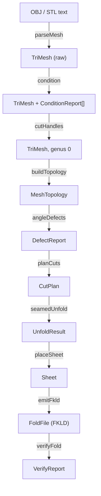

# Mesh-to-pattern pipeline

`src/pipeline/` turns a triangle mesh (OBJ or ASCII STL) into one connected, cuttable flat sheet, writes it as an FKLD file, and folds that file in the simulator to check that it lands back on the input shape. This page covers the stages, the data passed between them, how cuts are chosen, and how the flat sheet becomes printed tiles with hinges between them.

## Where it sits

The pipeline is a pure TypeScript layer. It has no DOM and no Three.js anywhere beneath its barrel, so it runs and tests in plain Node:

```ts title="src/pipeline/index.ts"
/**
 * Pipeline barrel (node-safe, mirrors `src/sim/index.ts`): no DOM and no
 * Three.js imports anywhere beneath this module, so the whole general
 * kirigamize pipeline runs and tests in plain Node.
 */
```

`tests/current/architecture/import-boundaries.test.ts` enforces this (rule R9), and also forbids `pipeline/` from importing views, services, the controller or the app store. See [import boundaries](../import-boundaries.md) and the [architecture overview](../architecture/overview.md).

The app reaches the pipeline through one service. `src/services/pattern-service.ts › kirigamizeMesh` calls `kirigamizeText(text, ext, { verify: true })` and narrows the large `KirigamizeResult` into a `PatternOutcome` (`fkld`, `name`, `summary`, `ok`). The controller never sees stage intermediates.

## Stages and data types

All cross-stage types live in `src/pipeline/types.ts`. Lengths are millimetres and angles are radians everywhere inside the pipeline. The one exception is FOLD's `edges_foldAngle`, which `emit.ts` writes in degrees.



| Stage | File › entry point | Consumes | Produces |
|---|---|---|---|
| Import | `import.ts › parseMesh` | text, `"obj" \| "stl"` | `TriMesh` |
| Conditioning | `conditioning.ts › condition` | `TriMesh` | `{ mesh, reports: ConditionReport[] }` |
| Handle cutting | `handle-cut.ts › cutHandles` | `TriMesh` | genus-0 `TriMesh` + one `ConditionReport` |
| Topology | `mesh.ts › buildTopology` | `TriMesh` | `MeshTopology` (edges, one-ring fans, boundary set) |
| Curvature | `curvature.ts › angleDefects` | `TriMesh`, `MeshTopology` | `DefectReport` |
| Cut planning | `plan-cuts.ts › planCuts` | mesh, topology, defects, `PlanOptions` | `CutPlan` |
| Seamed unfold | `unfold.ts › seamedUnfold` (flat layout in `flat-layout.ts`) | mesh, topology, `CutPlan`, defects | `UnfoldResult` |
| Placement and classification | `route-seams.ts › placeSheet` | `UnfoldResult`, `PackContext` | `Sheet` |
| Emit | `emit.ts › emitFkld` | `Sheet`, `EmitOptions` | `FoldFile` |
| Verify | `verify.ts › verifyFold` | `FoldFile`, target `TriMesh`, `VerifyOptions` | `VerifyReport` |

Every stage throws `PipelineError`, a subclass of the app-wide `AppError` (domain `"pipeline"`) that carries a `stage` tag. The controller can then show `"<stage>: <message>"`, and tests can assert which stage failed.

### Provenance: `origVertex` and `goalPos`

The contract that must survive every stage is the provenance pair. The header of `types.ts` describes it:

```ts title="src/pipeline/types.ts"
 * The one cross-milestone contract that must never break is the provenance
 * pair `origVertex` + `goalPos`. `origVertex` maps flat/sheet vertex index →
 * source target-mesh (Q) vertex index, with −1 for vertices SYNTHESIZED by
 * K1 vents — so it answers "which Q vertex?" but not "where must this vertex
 * land?". `goalPos` does: a folded-target position on Q for EVERY vertex
 * (including synthesized ones), the authoritative source of the emitted
 * guided-fold goal frame.
```

Cutting duplicates vertices (one copy per fan wedge) and vents create new ones. `goalPos` is what lets `emit.ts` write a 3D goal position for every flat vertex, and `verify.ts` folds toward that frame.

## The driver

`kirigamize.ts › kirigamize` runs the stages in order and returns every intermediate:

```ts title="src/pipeline/kirigamize.ts › kirigamize"
  // Stage 0: condition → cut handles (genus>0 → genus 0) → genus gate.
  const conditioned = condition(input);
  const handle = cutHandles(conditioned.mesh); // no-op for a genus-0 surface
  const mesh = handle.mesh;
  const reports = [...conditioned.reports, handle.report];
  const topo = buildTopology(mesh);
  assertGenusZero(mesh, topo); // now passes: any handles have been slit open

  // Stage 1: curvature.
  const defects = angleDefects(mesh, topo);

  // Stages 2–4 as a re-runnable unit (the optimize schedule re-plans once).
  const runPipeline = (extraTerminals: number[]) => {
    // … planCuts → seamedUnfold → placeSheet → emitFkld
  };
```

Stages 2 to 4 (plan, unfold, place, emit) are wrapped in `runPipeline` so that verification can re-plan with an extra cut terminal. `KirigamizeResult` holds `fkld`, `conditioning`, `defects`, `plan`, `unfold`, `sheet` and `report`.

The options and their defaults are in `DEFAULT_KIRIGAMIZE`: `lambda: 0`, `strategy: "dart"`, `tuckCostScale: 1`, `leafPruning: false`, `leafPruneDeltaMax: π/4`, `pruneRelief: false`, plus `epsilonRel`, `verify` and `iterations` taken from `DEFAULT_VERIFY`.

## Import and conditioning

`parseMesh` is a text-in, DTO-out parser. OBJ faces may use slashes and negative indices, and n-gons are fan-triangulated. ASCII STL is read as triangle soup. Binary STL is detected and rejected with an actionable message. The header gives the reason: `readAsText` garbles binary STL silently otherwise.

`condition` composes four passes. Each pass is a pure `TriMesh → { mesh, report }`, so the UI can show what was repaired and tests can run passes in isolation:

1. `weldVertices`: merges coincident vertices quantised to 1e-4 mm. A vertex with no match in its own cell also welds to a vertex in a neighbouring cell within 1e-4 mm per axis, so copies straddling a cell boundary still merge. STL soup depends on this pass.
2. `dropDegenerates`: removes zero-area faces and unreferenced vertices.
3. `keepLargestComponent`: keeps the largest edge-connected shell. The drop is written to the audit trail, so a discarded body does not vanish silently, and `pattern-service.ts › kirigamizeMesh` adds a warning to the status line ("only the largest shell was kirigamized") and sets `PatternOutcome.ok` to false.
4. `orientFaces`: makes winding consistent by BFS across shared edges, and throws if the surface is non-orientable. A duplicate face (two faces on the same three vertices) or a non-manifold edge (shared by more than two faces) would also fail that check, so each is caught first and thrown under its own name.

`assertGenusZero` computes genus from the Euler characteristic, boundary loop count and component count (`g = (2C − b − χ)/2`). It rejects meshes with more than one component or with genus above zero.

### Handle cutting

Before that gate runs, `cutHandles` slits open any handles, so a torus-like mesh becomes a genus-0 surface with extra boundary. It uses a tree-cotree decomposition: a primal spanning tree, a dual spanning tree over the remaining edges, and the leftover edges as homology generators. Each generator plus its tree path forms a loop to cut. The surgery reuses `unfold.ts › cutAlongEdges`. Rounds are capped at `MAX_ROUNDS = 8`. The result is deliberately not re-welded, because welding would merge the lips back together.

## Curvature

`curvature.ts` is the only place angle defects are computed:

- `angleDefects`: δ(v) = 2π − Σαᵢ(v) per interior vertex, classified as `positive`, `negative` or `flat` (|δ| ≤ `FLAT_EPS` = 1e-6). Boundary vertices report 0 and `boundary`. These four classes match the `fkld:vertices_curvatureClass` enum.
- `signedDihedral`: the fold angle at an interior edge, with mountain positive. Planning and classification both use it.

A δ > 0 vertex (a cone point, such as a cube corner) has too much curvature to lie flat and needs material removed. A δ < 0 vertex (a saddle) has too much material and needs a vent.

## Cut planning

`plan-cuts.ts › planCuts` decides where cuts go, under one invariant stated in its header: **the cut sheet must stay one connected piece**.

### Terminals

Each vertex gets an action in `CutPlan.perVertexAction`:

| Class | Action | Becomes a cut terminal |
|---|---|---|
| δ > 0 | `dart` (default), or `tuck` under `strategy: "tuck-all"` or a losing `hybrid` comparison | if `dart` |
| δ < 0 | `slit` | always ("tucking cannot supply missing angle") |
| flat or boundary | `none` | no |

Under `hybrid`, a vertex is darted when its weighted path to the boundary costs no more than `tuckCostScale · δ(v) · r̄(v)`, where r̄ is the mean one-ring edge length. A closed mesh has no boundary path, so it falls back to dart. `extraTerminals` lets the verifier add a vertex on a retry.

### Edge weights and connection

```ts title="src/pipeline/plan-cuts.ts › planCuts"
  // --- Edge weights: w(e) = len(e) + λ·vis(e), vis(e) = 1 − |θ_e|/π. ------
  // Boundary edges (θ undefined): vis = 1 (no fold → full visual penalty).
  const dihedrals = topo.edges.map((edge, e) =>
    edge.faces.length === 2 ? Math.abs(signedDihedral(mesh, topo, e)) : 0,
  );
  const weights = topo.edges.map((_, e) => {
    const vis = 1 - dihedrals[e] / Math.PI;
    return edgeLength(mesh, topo, e) + lambda * vis;
  });
```

With λ > 0, sharp ridges get cheaper, so cuts tend to follow existing fold lines where they are less visible. At the default λ = 0, routing is by length only.

Terminals are then connected:

1. Dijkstra (`shortestPaths`) from each terminal. Boundary vertices are passed as `noTransit`: a path may end on the boundary but never pass through it.
2. Each boundary loop acts as one pseudo-terminal (`boundaryLoops`). Prim's MST runs over the metric closure of the terminals and the loops, so each loop joins the tree at most once. With more than one loop the tree also joins the loops to each other, even with no cut terminals, which is what lets an open cylinder flatten with one rim-to-rim seam.
3. Each MST pair is expanded back into mesh-edge paths, and `spanningForest` prunes any cycles the union created.
4. Special case: one terminal on a closed mesh gets a single dangling slit along its cheapest edge.
5. With `leafPruning` on, degree-1 dart leaves with δ below `leafPruneDeltaMax` are demoted to tucks and their branch is removed.

A forest with at most one contact per boundary loop cannot disconnect the sheet. `CutPlan.cost` records total length, the visibility term and λ.

## Seamed unfolding

`unfold.ts › seamedUnfold` cuts the mesh along the plan, adds vents, lays the result flat, and adds relief cuts until the layout has no overlaps.

```ts title="src/pipeline/unfold.ts › seamedUnfold"
  for (let pass = 0; pass <= RELIEF_MAX; pass++) {
    const cut = cutAlongEdges(mesh, topo, [...cutSet], ventAngles);
    const components = labelComponents(cut.mesh);
    if (components.count !== 1) {
      throw new PipelineError(
        "unfold",
        `cut plan disconnected the sheet into ${components.count} pieces — a proper kirigami is one connected sheet (planner bug)`,
        { components: components.count },
      );
    }

    const allFaces = cut.mesh.faces.map((_, f) => f);
    const flat = unfoldPatch(cut, allFaces);
    const overlap = findSelfOverlap(flat, cut.mesh.faces);
    // … return on no overlap; otherwise addReliefCut and loop
```

**Cutting** (`cutAlongEdges`). Each vertex is split into one copy per fan wedge, using cut edges as separators. Each cut edge's two boundary copies are recorded as a `LipPair`.

**Vents.** At every δ < 0 slit vertex, `cutAlongEdges` removes a sliver of total angle |δ| from the larger wedge, starting at its leading lip. Whole faces are consumed while they fit, and the face where the remainder lands is split. After this, every interior vertex carries exactly 2π of flat material. The slit is zero-width in the flat pattern and opens into a small hole when folded. Each sliver is recorded as a `VentRecord`.

**Flattening** (`flat-layout.ts › unfoldPatch`, with the overlap tests `findSelfOverlap` and `countFlatOverlaps`). A BFS over the face dual places each new face from its shared edge, using 3D edge lengths, so the layout is isometric by construction. A mismatch on a non-tree edge throws, because that means the patch was not developable (a planner bug, not a relief case).

**Relief** (`addReliefCut`). When two flat faces overlap, the stage routes a shortest interior path from the existing cut graph or boundary to the later face's vertex, so that limb swings free on the next pass. Every candidate is test-cut first and accepted only if the sheet stays in one piece. When the cut graph already reaches every vertex and any addition would close a cycle, it falls back to a greedy add-or-swap search that must strictly reduce the overlap count. The loop is capped at `RELIEF_MAX = 64`.

**Optional pruning** (`pruneRelief`). Afterwards, each relief edge is re-tested in reverse order and dropped if the sheet still develops cleanly without it. Planned cuts are never offered for removal. The pass is capped at `PRUNE_MAX_PASSES = 4` and `PRUNE_MAX_TRIALS = 256`.

## Placement and classification

`route-seams.ts › placeSheet` takes the single flat piece and:

- translates it into the positive quadrant with a margin (default 5 mm), recording `sheetRect` (`widthMm`, `heightMm`, `marginMm`);
- builds sheet topology, in which coincident slit lips stay separate edges because they have separate vertex indices;
- classifies every edge and measures fold targets on the goal pose (sheet faces placed at `goalPos`).

```ts title="src/pipeline/route-seams.ts › placeSheet"
    if (edge.faces.length === 1) {
      if (ventKeys.has(key)) {
        assignment.push("C");
        foldAngle.push(null);
        cutType.push("vent");
      } else if (lipKeys.has(key)) {
        assignment.push("C");
        foldAngle.push(null);
        cutType.push(lipSubtype(topo, defects, lipKeys.get(key)!));
      } else {
        assignment.push("B"); // original ∂Q boundary (cut from the sheet rect)
        // …
      }
    } else {
      const theta = signedDihedral(goalMesh, sheetTopo, e);
      assignment.push(theta > FLAT_EPS ? "M" : theta < -FLAT_EPS ? "V" : "F");
      foldAngle.push(theta);
      cutType.push(null);
    }
```

| Edge | `edges_assignment` | `fkld:edges_cutType` |
|---|---|---|
| Vent sliver boundary | `C` | `vent` |
| Lip with a δ > 0 endpoint | `C` | `dart` |
| Other lip (zero-width slit that seals) | `C` | `seam` |
| Original mesh boundary | `B` | null |
| Interior, θ above / below / within ±`FLAT_EPS` | `M` / `V` / `F` | null |

The header notes that `minor` and `major` are no longer used by this pipeline. They remain AKDE pyramid vocabulary (see [FKLD](fkld.md)).

## Emit

`emit.ts › emitFkld` writes the `Sheet` as an FKLD object. The base frame is the flat 2D crease pattern. `file_frames[0]` is a 3D `foldedForm` frame holding `goalPos`, and `fkld:vertices_driven` marks every vertex on a `B` or `C` edge. Per-vertex defect, curvature class and relief strategy are mapped through `origVertex`. Synthesized vent vertices get defect 0 and class `boundary`. Tucked vertices get molecule annotations (θ = δ/N, w = 2·s̄·sin(θ/2)) on their incident creases, as metadata only.

```ts title="src/pipeline/emit.ts › emitFkld"
  // FOLD edges_foldAngle is in DEGREES; AKDE sign convention (M+, V−).
  const edges_foldAngle = sheet.foldAngle.map((t) => (t === null ? null : (t * 180) / Math.PI));
```

The same targets are also written in radians to `fkld:edges_dihedralTarget`. Before returning, `emitFkld` runs the package validators `validateEdgeCutTypes` and `validateMoleculeArrays`, and throws `PipelineError("emit")` on failure. The full key list, units and angle pitfalls are on the [FKLD page](fkld.md).

## Verify

`verify.ts › verifyFold` folds the emitted file with the CPU `FoldSolver` and measures the result against the conditioned mesh. Its header describes a two-phase fold from flat:

- **Phase A, kinematic transport.** Every vertex is driven linearly from rest to goal. The mean tensile bar strain at fold percentages 0.25, 0.5 and 0.75 is recorded as `pathStrain`. It is close to 0 only when flat and goal edge lengths agree.
- **Phase B, release and settle.** Only sheet-boundary vertices stay pinned, and the solver relaxes. The folded state has to hold under the pattern's own bars and creases.

Metrics after phase B are the sampled symmetric Hausdorff distance `dH` (after Kabsch alignment without reflection), mean and max strain, and the crease-angle residual. Q→folded samples inside declared vent holes are skipped, because a vent legitimately leaves a hole. An equilibrium check (start at the goal and measure drift) is also reported but never decides the result alone. `converged` requires a settled fold, `dH ≤ ε`, strain and crease residuals within tolerance, and `pathStrain ≤ 2 × strainTol`. The defaults in `DEFAULT_VERIFY` are `epsilonRel: 0.05`, `iterations: 16000`, `strainTol: 0.1`, `creaseTol: 0.15`.

Both scenes are rescaled to about unit span before solving. The header explains why: the explicit solver's timestep bound assumes axial stiffness far exceeds crease stiffness, which the display normalisation breaks badly enough to make solves explode.

### Retry schedule

`kirigamize` allows up to three attempts and keeps the best report by `foldFromFlat.dH`:

1. Verify at `iterations`.
2. If not converged, verify the same pattern at 3 × `iterations`.
3. If still not converged, re-run `runPipeline([report.worstSourceVertex])`, which adds the worst-fitting vertex as an extra cut terminal, and verify again.

`kirigamize.test.ts` pins this order. When `converged` is false the result is still usable: `pattern-service.ts` reports that the model is shown at its folded form ("guided") rather than as an error. See [simulation](simulation.md) for how the viewer folds it.

## Printed tiles, gaps and hinges

The flat sheet is fabricated in two ways. Vinyl is a thin flexible sheet cut and scored from the [SVG export](fkld.md#cut-and-score-svg). The printed build is rigid tiles on a flexible backing, where the bare strip between two tiles is the hinge. The tile geometry lives in `src/model/printed-joinery.ts`, which `stl-export.ts` and `scripts/gen-house-door.ts` share. Its header says it is matched to the 3D Sim's `updatePrintedTiles` "so what you see is what you cut".

Each triangular face becomes a hexagon `[A, mAB, B, mBC, C, mCA]`. Corners stay full, because neighbouring tiles meet there as pivot points. An edge midpoint is pulled inward by `gap · inradius · 2` only where the edge is a real joint, which opens a diamond-shaped gap between the two tiles. Which edges count is decided by `edgeRole`:

```ts title="src/model/printed-joinery.ts › edgeRole"
export function edgeRole(assignment: string | undefined, faceCount: number): EdgeRole {
  if (assignment === "F") return "boundary"; // flat-facet triangulation diagonal interior to ONE polygon —
  //   NOT a joint: stays full so coplanar triangles merge into a single rigid tile (matches the sim)
  if (faceCount <= 1) return "boundary"; // outer rim or cut-open silhouette — straight, clean perimeter
  if (assignment === "C") return "cut"; // a slit with tiles on both sides — pinched open
  return "merge"; // real M/V interior fold — pinched open, the hinge the tiles fold about (corners meet)
}
```

Because kirigamize writes each lip with its own vertices, its `C` edges have one incident face and stay straight. The gaps open on `M` and `V` creases.

`src/model/tile-subdiv.ts` holds the shared constants and the optional subdivision:

- `TILE_INSET_FRAC = 0.16` is the default gap. The 3D Sim's Gap slider moves it within `MIN_TILE_GAP`..`MAX_TILE_GAP`, and the electronics editor follows that slider (`setTileGap`).
- `TILE_THICK_FRAC = 0.018` is the tile thickness as a fraction of the flat bounding-box diagonal.
- `planSubTiles` splits the faces that fold hardest into 4^depth coplanar sub-tiles, up to the Detail slider's cap (`DEFAULT_MAX_SUBDIV = 0`, so no split by default). Total output is capped at `MAX_PRINTED_TILES`. The split adds no physics hinges.

Gap and thickness together limit how far a printed hinge can close. `src/sim/origami-import.ts › applyPrintedClosure` uses θ_max = 2·atan(g/t), where g comes from the two tiles' inradii and t from `TILE_THICK_FRAC`. A finer subdivision makes smaller tiles and smaller gaps, so the print can fold less far. See [simulation](simulation.md). Copper routing runs through these same gaps. See [electronics overview](../electronics/overview.md) and [fold strain](../electronics/fold-strain.md).

## Design choices

!!! note "Why one connected sheet"
    The cut planner, the unfold stage and placement all enforce one piece. `plan-cuts.ts` builds a forest with at most one contact per boundary loop for that reason. `seamedUnfold` throws when a plan splits the sheet ("planner bug"), and `placeSheet` throws on `patchCount !== 1`. Multi-patch shelf packing was removed in favour of a single translation (`route-seams.ts` header).

!!! note "Why the driver returns every intermediate"
    `kirigamize.ts` is a facade that returns all stage artifacts "so tests and the UI can introspect without re-running", after AKDE's `computeState` chain. `pattern-service.ts` narrows this to `PatternOutcome`, so the wide shape stays a pipeline and test contract.

!!! note "Why vents at saddles"
    The planner header says that δ < 0 closure is handled by vents in the unfold: a slit that reaches the vertex plus a removed sliver of |δ| makes the flat material exactly 2π, "no fan-splitting wedge rule, no extra tears". `vents.test.ts` checks the 2π invariant on every interior vertex.

!!! note "Why fold targets come from the goal pose"
    `placeSheet` measures each crease's dihedral on the sheet placed at `goalPos` rather than looking it up on the source edge. The header says this is "uniform for synthesized vent vertices (origVertex −1) and exactly the dihedral the crease must reach".

??? info "Why verification drives the boundary and checks residuals"
    On coarse meshes most vertices lie on a lip or the boundary, so a driven fold places them by construction and `dH` alone would always pass. `emit.ts` therefore leans on bar strain (the isometry check) and crease-angle residual (which catches M/V errors). It also records that "a free-lip mechanical fold was tried and reverted: without collision handling the explicit solver settles in frustrated mirror equilibria". `verify.ts` explains the two phases: with only the boundary driven, crease reactions push free ridge vertices toward the mirror side, so phase A moves them kinematically and phase B checks that they stay.

| Choice | Alternative considered | Reason (source) |
|---|---|---|
| `lambda = 0` default | visibility-weighted routing | At λ = 0 "the result is identical to the original length-only routing"; λ > 0 is opt-in (`plan-cuts.ts`). |
| `pruneRelief = false` default | always prune relief cuts | "measured headroom is small … relief edges are usually individually load-bearing" and each trial is a full re-cut and re-unfold (`KirigamizeOptions.pruneRelief`). |
| Dart, with tuck metadata only | Origamizer tuck creases | Tuck crease generation is deferred. `tuck-all` on a non-developable mesh throws an explicit error that recommends `"dart"` (`kirigamize.ts`, `emit.ts`). |
| Cut handles up front | reject genus > 0 | "Kirigami already *is* cutting, so the natural fix is to cut the handle loops up front" (`handle-cut.ts`). |
| Write a new emitter | extend AKDE's `foldNetToFkld` | That bridge "is hard-coupled to the pyramid KirigamiState" (`emit.ts`). |
| O(V²) Dijkstra, brute-force Hausdorff | heaps, BVH | Inputs are coarse. Decimation is out of scope and the pipeline documents "coarse flat-faceted input required" (`conditioning.ts`, `plan-cuts.ts`, `verify.ts`). |
| `C` with one face stays straight in tiles | pinch every `C` | Commit `9bd96b8` ("feat: Model taped seams as hinges"): pinching the cut-open silhouette "scalloped every outer tile of the printed house". |

!!! warning "Stale comments in the source"
    Some comments no longer match the code. `unfold.ts`'s header still mentions "the M2 wedge rule", which vents replaced. Trust the code. (The `kirigamize.ts` retry order and the `emit.ts` pointer to `applyDeclaredGoal` were corrected in `b9b8678`.)

Related: [bistable star tiling](bistable.md) is a separate pattern generator that reuses this pipeline's import and conditioning. [Testing](../development/testing.md) covers `tests/current/pipeline/`.
