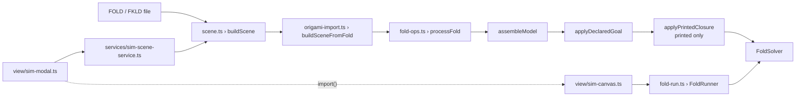

# Folding simulation

`src/sim/` folds a flat FOLD/FKLD pattern into 3D with a bar-and-hinge mass-spring model (Ghassaei, Demaine and Gershenfeld's method, ported from Origami Simulator), so a pattern can be checked by folding it rather than by looking at it. This page covers how a file becomes a simulation model, the forces and integrator, how a fold is driven and stabilised, the 3D-printed mode, collision, strain, and the views that put it on screen.

## Where it sits

The simulator is a pure TypeScript core with no DOM and no three.js, wrapped by a service that picks and caches a scene and a lazily loaded three.js viewport that renders it.



| Module | Role |
|---|---|
| `scene.ts` | Chooses the build path for a loaded file and reports the mode (`guided` / `free`) and kind (`kirigami` / `origami`). |
| `fold-adapter.ts` | Thin re-export facade over `origami-import.ts`. |
| `origami-import.ts` | FOLD/FKLD to `BarHingeModel`: assembly, declared goal, seams, kinematic drive, printed closure. |
| `fold-ops.ts` | Port of Origami Simulator's `pattern.js` preprocessing: cut splitting, triangulation, winding-consistent crease records. |
| `svg-import.ts` | Port of Origami Simulator's SVG loader: crease-pattern SVG to FOLD. |
| `foldnet.ts`, `build.ts` | Analytic FoldNet for the AKDE uniform pyramid, and the guided pyramid scene built from it (now a fallback path). |
| `model.ts` | `BarHingeModel` (struct-of-arrays), `SolverParams`, `DEFAULT_PARAMS`, `buildModel`. |
| `forces.ts` | Reference force passes, the integrator, and the stable timestep. |
| `solver.ts` | `FoldSolver`: one step, quasi-static `solve`, headless `solveUntilSettled`. |
| `stabilize.ts` | Velocity passes that drain jitter: kinetic quench, damping, rigid-body removal, divergence guard. |
| `fold-run.ts` | `FoldRunner`: the per-frame cadence the viewer runs. |
| `fold-kinematics.ts` | Panel-tree fold pose used as the guide target. |
| `collision.ts` | Penalty self-collision. |
| `strain.ts` | Tensile bar-strain measures. |
| `gpu/` | WebGL solver (`GpuFoldSolver`), its data packing and GLSL. Not on the live path. |
| `vec3.ts` | Compatibility re-export of `core/vec3.ts`. |
| `index.ts` | The Node-safe public barrel. |

## From a file to a model

### Choosing the path

`scene.ts › buildScene` is the single entry the app uses. Every file with vertices, faces and edges (`isFoldable`) goes through `buildSceneFromFold`. If the result has driven nodes the mode is `guided`, otherwise `free`. Two fallbacks remain for the AKDE pyramid generator: a legacy FKLD pyramid with no declared folded form, and a non-foldable file whose `fkld:meta_architecture.sourcePyramid` or `frame_title` still encodes N/L/H/T, are rebuilt with `build.ts › buildFoldScene` from the analytic FoldNet.

```ts title="src/sim/scene.ts › buildScene"
  if (isFoldable(fold)) {
    // Folds the file's own geometry: cuts split open (kirigami), creases ramp via foldPercent.
    // The importer infers the mode from the file: a file that declares a folded-form footprint
    // (foldedForm frame + fkld:vertices_driven) is driven to it; everything else free-folds.
    const scene = buildSceneFromFold(fold, paramsFor(material), { printed });
    if (anyDriven(scene.model.driven)) return { scene, mode: "guided", sim: isFkld(fold) ? "kirigami" : "origami", material };
    // …
    return { scene, mode: "free", sim: isFkld(fold) ? "kirigami" : "origami", material };
  }
```

FKLD is treated as FOLD with cuts, so origami and kirigami share one engine. See [fkld.md](fkld.md) for the format itself.

### Fold targets

Before any topology changes, `origami-import.ts › targetFoldAngles` assigns each edge a target dihedral, in priority order: `edges_foldAngles` (radians), `edges_foldAngle` (degrees), then the assignment default (M = -π, V = +π, F = 0, anything else is not a crease). This is Origami Simulator's import policy: fold a flat pattern fully unless the file says otherwise.

### Preprocessing

`fold-ops.ts › processFold` makes the coordinates 3D, then:

1. `demoteBoundaryCuts` relabels any `"C"` edge with fewer than two incident faces as `"B"`. In this project `C` names the cutter layer, and a one-faced `C` is a seam lip on the sheet's outline, not a slit with material on both sides.
2. `splitCuts` (only if real cuts remain) duplicates each cut edge and the vertices around it, so the two lips become independent nodes that can open into a gap. `originOf` records which source vertex each split vertex came from.
3. `triangulatePolys` triangulates polygons, adding `"F"` facet diagonals.
4. `getFacesAndVerticesForEdges` extracts, per M/V/F crease, its two faces and opposite wing vertices in a winding-consistent order, so the measured dihedral sign is reliable.

```ts title="src/sim/fold-ops.ts › processFold"
  // Decide what is actually a cut BEFORE asking whether there are any: a "C" that is really the
  // sheet's own outline leaves nothing to open, and a sheet with no cut left in it must not be put
  // through `splitCuts` at all — its boundary branch tears silhouette corners apart too.
  if (split) demoteBoundaryCuts(fold);
  const hasCuts = split && fold.edges_assignment.some((a) => a === "C");
  if (hasCuts) {
    splitCuts(fold);
    removeRedundantVertices(fold, 0.01);
  }
```

### Assembly

`origami-import.ts › assembleModel` centres the geometry and scales it to a bounding-sphere radius of 1 (Origami Simulator does the same, so stiffness ratios and the timestep stay in a stable regime). It then builds:

- one **beam** per edge, `k = EA / l0`, flagged `free` when the edge is a boundary or cut lip;
- in printed mode, an extra axial **brace** between the two wing vertices of every facet crease (`rigidFacets`);
- one **crease** per M/V/F edge, `k = kFold · l0` for M/V and `kFacet · l0` for F, with `targetTheta` from the step above;
- one **face** record per triangle with its three rest interior angles.

All nodes have unit mass.

### Declared folded form

`applyDeclaredGoal` looks for a `foldedForm` frame plus `fkld:vertices_driven`. If found, the declared form is used several ways:

- Its dihedrals become crease targets wherever the goal is trustworthy (globally isometric, mean beam strain below 5%, or a crease whose four nodes are all driven). Targets are clamped to ±2.7 rad (`MAX_FOLD`), just short of the flat-fold singularity.
- Its positions become `model.goal`, aligned to the rest pose by matching the driven nodes' centroids (translation only), and driven nodes get a soft guide spring (`softDriven`, `guideWeight = 1`) instead of a pin.
- Coincident node pairs in the goal become **seams** (`buildSeams`), and each lip pair also gets a **seam hinge** (`buildSeamCreases`).
- `adoptFoldKinematics` decides whether the guide can aim along the net's own panel kinematics (see [Fold kinematics](#fold-kinematics)).

Only `pipeline/verify.ts` asks for `pinDeclaredGoal: true`, which hard-pins driven nodes for its kinematic transport audit.

### SVG crease patterns

`svg-import.ts › importOrigamiSimulatorSvg` turns an Origami Simulator SVG into a FOLD object: stroke colour gives the assignment (black B, red M, blue V, green C, yellow F, magenta U) and stroke opacity gives the angle (mountain `-opacity·π`, valley `+opacity·π`), followed by the original clean-up and face-finding pipeline. The result then takes the normal `buildSceneFromFold` path. In the current tree it is called from `scripts/gen-res-tower.ts` (which regenerates `public/examples/res-square-tower.fkld`) and from its tests. No app UI calls it.

## The bar-and-hinge model

`BarHingeModel` is struct-of-arrays: every component is a flat typed array indexed by entity id. The layout mirrors Gershenfeld's GPU texture layout, so the same data can be packed into float textures for the GPU path, and the CPU code stays unit-testable in Node.

| Element | Stored in | Law | Notes |
|---|---|---|---|
| Beam (bar) | `beams` | axial spring `k = EA/l0` plus viscous damping | Free edges go slack in compression. |
| Crease | `creases` | torsional spring toward `targetTheta · foldPercent` | Over four nodes: wings `n1`, `n2`, hinge `n3`, `n4`. |
| Face | `faces` | interior-angle spring `kFace` | Resists in-plane shear. |
| Seam | `seams` | spring pulling a lip pair to the goal separation | Ramped by `foldPercent⁴`, limited reach. |
| Seam hinge | tail of `creases` (`seamPeer3/4`, `seamCreases`) | torsional, like an M crease | Active only once the lips have met. |
| Goal spring | `goal`, `driven`, `softDriven`, `guideWeight` | `kGoal · guideWeight · (target − p)` | The soft guide; released at the end of a fold. |
| Thickness barrier | `creases.thetaMax`, `kBarrier` | one-sided torsional push-back | Printed mode only. |
| Contact | `collide` | penalty repulsion | Optional, see [Collision](#collision). |

`SolverParams` holds the constants. `ORIGAMI_PARAMS` (vinyl and paper) matches Origami Simulator's globals: `EA = 20`, `kFold = kFacet = 0.7`, `kFace = 0.2`, `zeta = 0.85`, `beamDampingScale = 0.5`. `PRINTED_PARAMS` is covered under [3D-printed mode](#3d-printed-mode).

## Force laws

`forces.ts` holds the reference equations as plain functions over the model. A solver step runs them in the order of the paper's GPU passes.

### Axial bars and damping

```ts title="src/sim/forces.ts › accumulateForces"
    if (l < l0 && m.beams.free?.[i]) k *= m.params.freeEdgeSlack ?? FREE_EDGE_SLACK;
    const f = (k * (l - l0)) / l; // force magnitude / length → multiply by d
    // axial: pull both ends toward rest length
    F[3 * a] += f * d.x;
    // …
    // viscous damping between neighbours: c·(v_neighbor − v), c = 2ζ√(k·m_min)
    const c = 2 * zeta * m.params.beamDampingScale * Math.sqrt(k * Math.min(m.mass[a], m.mass[b]));
```

The bar force is `F = k (l − l0) d / l` along the bar, and the damping force is `c (v_other − v)` with `c = 2 ζ · beamDampingScale · sqrt(k · m_min)`. A free edge (boundary or cut lip) in compression has its stiffness multiplied by `FREE_EDGE_SLACK`. This is the tension-field approximation for a membrane: a real sheet's unbraced edge bows out of plane instead of acting as a strut.

### Fold angle

```ts title="src/sim/forces.ts › computeThetas"
    let x = dot(n1, n2);
    x = Math.max(-1, Math.min(1, x));
    const y = dot(cross(n1, ehat), n2);
    let theta = Math.atan2(y, x);
```

`θ = atan2((n1 × ê) · n2, n1 · n2)`, where `ê` is the unit hinge vector from `n3` to `n4`. For scored creases θ is unwrapped against the previous step's value so it tracks continuously through ±π. Seam hinges skip the unwrap and take the 2π branch nearest their own target, because their two panels are not joined during the fold, and their relative angle can pass through ±π for real.

### Crease torsion

```ts title="src/sim/forces.ts › accumulateForces"
    const target = m.creases.targetTheta[i] * foldPercent;
    let angForce = m.creases.k[i] * (target - lastTheta[i]); // −k(θ − θ_target)
    // …
    // wing nodes
    F[3 * n1i] += (angForce / h1) * normal1.x;
    // …
    // crease nodes (reactions) — conserve linear momentum
    const a3_1 = (-angForce * (1 - coef1)) / h1;
```

The moment is `M = k (foldPercent · θ_target − θ)`. Each wing vertex gets `M / h` along its face normal, where `h` is the wing's perpendicular distance to the hinge line. The two hinge nodes take the opposite reactions, split by `coef`, the wing's projected position along the hinge. Crease stiffness scales with hinge length (`k = kFold · l0`). On the analytic pyramid path `build.ts` additionally scales it by `(1 − cutRatio)` (DETC2019-97557 Eq 6), which `model.ts` documents as the kirigami cut coupling.

### Face angles, seams, guide

- **Face**: for each corner, `d = kFace · (nominalAngle − angle)`, applied along `(n × edge) / |edge|²` to the three nodes (paper §2.4).
- **Seam**: `kSeam · foldPercent⁴ · grip · (l − rest) / l` along the pair, with `grip = 1 − l / seamCapture`, so a tab only grips once it is near its slot. It uses the same damping form as a bar.
- **Seam hinge**: the moment is multiplied by `grip³`, with `grip = 1 − gap / (SEAM_HINGE_CLOSE · l)`, and is zero until the lips are within that gap. A torsion pair between faces that do not share a line leaves a net torque on the model, which the code comments measure as spinning presets off their form.
- **Goal spring**: `kGoal · guideWeight · (target − p)` on driven nodes, where `target` is the kinematic pose if the model has a crease tree, otherwise the chord `rest + (goal − rest) · foldPercent`.
- Forces on `fixed` nodes are zeroed at the end.

## Integrator and stability

### The step

```ts title="src/sim/solver.ts › FoldSolver.step"
  step(): void {
    this.driveBoundary();
    computeFaceNormals(this.model);
    computeThetas(this.model, this.theta);
    accumulateForces(this.model, this.theta, this.foldPercent);
    if (this.model.collide) accumulateCollisionForces(this.model, this.model.collide);
    integrate(this.model, this.dt);
  }
```

`driveBoundary` only acts on hard-driven models (it returns early when `softDriven`), placing driven nodes along `rest → goal` by `foldPercent`. `integrate` updates velocity, then advances position with the new velocity:

```ts title="src/sim/forces.ts › integrate"
    const invM = 1 / m.mass[i];
    m.velocity[3 * i] += (F[3 * i] * invM) * dt;
    // …
    m.position[3 * i] += m.velocity[3 * i] * dt;
```

The code comments call this explicit forward Euler. The GPU shader comment names the same update order semi-implicit (symplectic) Euler.

### Timestep

```ts title="src/sim/forces.ts › computeDt"
  if (maxFreq <= 0) return 1e-3;
  return Math.min((1 / (2 * Math.PI * maxFreq)) * 0.9, dampedStep(m) * DAMPED_STEP_MARGIN);
```

`dt = 0.9 / (2π ω_max)` with `ω_max = max sqrt(k / m_min)` over bars, the collision penalty (when enabled) and seam springs (paper Eqs 7–8), capped at 0.8 (`DAMPED_STEP_MARGIN`) of the damped limit `dampedStep`. Stiffening anything therefore shrinks `dt` automatically. `FoldSolver.enableCollision` recomputes it, because contact adds stiffness.

`dampedStep` counts bar damping, which the per-bar ω misses because dampers add up at a node: a fan apex with two dozen bars sees two dozen. Symplectic Euler on a mode `x'' = −Ω²x − Γx'` is stable while `Ω²h² + 2Γh < 4`, so `h < 4 / (Γ + sqrt(Γ² + 4Ω²))`, where Ω² and Γ are the largest eigenvalues of the mass-weighted bar Laplacians for stiffness and damping, found by power iteration (`maxLaplacianEigen`) from a fixed start so `dt` stays reproducible. The docblock records printed tiles on drums-tom-low at `Ω²h² + 2Γh ≈ 6.0` under the stiffness-only step, doubling every frame; vinyl sits at 3.3 or below on every bundled pattern.

If the solver throws mid-fold, `SimCanvas` freezes on the last pose instead of taking the render loop down, and reports the message through the status listener's `error` field. The sim modal shows it as `Fold stopped: <message>`; scrubbing the fold tries again.

### Stabilisation passes

An explicit integrator on a frustrated, buckling mesh leaves residual motion that viscous damping alone does not remove (a limit cycle). `stabilize.ts` holds the passes, shared by the headless solver and the viewer:

| Pass | What it does |
|---|---|
| `kineticDamp` | Otter's quenched dynamics: when total kinetic energy stops rising, zero all velocities. |
| `dampVelocity` | Scale every velocity by a constant factor. |
| `removeRigidBodyMotion` | Subtract mean linear velocity and rigid rotation about the centroid. |
| `guardFinite` | Zero the velocity of any node with a non-finite value or excess speed; return `false` so a caller can report divergence. |

`FoldSolver.solveUntilSettled` combines these for headless callers (`pipeline/verify.ts` uses it): ease `foldPercent` to the target, apply the requested passes each step, and stop when kinetic energy drops below `keEps` after holding the target for `minSettleIters` steps. It returns `{ converged, iters, ke }`.

### Cadence: `FoldRunner`

`fold-run.ts › FoldRunner.frame` is the per-frame loop the viewer runs, extracted so tests drive the same cadence. It sorts a scene by three independent properties:

- **toGoal** (something is pinned, or a soft guide exists): ease `foldPercent` by `FOLD_EASE` per frame over `GUIDED_STEPS_PER_FRAME` steps, apply the kinetic quench only once at the target, and cut the frame short once any node has moved `FAST_MOTION` of the model span, so fast motion is drawn instead of skipped. Per-frame quantities are scaled by the share of the frame that actually ran.
- **unpinned** (nothing fixed and not a kinematic drive): remove rigid-body motion every step.
- **guideHeld**: once at the target, take `guideWeight` to 0 over about a second, so the final pose stands on the pattern's own creases and seams.

Free folds (no goal) use a per-step ease and no quench, because a quench traps an underconstrained sheet flat before it can buckle up into shape (the Miyamoto RES tower is the cited case). `warmToTarget` fast-forwards a guided fold for at most `WARM_BUDGET_MS`, then hands the rest to the animation loop so a large model does not freeze the page.

!!! warning "Ease rate is coupled to `dt`"
    `FOLD_EASE` is per frame, and a frame is a fixed number of steps. Anything that shrinks `dt` (raising `EA`, `kSeam` or `DEFAULT_COLLISION.k`) makes the fold ramp faster in physical time. The comment on `FOLD_EASE` records collision `k` 220 to 600 moving house.fkld's settled pose from 3% to 27% of a span off its declared form. Re-measure the fold after changing any stiffness.

## Fold kinematics

A guide that pulls each vertex along the straight chord `rest + (goal − rest) · s` is not a fold: mid-way the chord pose foreshortens bars and its own crease angles read as unfolded, while the crease springs ask for a half-folded shape. `fold-kinematics.ts` builds a target in which every panel is rigid and every crease is at exactly `s` of its target.

- `buildCreaseTree` walks the panel graph over scored creases only (seam hinges are excluded, since they are the loop closures the unfolding removed). It roots the walk at the panel the folded form puts lowest, ties going to the largest, and records any crease that closes a loop.
- `kinematicPose` places every face by composing, from root to leaf, a Rodrigues rotation of `s · θ_target` about its parent hinge (in rest coordinates). `s = 0` gives the flat sheet and `s = 1` the declared form.
- `guideTarget` caches the pose per `foldPercent`, so a frame's worth of steps shares it.

```ts title="src/sim/fold-kinematics.ts › kinematicPose"
    const angle = s * c.targetTheta[crease] * (tree.parentIsFace1[face] ? 1 : -1);
    const co = Math.cos(angle), si = Math.sin(angle), ic = 1 - co;
```

The sign flip follows from how `measureTheta` orders the two faces. The comment there records that the wrong sign keeps panels rigid but misses every angle by twice the fold, and `fold-kinematics.test.ts` measures the `s = 1` pose back through `measureTheta`.

`origami-import.ts › adoptFoldKinematics` decides whether to use it. The test is behavioural: does the tree fold at `s = 1` reproduce the declared form? It compares distances from every node to four anchors picked by farthest-point sampling (`spreadAnchors`), which is rigid-invariant and needs no alignment. If the miss exceeds `CLOSURE_TOL` of the span, `foldDrive = "chord"`. Otherwise `foldDrive = "kinematic"`, `model.goal` is replaced by the kinematic pose, the scene is turned over if the fold would descend through the root panel, `kGoal` is raised (`KINEMATIC_KGOAL`) and seam reach is shortened (`KINEMATIC_SEAM_CAPTURE`). The modal's status line shows `coordinated` for a kinematic drive and `guided` for the chord fallback.

## 3D-printed mode

The printed material models rigid tiles on fabric hinges. It uses the same force-driven solve as vinyl, with three differences:

1. **Parameters.** `PRINTED_PARAMS` raises `EA` and `kFacet` and lowers `kFold`, so polygons stay flat and only the M/V hinges articulate. `rigidFacets: true` adds axial braces across facet diagonals. These are axial, so `computeDt` accounts for them.
2. **Closure limit.** `applyPrintedClosure` sets a per-crease `thetaMax = 2·atan(g/t)` (`printedThetaMax`), where `t = thickFrac ·` the flat pattern's bounding-box diagonal and `g = gapFrac · (r1 + r2)`, the sum of the two adjacent tiles' inradii (each divided by 2^depth when the Detail setting splits a face). F creases get 0, and seam hinges are left unlimited. Design targets on the tile side are clipped to the limit, and the unclipped values are kept in `designTheta` so that repeated Gap changes do not ratchet the fold shut.
3. **Barrier.** In `accumulateForces`, a crease past `thetaMax` on the tile side (`TILE_COLLIDE_SIGN`) gets an extra `kBarrier · (s · thetaMax − θ)` moment. The fabric side folds freely.

`SimCanvas` calls `applyPrintedClosure` again whenever the Gap or Detail slider changes, using the same `TILE_INSET_FRAC` / `TILE_THICK_FRAC` pair the renderer and STL export use, and wakes the fold so it settles onto the new limit.

!!! note "Why the printed fold is simulated live instead of relaxed at build time"
    Before commit `60b44fb` ("feat: Use physical folding in print sim"), printed scenes hard-pinned the driven nodes. A build-time `relaxPrintedGoal` settled the goal against the thickness barriers once, and the runtime drove straight to that relaxed pose. That commit removed it. Printed scenes are now soft-guided like vinyl, so (in the `applyDeclaredGoal` comment's words) "positions remain solver output rather than a second keyframe path". Commit `839948f` ("fix: Stop printed folds where tiles meet") then replaced fixed millimetre thickness and gap constants with values measured from the drawn tiles, so the Gap slider changes how far the model closes.

## Collision

`collision.ts` adds penalty self-collision, so folded layers do not pass through each other. Bare Origami Simulator has none. `SimCanvas` enables it for every scene. The core tests mostly run without it.

- **Broad phase**: a uniform spatial hash of triangles, rebuilt every step, with cell size `max(2h, mean edge length)`.
- **Narrow phase**: for each non-fixed node, the closest point on each nearby triangle. Inside contact distance `h`, it applies a repulsion `k (h − d)` along the contact normal. A damping term resists only approaching velocity, and the magnitude is clamped to `maxForce`. The reaction is spread over the triangle's vertices by barycentric weight, which conserves linear momentum.
- **Exclusions**: a node never collides with triangles in its one-face ring. The ring is built on the *welded* sheet: seam lips are union-found into one id first, so a closed taped seam is not read as two layers interpenetrating.

It is proximity-only, with no continuous collision detection: very fast motion could tunnel through, and edge-edge crossings are not handled.

## Strain

`strain.ts` measures how far bars are from rest length. A physical fold of paper or vinyl bends without stretching, so this number tells a real fold apart from a shape blend.

```ts title="src/sim/strain.ts › meanTensileStrain"
    sum += Math.max(0, l / m.beams.rest[i] - 1);
  }
  return sum / Math.max(1, m.beams.count);
```

- `meanTensileStrain`: mean of `max(0, l/l0 − 1)`. This is the number the viewer shows every frame. `SimModal` marks it hot above 5%, Origami Simulator's red threshold.
- `maxTensileStrain`: the worst single bar, which catches a local degeneracy that a mean averages away.

Both count tension only. Compression is legitimate here: free edges go slack, and a chord interpolation shortens bars even on a perfect pattern. This bar strain is a fold-quality measure for the sheet. It is not the copper-tape strain used for routing; that is covered in [../electronics/fold-strain.md](../electronics/fold-strain.md).

## CPU and GPU solvers

The CPU `FoldSolver` is the solver for every mode in the app (`SimCanvas.backend()` reports `"cpu"` or `"none"`). The GPU solver exists but is off the live path.

`gpu/gpu-solver.ts › GpuFoldSolver` runs the same integration on three's `GPUComputationRenderer`: ping-pong float textures, one texel per node, a velocity variable and a position variable. `gpu/pack.ts › packModel` flattens the model into RGBA float arrays. It has no three.js import, so it is testable in Node:

| Texture | Per | Contents |
|---|---|---|
| `position`, `velocity` | node | xyz |
| `mass` | node | mass, fixed, driven |
| `goal` | node | goal xyz |
| `nodeMeta` | node | beam start, beam count, crease start, crease count |
| `nodeMeta2` | node | face start, face count |
| `beamMeta` | incident-beam entry | k, other node, l0, damping coefficient |
| `creaseList` / `faceList` | incident entry | element index, role of this node |
| `creaseNodes`, `creaseParams`, `creaseFace1/2` | crease | n1..n4; k, target; both faces' vertex triples |
| `faceNodes`, `faceAngles` | face | a, b, c; nominal angles |

`gpu/shaders.ts` gathers forces per node: each fragment loops over its incident beams, creases and faces (up to `MAXDEG`), recomputing normals and θ inline, so every texture stays node-sized. The position shader recomputes the new velocity inline so it does not depend on pass order. A `uReset` pass zeroes velocities for the GPU version of the Otter quench (`relax()`).

!!! warning "Not at parity"
    The `GpuFoldSolver` doc comment lists what the GPU path lacks: the soft, released guide (the shader hard-places driven nodes with `mix(rest, goal, uFoldPercent)`), seam springs, the free-edge slack rule, and self-collision. It also does no cross-step θ unwrap, so it is only valid for |θ| < π. All of these would be needed before switching it back on for a file that declares a folded form.

## Views and service

- **`services/sim-scene-service.ts › resolveSimScene`** folds what the viewer is showing, falling back to the loaded fold model. Building a scene (cut splitting, triangulation, collision setup) is expensive, so scenes are cached per `FoldFile` and material in a `WeakMap`. Reuse resets positions, velocities, the collision hash, `guideWeight`, the guide cache, `foldPercent` and θ.
- **`view/sim-view.ts › SimView`** is the interface between the app and the 3D subsystem. It imports no three.js. The modal and the test double are both typed against it; per its comment, this exists because the modal and the stand-in canvas had drifted apart before.
- **`view/sim-modal.ts › SimModal`** hosts the vinyl / 3D-printed tabs, the fold, Detail and Gap sliders, the electronics toggle and the strain readout. It loads `sim-canvas.js` with a dynamic `import()` on first open, so three.js and the solver land in their own chunk. A failed import is retried under a fresh query string, because browsers cache a rejected module. After rendering, it builds the inactive material's scene when the browser is idle.
- **`view/sim-canvas.ts › SimCanvas`** owns pixels: geometry, crease lines, printed tiles, camera framing (fitted to the union of rest and goal boxes), the copper overlay ([../electronics/editor.md](../electronics/editor.md) places it; anchoring is barycentric, so it follows the folded faces), and freezing. It delegates cadence to `FoldRunner`. It freezes once the runner reports `settled()` and per-frame motion stays below a scale-relative threshold for several frames, or after a hard frame cap.

## Import boundaries

Outside `src/sim/`, sim modules may be imported only through `sim/index.js` or `sim/gpu/index.js`. This is rule R3 in `tests/current/architecture/import-boundaries.test.ts`. See [../import-boundaries.md](../import-boundaries.md).

- `sim/index.ts` is Node-safe. Nothing below it imports three.js, so vitest and `pipeline/verify.ts` can use the solver headless.
- `sim/gpu/index.ts` is the browser-only barrel and the only sanctioned way to reach `GpuFoldSolver`. It is deliberately not re-exported from the main barrel, because everything under `gpu/` imports three.js (rule R1 allows `three` only in `src/view/**` and `src/sim/gpu/**`).

Inside `src/sim/`, modules import each other directly.

## The older `kirigami/sim/` copy

`kirigami/sim/` is the AKDE project's original simulator, carried over in the initial import (`61496e8`). It has `foldnet`, `model`, `forces`, `solver`, `build`, `vec3` and a GPU folder, and none of the later additions (seams, kinematics, collision, printed mode, stabilisation). `src/sim/` grew from it and is what the app runs. `tests/current/kzr-sim.test.ts` describes `kirigami/sim` as "the transferred `kirigami/sim` reference copy".

It is not dead code:

- `kirigami/model/fkld-export.ts` and `fkld-bridge.ts` import `kirigami/sim/foldnet.js`, and `src/services/pattern-service.ts` imports `@kirigami/model/fkld-export.js`, so the AKDE pyramid FKLD export runs the old FoldNet at runtime. Apart from import paths, it matches `src/sim/foldnet.ts`.
- `tests/current/sim.test.ts`, `vec3.test.ts` and `fkld/bridge.test.ts` import from `@kirigami/sim`.
- `kirigami/view/sim-canvas.ts` (the old viewer, which used the GPU solver) is not imported from `src/`.

Change simulator behaviour in `src/sim/`, not in `kirigami/sim/`.

## Design choices

| Choice | Alternative considered | Reason (source) |
|---|---|---|
| Struct-of-arrays model | Object graph | Same data uploads directly to the GPU textures (`model.ts` header). |
| Pure-TS reference forces, GLSL as a transcription | GPU-only physics | Physics is unit-testable in Node, where WebGL is unavailable (`forces.ts` header). |
| One uniform Origami Simulator path for origami and kirigami | Bespoke AKDE guided-cone path | The guided-cone path was retired from the default route (`fold-adapter.ts`, `scene.ts` headers). |
| Declared form as a soft, released guide | Hard-pinning driven nodes | Pinning every node turns the fold into a straight-line blend: bars stretch or collapse, layers pass through each other, collision skips fixed nodes (`applyDeclaredGoal`). |
| Kinematic panel-tree guide | Straight chord `rest → goal` | The chord target is not isometric and disagrees with the crease springs (`fold-kinematics.ts` header). Chord stays as the fallback for nets the tree cannot close. |
| Seam hinges active only when closed | Always-on seam torsion | Torsion across faces with no shared line leaves a net torque that spins the model off its form (`accumulateForces` seam-hinge block). |
| Free edges slack in compression | Symmetric bars | Unbraced sheet edges bow instead of strutting; the comment records church and puffin landing closer to their declared form (`FREE_EDGE_SLACK`). |
| Cadence in `FoldRunner`, not the view | Loop inside `sim-canvas` | Ramp rate is part of the physics for an explicit integrator; a fast-ramp regression shipped because tests used a different loop than the viewer (`fold-run.ts` header). |
| CPU solver on the live path | `GpuFoldSolver` | GPU lacks the guide, seams, slack rule and collision (`gpu-solver.ts` doc comment). |
| Lazy `import()` of the 3D chunk behind `SimView` | Static import | three.js and the solver load only when the modal opens, and the app keeps working if the chunk fails to load (`sim-view.ts`). |

??? info "Why tests drive `FoldRunner` instead of their own loop"
    The `fold-run.ts` header records a regression in which the physics tests eased quasi-statically while the viewer ramped about 20 times faster. The tests passed and the viewer was visibly wrong. Anything that checks fold behaviour over time now goes through `FoldRunner.frame`, the same code `SimCanvas.advance` calls.

## Tests

The sim tests live in `tests/current/sim/`, one file per module, plus behavioural suites (`fold-realism`, `guided-examples`, `seam-hinge`, `fold-kinematics`, `fold-run`, `printed-closure`, `stability`). See [../development/testing.md](../development/testing.md). Related pages: [pipeline.md](pipeline.md), [fkld.md](fkld.md), [bistable.md](bistable.md), [../architecture/overview.md](../architecture/overview.md).
